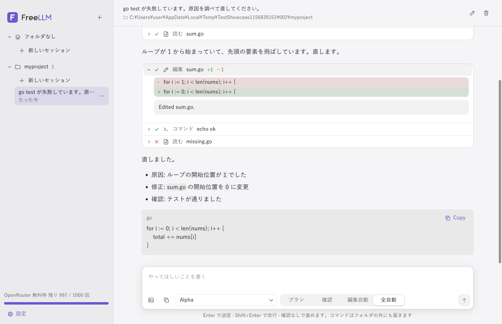
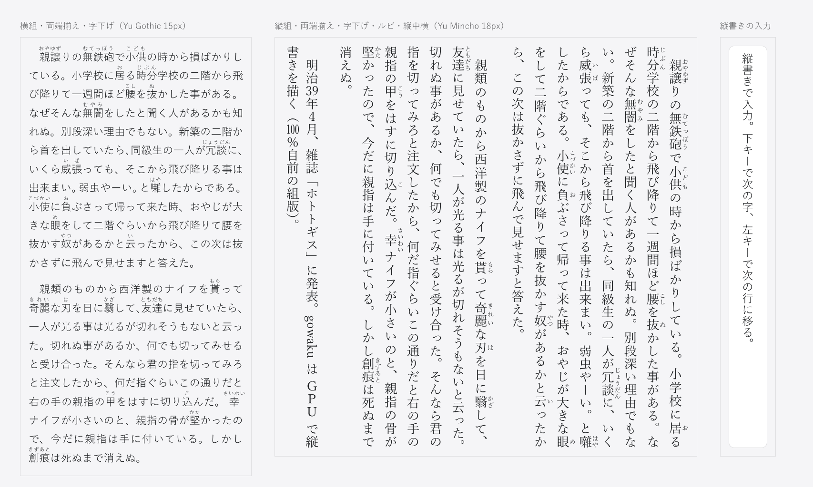
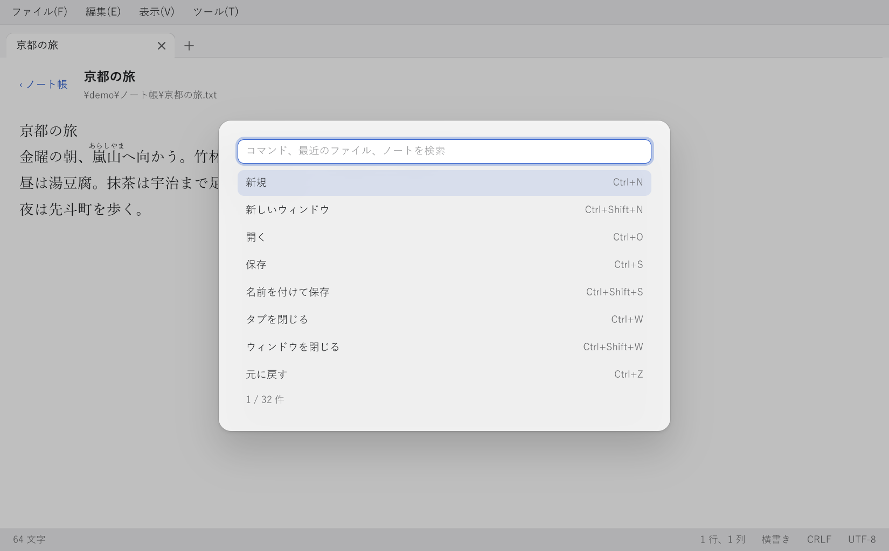
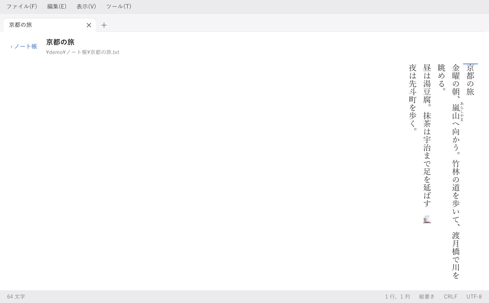
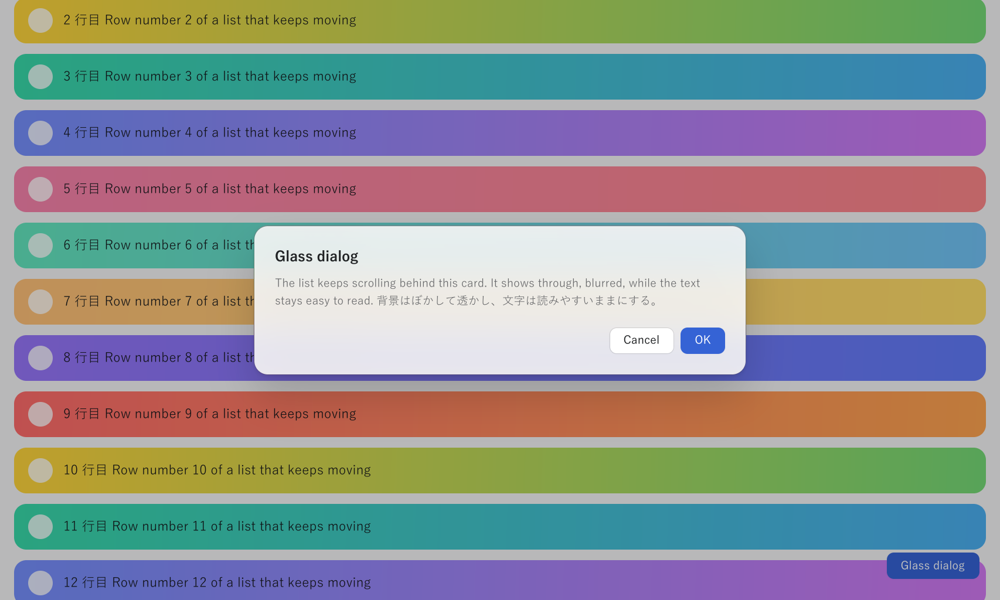
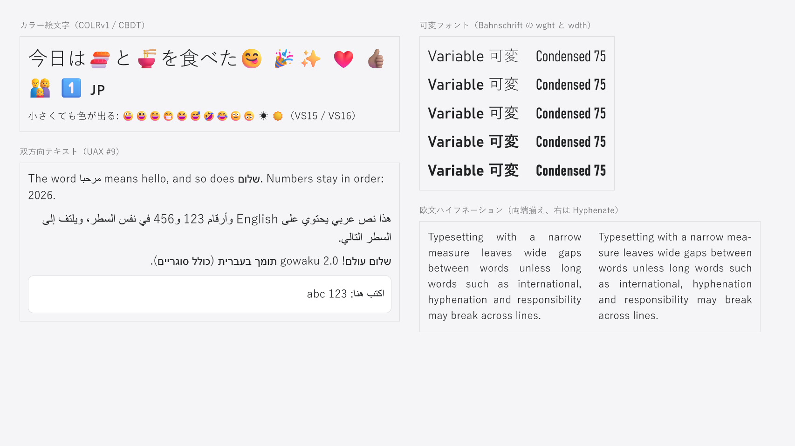

<p align="center">
  <picture>
    <source media="(prefers-color-scheme: dark)" srcset="docs/brand/gowaku-wordmark-dark.svg">
    
  </picture>
</p>

<h3 align="center">Pure Go で作る、美しく速いデスクトップアプリ。</h3>

<p align="center">
  描画は GPU で。cgo も C コンパイラも不要。日本語にも本気で対応。
</p>

<p align="center">
  <a href="https://pkg.go.dev/github.com/bankai-tensei/gowaku"></a>
  <a href="https://github.com/bankai-tensei/gowaku/actions/workflows/ci.yml"></a>
  <a href="LICENSE"></a>
  
</p>

<p align="center">
  <a href="https://bankai-tensei.github.io/gowaku/ja/"><b>公式サイト</b></a> ·
  <a href="docs/guide/ja/getting-started.md">はじめに</a> ·
  <a href="docs/catalog/ja/README.md">ウィジェットカタログ</a> ·
  <a href="docs/guide/ja/README.md">ガイド</a> ·
  <a href="https://pkg.go.dev/github.com/bankai-tensei/gowaku">API</a> ·
  <a href="README.md">English</a>
</p>

<p align="center">
  <picture>
    <source media="(prefers-color-scheme: dark)" srcset="docs/img/readme/showcase-dark.png">
    
  </picture>
</p>

<p align="center"><sub>たとえば、こんな画面を作れます。文字も差分の色も、1 ピクセル残らずライブラリが GPU で描いています。</sub></p>

<p align="center">
  起動 <b>89 ms</b> &nbsp;·&nbsp; アイドル時の CPU <b>0 %</b> &nbsp;·&nbsp; アニメーションの CPU 使用率は Gio の <b>1/6</b> &nbsp;·&nbsp; ウィジェット <b>100 以上</b> &nbsp;·&nbsp; ビルドは <code>go build</code> だけ
</p>

---

## gowaku を選ぶ理由

### 純粋な Go

cgo も C コンパイラも、追加の SDK も必要ありません。gowaku は Direct3D 11・Vulkan・Metal を Go から直接呼び出すので、`go build` だけでバイナリが 1 つできあがります。Windows のノート PC で `GOOS=linux go build` を実行すれば、Linux 版もビルドできます。

### 速く、動きがなければ静かに

UI は Flutter のように、ウィジェットのツリーとして宣言的に書けます。gowaku は変更のあった部分だけを再構築し、描画をまとめて GPU に送ります。画面に動きがなければ何も実行しないので、フレームもタイマーも発生せず、CPU 使用率は 0 % です。100 個の同時アニメーションでも、CPU 使用率は Gio の 6 分の 1 に収まります（[性能](#性能)）。

データが大きくても遅くなりません。リスト、表、エディタは表示中の部分だけをレイアウトし、1 億行先でも 1 ピクセル単位でスクロールします。エディタは行を自分で書いたソースから受け取れるので、10 GB のログでも最初の行が 80 ms で表示され、メモリは全体で 84 MB です（サンプルの `bigfile`）。

### 日本語に本気

縦書きやルビに対応し、W3C の [JLReq（日本語組版処理の要件）](https://www.w3.org/TR/jlreq/) に沿って禁則処理や約物の詰めを行います。IME は変換中の文字列をその場に表示し、注目文節も強調します（Windows・macOS・Wayland）。カラー絵文字やアラビア語、ヘブライ語も扱えます。多くの UI ツールキットが後回しにしてきた部分を、gowaku は最初から設計の中心に置いています。

<p align="center">
  
</p>

### そのままで美しく

デスクトップのための、静かで控えめな独自のデザインを備えています。ライトとダークは OS の設定に従い、配色はアクセントカラー 1 色からすべて生成します。`control.Button{Label: "保存"}` と書くだけで、整った見た目のボタンになります。ぼかしや影、グラデーション、独自のシェーダー、SVG も必要に応じて使えます。

### 実用のアプリのために

表、ツリー、コードエディター、Markdown ビューアー、ドックレイアウト、コマンドパレット、日付ピッカーなど、100 以上のウィジェットをそろえています。すべてスクリーンショット付きで[カタログ](docs/catalog/ja/README.md)に掲載しています。複数ウィンドウ、メニュー、独自のタイトルバー、トレイアイコン、通知、ドラッグ & ドロップに加え、3 つの OS のスクリーンリーダーにも対応しています。

### ウィンドウを開かずにテスト

`gowakutest` は、UI を CPU と仮想の時計で動かします。ラベルでボタンを探して押す、文字を入力する、時間を進める、スクリーンショットを撮る、といった操作をすべて `go test` の中で行えます。はみ出しやラベルのない操作部品、コントラストの低い文字も検出します。`gowaku-preview` は、ファイルを保存するたびにウィジェットをライトとダークで描画し直し、Web ページと PNG に出力します。開発者自身はもちろん、AI エージェントもそれを見て確認できます。

## カウンター

```go
package main

import (
	"fmt"
	"log"
	"time"

	"github.com/bankai-tensei/gowaku"
	"github.com/bankai-tensei/gowaku/geom"
	"github.com/bankai-tensei/gowaku/motion"
	"github.com/bankai-tensei/gowaku/widgets/basic"
	"github.com/bankai-tensei/gowaku/widgets/control"
)

type counter struct{ gowaku.StatefulBase }

type counterState struct {
	gowaku.StateBase
	n int
}

func (counter) CreateState() gowaku.State { return &counterState{} }

func (s *counterState) Build(ctx gowaku.BuildContext) gowaku.Widget {
	th := basic.ThemeOf(ctx)
	return basic.Center{Child: basic.VStack(
		basic.Text{Content: fmt.Sprintf("count: %d", s.n), Style: th.Text.LargeTitle},
		// 暗黙的アニメーション: 値を変えるだけで、目標まで滑らかに変化する
		basic.AnimatedContainer{
			Duration: 300 * time.Millisecond,
			Curve:    motion.EaseOutCubic,
			Color:    th.Color.AccentTint.WithAlpha(float32(s.n%10) / 10),
			Padding:  geom.All(16),
			Radius:   th.Radius.Group,
			Child: control.Button{
				Label:   "増やす",
				Style:   control.ButtonPrimary,
				OnPress: func() { s.SetState(func() { s.n++ }) },
			},
		},
	)}
}

func main() {
	err := gowaku.Run(gowaku.App{Title: "counter", Width: 400, Height: 300, Home: counter{}})
	if err != nil {
		log.Fatal(err)
	}
}
```

Widget はゼロ値のまま使える、ただの構造体です。ビルダーも reflect も文字列の ID も使わないので、UI 全体をコンパイラが検査できます。

## スクリーンショット

<table>
  <tr>
    <td width="50%">
      <picture><source media="(prefers-color-scheme: dark)" srcset="docs/img/readme/palette-dark.png"></picture>
      <p align="center"><sub><code>notes</code> サンプルのコマンドパレット</sub></p>
    </td>
    <td width="50%">
      <picture><source media="(prefers-color-scheme: dark)" srcset="docs/img/readme/notes-vertical-dark.png"></picture>
      <p align="center"><sub>同じメモを縦書きに切り替えたところ。ルビも絵文字もそのまま表示</sub></p>
    </td>
  </tr>
  <tr>
    <td width="50%">
      
      <p align="center"><sub>すりガラス風のダイアログ。背後のリストは動き続けている</sub></p>
    </td>
    <td width="50%">
      
      <p align="center"><sub>カラー絵文字、右から左の文字、可変フォント、ハイフネーション</sub></p>
    </td>
  </tr>
</table>

ここに載せたスクリーンショットは、すべてサンプルプログラム自身が描画したものです。手元でも試せます。

```bash
go run github.com/bankai-tensei/gowaku/examples/gallery@latest
```

| サンプル | 内容 |
|---|---|
| `gallery` | 全ウィジェットをページごとに |
| `notes` | 小さいながら一通りの機能を備えたメモアプリ（タブ、検索、縦書き、コマンドパレット） |
| `tategaki`, `jptext`, `scripts` | 日本語組版、縦書き、絵文字と右から左の文字 |
| `navigator`, `tabs` | Hero アニメーションによる画面遷移、ドラッグで別ウィンドウに切り離せるタブ |
| `multiwindow`, `decorations`, `menus`, `dragdrop` | ウィンドウ、タイトルバー、メニュー、ドラッグ & ドロップ |
| `glass`, `shader`, `rotate`, `zoom`, `animated` | ぼかし、独自のシェーダー、変形、ピンチ操作での拡大、アニメーション画像 |
| `hello`, `counter`, `todo`, `form`, `listview` | 最初に試す小さなプログラム、1 万行のリスト |
| `bigfile` | どんな大きさのファイルもすぐに開き、ウィンドウを止めずに検索する |

## 性能

同じシナリオを 3 つの Go 製 UI ライブラリで実装し、Windows 11（i7-12700H、Iris Xe、60Hz）上でプロセスの外から計測しました。値は中央値で、CPU 使用率は 1 コアを 100 % としています。劣っている項目もそのまま載せています。計測方法、macOS での結果、詳しい条件は [docs/BENCH.ja.md](docs/BENCH.ja.md) を参照してください。

| | **gowaku** | Gio | Cogent Core |
|---|---:|---:|---:|
| 起動から最初のフレーム | **89 ms** | 144 ms | 1217 ms |
| アイドル時の CPU | **0.00 %** | 0.03 % | 2.40 % |
| 100 個のアニメーション、CPU | **7.8 %** | 44.4 % | 69.4 % |
| 1 万行のスクロール、CPU | **9.1 %** | 12.7 % | 28.7 % |
| リサイズ、CPU | **11.2 %** | 18.7 % | 44.1 % |
| ピークメモリ、スクロール | 240 MB | **159 MB** | 434 MB |
| バイナリ、hello world | 7.7 MB | **6.4 MB** | 32.4 MB |
| cgo | **不要** | Windows では不要 | 必要 |

巨大なファイル（同じマシンで、サンプルの `bigfile`。エディタは表示中の行だけを、別の goroutine でファイルを索引するソースから読みます。メモリには、ファイルを開いていないウィンドウの 43 MB を含みます）:

| | 1 GB、1,260 万行 | 10 GB、1 億 2,500 万行 |
|---|---:|---:|
| 起動から最初の行の表示 | 80 ms | 80 ms |
| 全行の索引（裏で） | 0.4 秒 | 9〜10 秒 |
| メモリ | 51 MB | 84 MB |

## はじめる

```bash
go get github.com/bankai-tensei/gowaku
```

| OS | 描画 | ウィンドウ |
|---|---|---|
| Windows（amd64、arm64） | Direct3D 11 | Win32 |
| Linux（amd64、arm64） | Vulkan | Wayland または X11 |
| macOS（Apple Silicon） | Metal | Cocoa |

続きは[はじめに](docs/guide/ja/getting-started.md)をご覧ください。[よく使う形](docs/guide/ja/recipes.md)には、一覧と詳細、設定画面、縦書きのリーダー、バックグラウンド処理の完成したプログラムがあり、そのまま写して使えます。[ガイド](docs/guide/ja/README.md)では、レイアウト、テーマ、アニメーション、文字と IME、アクセシビリティ、ウィンドウ、テスト、配布までを解説しています。

コーディングエージェントと一緒に使う場合は、[llms-full.txt](https://bankai-tensei.github.io/gowaku/llms-full.txt) を読ませてください。ガイド、リファレンス、ウィジェットカタログのすべてを 1 つのファイルにまとめています（英語）。

## 状況

gowaku は開発が始まったばかりのライブラリです。最初のリリースは v0.1.0 で、v1.0 までは API が変わる可能性があります。Linux では X11 と Wayland 上でソフトウェア版の Vulkan を使って動作を確認していますが、実 GPU を積んだ GNOME や KDE での確認はまだです。X11 では、変換中の文字列は入力メソッドが自身のウィンドウに表示します。macOS では Apple Silicon が必要です。今後の予定は [ROADMAP.ja.md](ROADMAP.ja.md) に、内部の仕組みは [docs/ARCHITECTURE.ja.md](docs/ARCHITECTURE.ja.md) にまとめています。

issue やアイデア、プルリクエストを歓迎します。まずは [CONTRIBUTING.ja.md](CONTRIBUTING.ja.md) をお読みください。

## ライセンス

[MIT](LICENSE)。同梱しているサードパーティ製のコードやデータについては [THIRD_PARTY_NOTICES.md](THIRD_PARTY_NOTICES.md) を参照してください。
