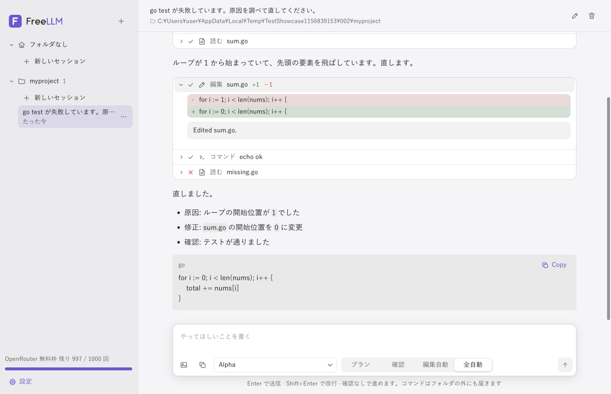
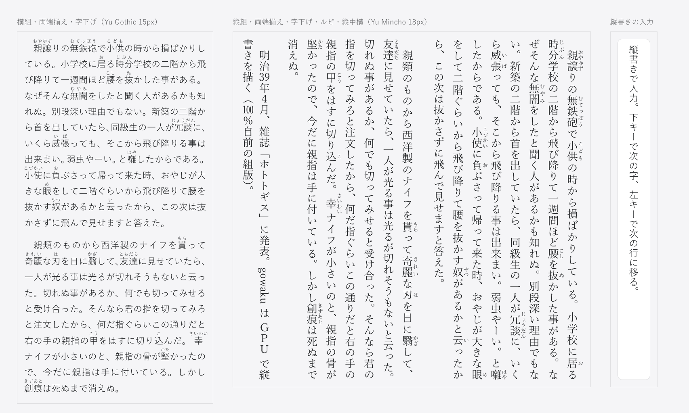
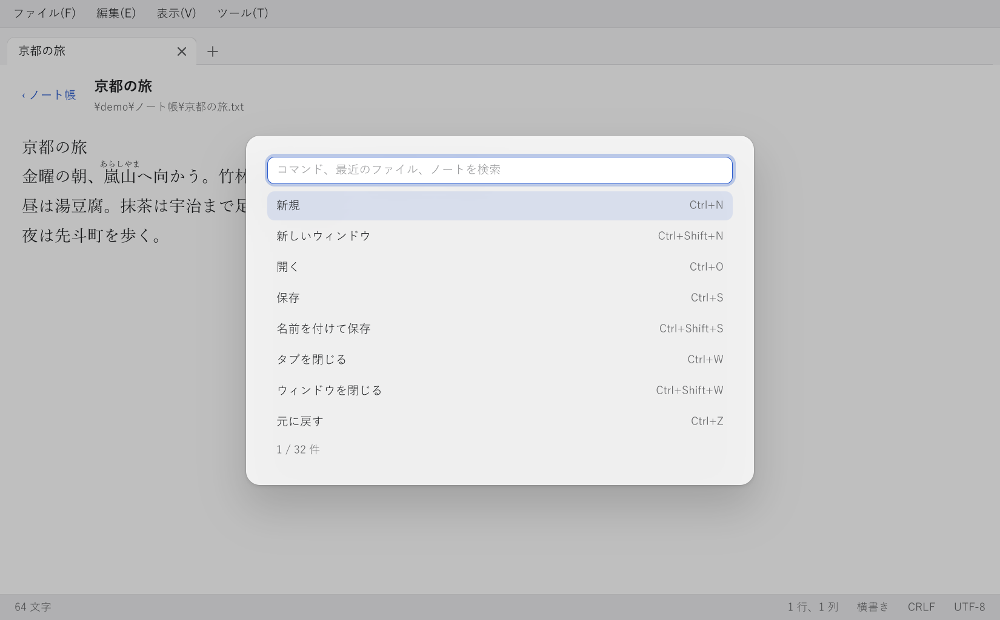
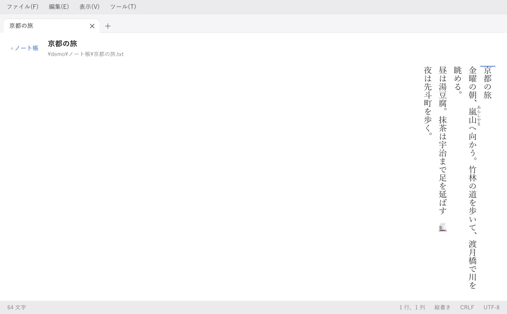
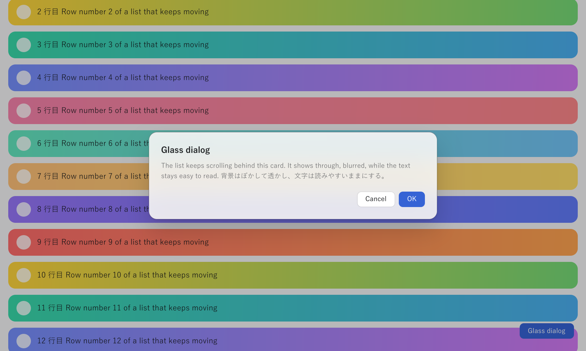
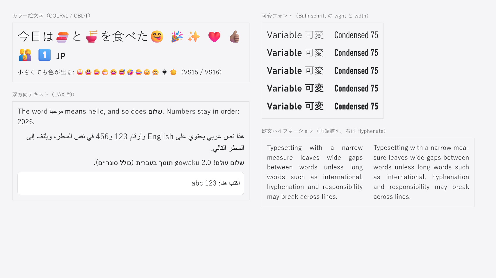

<p align="center">
  <picture>
    <source media="(prefers-color-scheme: dark)" srcset="docs/brand/gowaku-wordmark-dark.svg">
    
  </picture>
</p>

<h3 align="center">Beautiful, fast desktop apps in pure Go.</h3>

<p align="center">
  Drawn on the GPU. No cgo, no C compiler. Fluent in Japanese.
</p>

<p align="center">
  <a href="https://pkg.go.dev/github.com/bankai-tensei/gowaku"></a>
  <a href="https://github.com/bankai-tensei/gowaku/actions/workflows/ci.yml"></a>
  <a href="LICENSE"></a>
  
</p>

<p align="center">
  <a href="https://bankai-tensei.github.io/gowaku/"><b>Website</b></a> ·
  <a href="docs/guide/en/getting-started.md">Get started</a> ·
  <a href="docs/catalog/en/README.md">Widget catalog</a> ·
  <a href="docs/guide/en/README.md">Guides</a> ·
  <a href="https://pkg.go.dev/github.com/bankai-tensei/gowaku">API</a> ·
  <a href="README.ja.md">日本語</a>
</p>

<p align="center">
  <picture>
    <source media="(prefers-color-scheme: dark)" srcset="docs/img/readme/showcase-dark.png">
    
  </picture>
</p>

<p align="center"><sub>For example, you can build a screen like this. Every pixel of it, from the text to the colors of the diff, is drawn by the library on the GPU.</sub></p>

<p align="center">
  <b>89 ms</b> to the first frame &nbsp;·&nbsp; <b>0 %</b> CPU when idle &nbsp;·&nbsp; <b>1/6</b> the CPU of Gio for 100 animations &nbsp;·&nbsp; <b>100+</b> widgets &nbsp;·&nbsp; <b>one</b> <code>go build</code>
</p>

---

## Why gowaku

### It's just Go

No cgo. No C compiler. No SDK to install. gowaku calls Direct3D 11, Vulkan and Metal straight from Go, so `go build` gives you one binary, and `GOOS=linux go build` on your Windows laptop gives you the Linux one too.

### Fast, and quiet when there's nothing to do

gowaku is declarative and Flutter-like: you describe the UI as a tree of widgets, and it rebuilds only what changed and batches the drawing for the GPU. When nothing moves, nothing runs. No frames, no timers, 0 % CPU. A hundred animations at once take a sixth of the CPU Gio needs ([benchmarks](#performance)).

Size does not slow it down either. Lists, tables and the editor lay out only what is in view, and scroll a pixel at a time a hundred million rows down. The editor takes its lines from a source you write, so a 10 GB log shows its first lines in 80 ms, with 84 MB of memory in all (see the `bigfile` example).

### Japanese, done properly

Vertical text. Ruby. Line-break rules and punctuation spacing after the W3C's [JLReq](https://www.w3.org/TR/jlreq/). An IME that composes inline with the active clause highlighted, on Windows, macOS and Wayland. Color emoji, Arabic and Hebrew too. Most UI toolkits treat these as edge cases; gowaku was built around them.

<p align="center">
  
</p>

### Good-looking by default

A quiet desktop design of its own, light and dark following the OS, and a whole palette generated from one accent color. `control.Button{Label: "Save"}` already looks finished. Blur, shadows, gradients, custom shaders and SVG are there when you want more.

### Built for real applications

Tables, trees, a code editor, a Markdown view, a dock layout, a command palette, date pickers and a hundred more, each with a picture in the [catalog](docs/catalog/en/README.md). Multiple windows, menus, custom title bars, tray icons, notifications, drag and drop, and accessibility for screen readers on all three operating systems.

### Testable without a window

`gowakutest` runs your UI on the CPU with a fake clock: find a button by its label, tap it, type, advance time, take a screenshot, all in `go test`. It also flags overflow, unlabeled controls and low-contrast text. `gowaku-preview` redraws your widgets light and dark on every save, as a page and as PNG files that you, or an AI agent, can look at.

## Hello, counter

```go
package main

import (
	"fmt"
	"log"
	"time"

	"github.com/bankai-tensei/gowaku"
	"github.com/bankai-tensei/gowaku/geom"
	"github.com/bankai-tensei/gowaku/motion"
	"github.com/bankai-tensei/gowaku/widgets/basic"
	"github.com/bankai-tensei/gowaku/widgets/control"
)

type counter struct{ gowaku.StatefulBase }

type counterState struct {
	gowaku.StateBase
	n int
}

func (counter) CreateState() gowaku.State { return &counterState{} }

func (s *counterState) Build(ctx gowaku.BuildContext) gowaku.Widget {
	th := basic.ThemeOf(ctx)
	return basic.Center{Child: basic.VStack(
		basic.Text{Content: fmt.Sprintf("count: %d", s.n), Style: th.Text.LargeTitle},
		// An implicit animation: change the value, and it glides there.
		basic.AnimatedContainer{
			Duration: 300 * time.Millisecond,
			Curve:    motion.EaseOutCubic,
			Color:    th.Color.AccentTint.WithAlpha(float32(s.n%10) / 10),
			Padding:  geom.All(16),
			Radius:   th.Radius.Group,
			Child: control.Button{
				Label:   "Add one",
				Style:   control.ButtonPrimary,
				OnPress: func() { s.SetState(func() { s.n++ }) },
			},
		},
	)}
}

func main() {
	err := gowaku.Run(gowaku.App{Title: "counter", Width: 400, Height: 300, Home: counter{}})
	if err != nil {
		log.Fatal(err)
	}
}
```

Widgets are plain structs that work at their zero value. No builders, no reflection, no string IDs: the compiler checks your whole UI.

## A look around

<table>
  <tr>
    <td width="50%">
      <picture><source media="(prefers-color-scheme: dark)" srcset="docs/img/readme/palette-dark.png"></picture>
      <p align="center"><sub>A command palette in the <code>notes</code> example</sub></p>
    </td>
    <td width="50%">
      <picture><source media="(prefers-color-scheme: dark)" srcset="docs/img/readme/notes-vertical-dark.png"></picture>
      <p align="center"><sub>The same note, set vertically, with ruby and emoji</sub></p>
    </td>
  </tr>
  <tr>
    <td width="50%">
      
      <p align="center"><sub>A glass dialog: the list keeps moving behind the blur</sub></p>
    </td>
    <td width="50%">
      
      <p align="center"><sub>Color emoji, right-to-left text, variable fonts, hyphenation</sub></p>
    </td>
  </tr>
</table>

Every screenshot here is drawn by the examples themselves. Try them:

```bash
go run github.com/bankai-tensei/gowaku/examples/gallery@latest
```

| Example | What you'll see |
|---|---|
| `gallery` | Every widget, page by page |
| `notes` | A small but complete notes app: tabs, search, vertical writing, a command palette |
| `tategaki`, `jptext`, `scripts` | Japanese typesetting, vertical text, emoji and right-to-left text |
| `navigator`, `tabs` | Hero transitions between pages; documents in tabs that tear off into windows |
| `multiwindow`, `decorations`, `menus`, `dragdrop` | Windows, title bars, menus, drag and drop |
| `glass`, `shader`, `rotate`, `zoom`, `animated` | Blur, custom shaders, transforms, pinch zoom, animated images |
| `hello`, `counter`, `todo`, `form`, `listview` | Small programs to start from; a list of 10,000 rows |
| `bigfile` | A file of any size, opened at once and searched without stopping the window |

## Performance

The same scenarios written for three Go UI libraries, measured from outside the process on Windows 11 (i7-12700H, Iris Xe, 60 Hz). Medians; CPU is percent of one core. The losses are in the table too. [docs/BENCH.md](docs/BENCH.md) has the method, the macOS numbers and the details.

| | **gowaku** | Gio | Cogent Core |
|---|---:|---:|---:|
| Start to first frame | **89 ms** | 144 ms | 1217 ms |
| Idle CPU | **0.00 %** | 0.03 % | 2.40 % |
| 100 animations, CPU | **7.8 %** | 44.4 % | 69.4 % |
| 10,000-row scroll, CPU | **9.1 %** | 12.7 % | 28.7 % |
| Resize, CPU | **11.2 %** | 18.7 % | 44.1 % |
| Peak memory, scroll | 240 MB | **159 MB** | 434 MB |
| Binary, hello world | 7.7 MB | **6.4 MB** | 32.4 MB |
| Needs cgo | **no** | no on Windows | yes |

Large files, with the `bigfile` example on the same machine (the editor reads only the lines in view, from a source that indexes the file on a goroutine of its own; memory includes the 43 MB the window holds without a file):

| | 1 GB, 12.6 million lines | 10 GB, 125 million lines |
|---|---:|---:|
| Start to the first lines | 80 ms | 80 ms |
| Every line indexed, in the background | 0.4 s | 9 to 10 s |
| Memory | 51 MB | 84 MB |

## Get started

```bash
go get github.com/bankai-tensei/gowaku
```

| OS | Drawn with | Windows from |
|---|---|---|
| Windows (amd64, arm64) | Direct3D 11 | Win32 |
| Linux (amd64, arm64) | Vulkan | Wayland or X11 |
| macOS (Apple Silicon) | Metal | Cocoa |

Then read [Getting started](docs/guide/en/getting-started.md), and copy a complete program from [Recipes](docs/guide/en/recipes.md): a list and a detail, a settings window, a vertical reader, a background job. The [guides](docs/guide/en/README.md) go on to layout, theming, animation, text and IME, accessibility, windows, testing and shipping.

Working with a coding agent? Point it at [llms-full.txt](https://bankai-tensei.github.io/gowaku/llms-full.txt): the guides, the reference and the whole widget catalog in one file.

## Status

gowaku is young. The first release is v0.1.0, and the API may still change before v1.0. Linux has been checked under X11 and Wayland with a software Vulkan driver, but not yet on GNOME or KDE with a real GPU; under X11 the input method shows its own composition window. macOS needs Apple Silicon. See [ROADMAP.md](ROADMAP.md) for what's next, and [docs/ARCHITECTURE.md](docs/ARCHITECTURE.md) for how it works inside.

Issues, ideas and pull requests are welcome: start with [CONTRIBUTING.md](CONTRIBUTING.md).

## License

[MIT](LICENSE). Third-party material is listed in [THIRD_PARTY_NOTICES.md](THIRD_PARTY_NOTICES.md).
