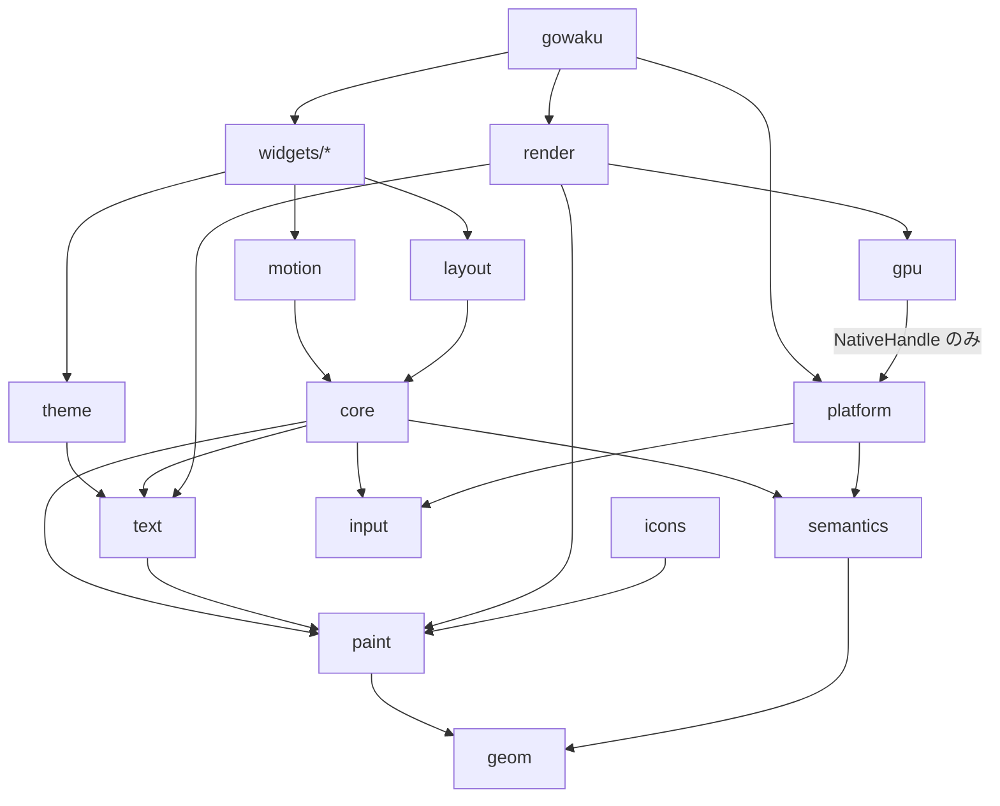

# アーキテクチャ

[English](ARCHITECTURE.md)

この文書では gowaku の構成として、層の分け方、各パッケージの役割、フレームの流れ、パッケージ間で許される import を説明する。記述は現在のコードに基づく。個々の設計判断の理由は [docs/ADR/](ADR/) にまとめてあり、本文中では「背景」としてリンクしている。

## gowaku とは

gowaku は Go 向けのデスクトップ UI ライブラリである。UI は Flutter のように宣言的に書き、内部では 3 つのツリー（Widget、Element、RenderObject）を Go の型で表現し、図形も文字も影も GPU で描画する。何も変わらなければ何も処理しない。Windows では Direct3D 11 と Win32、Linux では Vulkan と X11 または Wayland、macOS（Apple Silicon）では Metal と AppKit を、いずれも純 Go から呼び出すため、どの OS でも cgo や C コンパイラは不要である。日本語を第一級に扱っており、改行は JLReq に従い、ルビと縦書きに対応する。IME では変換中の文字をその場に表示し、注目文節を強調する。

## 層

```
┌──────────────────────────────────────────────────────────────────┐
│ アプリケーション   Widget / State / Build                         │
├──────────────────────────────────────────────────────────────────┤
│ gowaku（ルート）   Run, App, ウィンドウ, Post。下の層をつなぐ       │
├──────────────────────────────────────────────────────────────────┤
│ widgets/*         標準ウィジェット（層に分かれる）                  │
│ motion  theme     アニメーション、デザインのトークン                │
├──────────────────────────────────────────────────────────────────┤
│ layout            標準の RenderObject                             │
│ core              Widget → Element → RenderObject、reconcile、    │
│                   スケジューリング、フォーカス、Semantics ツリー     │
├──────────────────────────────────────────────────────────────────┤
│ text              フォント、シェイピング、JLReq の改行、アトラス     │
│ paint  icons      Canvas が DisplayList を記録する。標準のアイコン │
├──────────────────────────────────────────────────────────────────┤
│ render            DisplayList → gpu.Batch                         │
│ gpu               Backend interface。d3d11, vulkan, metal, soft    │
├──────────────────────────────────────────────────────────────────┤
│ platform          Platform / Window interface。                    │
│                   win32, x11, wayland, cocoa, dbus                 │
├──────────────────────────────────────────────────────────────────┤
│ semantics  input  geom   最下層の共有する値の型                     │
└──────────────────────────────────────────────────────────────────┘
```

`core` は GPU について何も知らず、描画命令を `paint.Canvas` に出力するだけである。それを GPU の処理に変換するのは `render` だけだ。このため `core`、`layout`、`paint`、`text`、`theme`、`motion` とウィジェットは、GPU やウィンドウがなくても通常の `go test` で動く。

## core: 3 つのツリー

| ツリー | 寿命 | 役割 | Go での形 |
|---|---|---|---|
| Widget | Build のたびに生成して破棄する | UI の一部を表す不変の記述 | 値型の構造体 |
| Element | ツリー上にある間 | Widget と RenderObject を結び、State を保持する。差分計算の単位 | 非公開の型 |
| RenderObject | Element と同じ | レイアウト、描画、ヒットテスト、Semantics | `core.RenderObject` interface |

```go
type Widget interface{ Key() Key }
type StatelessWidget interface { Widget; Build(ctx BuildContext) Widget }
type StatefulWidget  interface { Widget; CreateState() State }
type RenderWidget    interface { Widget; CreateRenderObject() RenderObject; UpdateRenderObject(RenderObject) }

type State interface {
    Build(ctx BuildContext) Widget
    InitState(); DidUpdateWidget(old Widget); Dispose()
    // 非公開のメソッド: 実装は StateBase を埋め込む
}
```

- Widget は `StatelessBase` か `StatefulBase` を、State は `StateBase`（または、`Widget()` が型付きの Widget を返す `StateOf[W]`）を埋め込む。`RenderObject` の実装は `RenderBase` を埋め込む。非公開のメソッドによって埋め込みを必須にしているので、後から interface にメソッドを追加しても開発者のコードは壊れない。背景: [ADR 0006](ADR/0006-core-tree-api.md)、[ADR 0029](ADR/0029-typed-state-widget.md)。
- **reconcile** は、宣言的 UI のツールキットで一般的な、キーによる差分の照合である。2 つの Widget は、動的な型と Key が等しければ同一とみなす。型の比較は interface の型ワードを見るだけで、構造体のフィールドを reflect で走査することはない。子の列は先頭から、末尾から、そして Key で突き合わせるので、O(n) で済む。
- `type Key = any` であり、`Keyed(key, widget)` で Key を付ける。比較できない Key を渡すと panic する。
- **スケジューリング。** `SetState` は渡された関数を実行し、Element をダーティにする。フレームの最初にダーティな Element を深さ順に並べ、親から順に再ビルドする。Build 中に `SetState` を呼ぶと panic する。
- 継承された値は `BuildContext` から読む。`core.DependOn[T]` は祖先の `Inherited[T]` を購読し、`core.Lookup[T]` は購読せずに値だけを読む。
- `core.Tree` は 1 つのウィンドウの Element と RenderObject のツリーを保持する。フレームでは `Build`、`Layout`、`Paint`（または `Repaint`）をこの順に呼ぶ。ツリーはポインタ、キー、文字入力、変換中の文字、ドラッグのイベントを配送し、フォーカスを管理し、Ticker を駆動する。
- フレームを要求する経路は `core.Ticker` しかない。Ticker は画面の更新に合わせて進み、動いている Ticker がなければツリーは休止する。

reflect を使うのは、Widget の型の同一性の判定と、`DependOn` の型引数の解決だけである。構造体のフィールドやタグは読まない。

### API の決まり

- ツリーは構造体リテラルで書くのが基本である。子を並べるだけのよくある形のために、`widgets/basic` に 1 行で書ける補助関数 `VStack`、`HStack`、`Layers`、`Pad` を用意している。
- ウィジェットはすべて値型で、ゼロ値のまま使える。API はフィールドがすべてであり、関数オプションやメソッドチェーンはない。
- UI のファイルでは、使うウィジェットの層（`widgets/basic`、`widgets/control` など）を import する。ルートの `gowaku` が提供するのは、アプリとウィンドウの入口と、どのウィジェットでも使う型の別名（`Widget`、`BuildContext`、`State`、`StateBase`、`StateOf`、`StatelessBase`、`StatefulBase`、`Key`）だけで、ウィジェットや下位層の型は再エクスポートしない。背景: [ADR 0081](ADR/0081-widget-layers.md)。
- 初期化の失敗は `error` で返す。実行中の契約違反では、`gowaku:` で始まり直し方を示すメッセージで panic する。ライブラリの内部で recover はしない。

## layout: 制約のプロトコル

```go
type Constraints struct{ MinW, MaxW, MinH, MaxH float32 } // geom.Constraints。無限は geom.Inf

type RenderObject interface {
    Layout(c geom.Constraints) geom.Size
    Paint(cv *paint.Canvas, off geom.Offset)
    HitTest(pos geom.Offset, r *HitTestResult) bool
    Semantics(sb *SemanticsBuilder)
    Parent() RenderObject; ChildCount() int; ChildAt(i int) RenderObject
    Size() geom.Size; Offset() geom.Offset; SetOffset(off geom.Offset)
    MarkNeedsLayout(); MarkNeedsPaint()
}
```

- 制約は親から子へ、サイズは子から親へ伝わり、子の位置は親が決める。子のレイアウトには `core.LayoutChild` を使う。
- 再レイアウトは、最も近い relayout boundary（tight な制約を受けた RenderObject）から始まる。色が変わっただけなら `MarkNeedsPaint` で済み、レイアウトは走らない。
- `layout` には標準の RenderObject がそろっている。`RenderPadding`、`RenderAlign`、`RenderConstrainedBox`、`RenderFlex`、`RenderStack`、`RenderWrap`、`RenderGrid`、`RenderViewport`、`RenderList`、`RenderCustomLayout`（`Delegate` を受け取る）、`RenderDecoratedBox`、各種の効果の RenderObject などである。`core.RenderObject` を実装するのは `layout` の側であり、`core` は `layout` を知らない。
- 長さが決まらない場所に置いた `Scroll`、リスト、`Grid`、交差方向が無限の `CrossStretch`、領域に上限のない `Expanded` は、直し方を示すメッセージで panic する。背景: [ADR 0026](ADR/0026-unbounded-room.md)。
- `Alignment` は 0〜1 の値で表し、`AlignCenter` などの名前付きの値も用意している。背景: [ADR 0031](ADR/0031-style-copy-and-named-alignments.md)。

## paint: 描画命令の記録

`paint.Canvas` は呼び出しを `DisplayList` に記録するだけで、実際には描画しない。

```go
func (c *Canvas) DrawRRect(rr geom.RRect, p Paint)
func (c *Canvas) DrawPath(p *Path, pt Paint)
func (c *Canvas) DrawImage(img *Image, dst geom.Rect, opacity float32)
func (c *Canvas) DrawGlyphs(run *GlyphRun, off geom.Offset, color geom.Color)
func (c *Canvas) DrawShadow(rr geom.RRect, blur float32, color geom.Color, offset geom.Offset)
func (c *Canvas) DrawBackdrop(rr geom.RRect, sigma float32)
func (c *Canvas) DrawShader(dst geom.Rect, call ShaderCall)
func (c *Canvas) DrawLayer(l *Layer, off geom.Offset)
func (c *Canvas) ClipRect / ClipRRect / ClipPath, Save / Restore
func (c *Canvas) Translate / Scale / Transform(geom.Affine), PushOpacity, PushBlend, PushGroup / PopGroup

type Paint struct {
    Color    geom.Color
    Gradient *Gradient  // 線形・放射・焦点付き放射・スイープ。ストップ付き
    Stroke   *Stroke    // nil なら塗り
    Blend    BlendMode  // ゼロ値は source-over
}
```

- ボーダー、グラデーション、影はいずれも 1 つの角丸矩形のパラメータとして表すので、矩形 1 つが GPU の 1 インスタンスになる。
- ブレンドモードは、Porter-Duff の演算子と、W3C の分離可能・分離不可能なモードに対応する。下地を読むモードは、下の画素をコピーする分だけ負荷が高い。背景: [ADR 0044](ADR/0044-drawing-extensions.md)。
- `PushGroup` は部分木をオフスクリーンの画像に描き、マスクとフィルターを適用する。`GroupCache` はその画像をフレームをまたいで保持する。背景: [ADR 0114](ADR/0114-gpu-layers-masks-filters.md)、[ADR 0115](ADR/0115-cached-groups.md)。
- `paint.SVG` は静的な SVG のサブセット（図形、パス、グループ、変換、塗り、クリップ、マスク、一部のフィルター、テキスト）を描画命令に変換する。背景: [ADR 0112](ADR/0112-svg-structure-paint-clip.md)、[ADR 0113](ADR/0113-svg-filters-text.md)。
- `paint.Shader` は、`cmd/gowaku-shader` で事前にコンパイルした開発者独自のシェーダーを受け渡す。背景: [ADR 0045](ADR/0045-shaders-svg-animated-images.md)。
- 色は `geom.Color{R, G, B, A float32}` で表す。premultiplied ではなく sRGB のままで、合成も sRGB の値で行う。

### レイヤー

`basic.RepaintBoundary` を使うと、ツリーに `core.RenderRepaintBoundary` が置かれ、部分木が `paint.Layer`（版番号付きの専用の DisplayList）に記録される。`MarkNeedsPaint` は最も近い boundary までさかのぼって止まるので、記録し直すのは汚れた boundary だけで済む。`render` はレイヤーをテクスチャのページにラスタライズし、毎フレーム画面全体にページを合成する。キャッシュできないレイヤー（scale や opacity の下にあるもの、パスや形状のクリップを含むもの、ページより大きいもの、毎フレーム変わるもの）はその場で直接描画するので、どちらの経路でも結果の画像は同じになる。汚れた矩形だけを present する方式は、計測した結果採用しなかった。背景: [ADR 0019](ADR/0019-layers.md)。

## render と gpu: バッチ化

デスクトップの UI は、小さな矩形とグリフが大量に並び、ところどころに画像やパスが混ざる。gowaku はこれを 1 本の大きなインスタンスバッファと少数のパイプラインで描画する。

| パイプライン | 入力 | 用途 |
|---|---|---|
| P1 quad + SDF | インスタンス化したクワッド | 角丸矩形、ボーダー、グラデーション、影、グリフ、画像、背景のぼかし。`gpu.InstanceKind` で分岐する 1 つのピクセルシェーダー |
| P2 path + stencil | 三角形ファン | パスの被覆をステンシルに書き込む（色は出力しない） |
| P3 quad + cover | 外接クワッド | ステンシルが立っている部分を塗る |

カスタムシェーダーとグループ効果のパスは、同じクワッドを使う別のパイプラインで実行する（`InstanceShader`、`InstanceEffect`）。

```go
type Backend interface {
    CreateSurface(h platform.NativeHandle, physicalWidth, physicalHeight int, scale float32) (Surface, error)
    BeginFrame(s Surface, background geom.Color) error
    Draw(s Surface, batch *Batch) error
    EndFrame(s Surface) error // present する
    CreateTexture(width, height int, format TextureFormat) (Texture, error)
    UpdateTexture(t Texture, region image.Rectangle, pix []byte, stride int) error
    CreateTarget(width, height int) (Texture, error)
    DrawToTarget(t Texture, batch *Batch, scale float32) error
    PrepareShader(s *Shader) error
    Destroy()
}
```

- `render.Encode` は `paint.DisplayList` を `gpu.Batch` に変換する。Batch の中身はインスタンスと `DrawCall`（`DrawQuads`、`DrawFill`、`DrawClipPush`、`DrawClipPop`）の列で、1 つの DrawCall がバインドするテクスチャは最大 1 枚である。`render.Resources` は、全ウィンドウで共有するグリフアトラス、画像、レイヤーのページを保持する。
- **影**は、ガウスぼかしをかけた角丸矩形を SDF で近似したもので、P1 で描画する。影専用のパスはない。本物のぼかし（`BackdropFilter`、`ImageFiltered`）は、縮小したコピーに 2 パスの分離フィルターをかける。
- **アンチエイリアス。** SDF の図形はシェーダーの中で縁を処理する。パスと形状のクリップには 4x MSAA が必要で、それを含むバッチのあるフレームでだけ使う（`Batch.Multisampled`）。背景: [ADR 0009](ADR/0009-paths-and-clips.md)、[ADR 0017](ADR/0017-multisample-on-demand.md)。
- **クリップ。** 軸に平行な矩形はシザーで、角丸とパスは深度バッファのレベルで処理する。ステンシルはパスの塗りにしか使わない。
- **座標。** ビューポートとスケールは定数バッファで渡すので、バッチは論理ピクセルで記述する。HiDPI で変わるのはスケールだけである。
- **パス**は CPU で平坦化し、ステンシルとカバーで塗る（non-zero または even-odd）。アイコンのような小さなパスは、代わりに CPU 上で `golang.org/x/image/vector` を使ってラスタライズし、アトラスに載せる。
- **シェーダー。** `gpu/shaders` にある 1 つの HLSL を、D3D11 用の DXBC（fxc）と Vulkan 用の SPIR-V（dxc）に事前コンパイルし、`go:embed` で埋め込む。再生成は `go generate ./gpu/...` で行う。Metal には MSL に移植したものがあり、デバイスの作成時にドライバがコンパイルするので、macOS 向けに生成するものはない。
- **バックエンド。** `gpu/d3d11` は COM の vtable を `syscall.SyscallN` で呼び出す。`gpu/vulkan` は Linux では purego で（Windows では比較テストのためだけに `LoadLibrary` で）ローダーを開き、関数を `vkGetInstanceProcAddr` で取得する。`gpu/metal` は purego で Objective-C ランタイムを呼び出し、darwin/arm64 でのみビルドされる。`gpu/soft` はシェーダーの計算を再現する CPU の参照実装で、テスト、ヘッドレスのスクリーンショット、カタログに使う。アプリの描画には使わない。背景: [ADR 0013](ADR/0013-vulkan-backend.md)、[ADR 0020](ADR/0020-pixel-goldens.md)、[ADR 0082](ADR/0082-macos-cocoa-metal.md)。
- `gpu/soft` で描画するピクセルの golden テストは CI で実行する。`go test -tags gpu ./internal/golden` を使えば、手元のマシンで D3D11 と Vulkan の出力を同じ golden と照合できる。

## text: シェイピングと日本語組版

```
string + text.Style
  → fontscan でフォントを探し、文字体系ごとに run に分けてフォールバック
  → go-text/typesetting でシェイピング（グリフ ID、送り幅、オフセット）
  → UAX #14 で改行の候補
  → text/jlreq で日本語の規則
  → BiDi の並べ替え（UAX #9）、折り返し → text.Layout   （ここまでキャッシュ）
  → 描くとき: グリフ → アトラスの座標（初めて使うときにラスタしてアップロード）
```

`text/jlreq` が扱うのは rune と、計測済みの送り幅を持つ単位の列であり、フォントには依存しない。そのため、どの規則も仮の寸法でテストできる。

| 規則 | 振る舞い |
|---|---|
| 行頭禁則 | 閉じ括弧、小書きの仮名、。、ー々 などを行頭に置かない。強さは `Style.LineBreak`（`Strict`、標準、緩い）で指定する |
| 行末禁則 | 始め括弧を行末に置かない |
| 分離禁止 | —、…、‥ の連続や、数字と単位を分割しない |
| 解決方法 | `Style.Kinsoku`: `Oidashi`（追い出し）か `Oikomi`（追い込み） |
| 約物の詰め | 隣り合う約物の間にある半角分の空きを詰める（`Style.Punctuation`） |
| ぶら下げ | 句読点を行末からはみ出させる（`Style.Hanging`、既定は off） |
| 和欧間アキ | 和文と欧文の間に 1/4 em の空きを入れる（`Style.WesternSpacing`） |
| ルビ | モノルビとグループルビ。親文字の隣へのはみ出しを制御する。`text/aozora` は青空文庫の記法を解釈する |

- **縦書き**: `Style.Orientation` で指定する。レイアウトは「行に沿う軸」と「行を積む軸」で考えるので、カーソル、選択範囲、IME の候補位置はすべて同じ変換を通る。`vert`/`vrt2` の置換、縦中横、縦書きのルビに対応する。背景: [ADR 0023](ADR/0023-vertical-text.md)。
- `text.Style` にはほかにも、両端揃えを含む行揃え、`Indent`、`HangingIndent`、`TabStop`、`Hyphenate`（`text/hyphen` による Liang のアルゴリズム）、可変フォントの `Variations`、基本の `Direction` がある。斜体を持たない書体は合成して傾ける。背景: [ADR 0024](ADR/0024-color-emoji-bidi-variable-hyphen-incremental.md)、[ADR 0101](ADR/0101-synthetic-italic.md)。
- **フォント**: システムのフォントは fontscan で探す。既定のファミリーは Yu Gothic、Noto Sans CJK JP、Hiragino Sans、Meiryo である。Yu Gothic UI は仮名と約物がプロポーショナルで JLReq の前提に合わないため、除外している。背景: [ADR 0007](ADR/0007-text-architecture.md)。
- **カラー絵文字**: COLRv0、COLRv1、CBDT、sbix に対応し、アトラスの RGBA のページに載せる。
- **グリフアトラス**: ページは 2048²。輪郭は R8、カラーは RGBA8 で格納する。横位置は 1/4 ピクセル単位で量子化し、ヒンティングはしない。ページが埋まると、最も長く使われていないグリフを追い出して場所を空ける。背景: [ADR 0079](ADR/0079-atlas-lru.md)。
- **編集**: `Layout.HitTest`、`CaretRect`、`SelectionRects`、単語単位や行単位の移動は、書記素クラスタ単位で動作する。編集時には変更のあった段落だけをシェイピングし直す。
- 組版ライブラリへの依存は `text` の中に閉じ込めている。レイアウトの結果は `paint.GlyphRun` の列なので、`paint` はフォントを知らなくてよい。

## ウィジェット

標準のウィジェットは、`widgets/` 以下の 8 つのパッケージに層状に配置している。各パッケージは自分より下の層だけを import し、同じ段のパッケージは import しない。`widgets` 自体にはコードがない。

| 段 | パッケージ | 中身 |
|---|---|---|
| 1 | `widgets/basic` | Theme、MediaQuery、ローカライズした文言。箱と配置（`Container`、`Padding`、`SizedBox`、`Align`、`Row`、`Column`、`Stack`、`Wrap`、`Grid`、`AspectRatio`、`CustomLayout`、`LayoutBuilder`）。効果（`Opacity`、`Blend`、`BackdropFilter`、`ShaderMask`、`Transform`）。暗黙アニメーション。`Text`、`RichText`、`Icon`、`Image`、`SVG`。`Scroll`。`RepaintBoundary` |
| 2 | `widgets/interact` | `GestureDetector`、`MouseRegion`、`Listener`、`Focus`、`FocusRing`、`Pressable`、`Shortcut`/`Actions`、`Draggable`/`DragTarget`、`Semantics`、`InteractiveViewer` |
| 3 | `widgets/control` | `Button`、`Checkbox`、`Switch`、`Slider`、`RangeSlider`、`SegmentedControl`、`Radio`、`Chip`、`Card`、`NumberStepper`、`Tabs`、`SplitPane`、`Badge`、進捗表示、`Disclosure`、`Link`、`InfoBar`、`Skeleton`、`Sparkline`、`CustomPaint` |
| 4 | `widgets/overlay` | `Overlay`、`Dialog`、`Sheet`、`Toast`、`Tooltip`、`MenuBar`、`ContextMenu`、ポップアップメニュー |
| 5 | `widgets/field` | `Input`（単一行・複数行、IME、選択、Undo）、`Search`、`Form`、`Autocomplete`、`DropdownMenu`、`NumberField`、`TokenField`、`ColorPicker`、`Calendar`、日付と時刻のピッカー、`SelectionArea`、`CommandPalette` |
| 5 | `widgets/nav` | `Navigator` とルート、`Hero`、`BackButton`、`Breadcrumb`、`Steps`、`TabBar`、`Toolbar`、`StatusBar`、`DockLayout` |
| 6 | `widgets/collection` | `List`、`GridView`、`ReorderableList`、`Tree`、`Table`、`PropertyGrid`、`Group`、`Sidebar` |
| 6 | `widgets/editor` | `Editor`。検索、行ごとのスタイル、装飾を備えた、長い文書のための編集領域 |

共有する実装は internal パッケージに閉じ込めている。`widgets/internal/kit`（`basic` より下）には小さな補助関数を、`widgets/internal/behavior`（`interact` と `control` の間）にはコントロール間で共有するホバー・フォーカス・押下の振る舞いを置く。全ウィジェットの一覧とスクリーンショットは[ウィジェットカタログ](catalog/ja/README.md)にある。

`markdown` は別モジュール（`github.com/bankai-tensei/gowaku/markdown`）で、独自の CommonMark パーサを備える。別モジュールにしたのは、本体モジュールの依存を少なく保つためである。gowaku 本体からは import していない。背景: [ADR 0099](ADR/0099-markdown-module.md)。

## theme

デザインそのものについては [DESIGN.md](DESIGN.md) を参照。`theme` はそのトークンを提供する。

- `theme.Theme` は、`Color`（1 つのアクセント色から導く用途別の色。ライトとダーク）、`Text`（日本語を基準に決めた 8 つの役割の文字サイズ）、`Radius` からなる。`Lift` は 2 層の影を、`basic.Container` が受け取る `paint.BoxShadow` として返す。
- `theme.Set` はライトとダークの組である。`FromAccent` は色から生成し、`Default` は既定の組を返す。`App.ThemeMode` で固定しない限り、アプリは OS のライト／ダーク設定に従う。
- 色は HCT 色空間（CAM16 と L*）から生成する。material-color-utilities から移植したもので、そのテストベクタで検証している。
- `theme.Extension[T]` を使えば、アプリ独自のトークンを追加できる。
- `basic.ThemeOf(ctx)` は `widgets/basic` に置いている。`theme` が `core` に依存しないようにするためである。

## motion

- `motion.AnimationController` は、時間と `Curve` に従って値を 0 から 1 まで変化させる。順再生、逆再生、繰り返し、停止ができる。
- 曲線には `Linear`、`EaseInCubic`、`EaseOutCubic`、`EaseInOutCubic`、`EaseOutBack`、`ElasticOut`、`BounceOut`、`Standard`、`CubicBezier` などがある。
- `SpringSimulation` は速度を引き継ぐので、ドラッグを離した後の戻りやスクロールの物理挙動に使う。
- `Tween[T]` と `Lerp*` 関数は、float、色、Offset、Size、Rect、RRect、Insets、Affine を補間する。
- `motion.Implicit` は暗黙アニメーションの仕組みである。State が前の Widget の値を保持し、`DidUpdateWidget` で目標値を設定し直す。`widgets/basic` の `Animated*`（`AnimatedContainer`、`AnimatedOpacity`、`AnimatedPositioned`、`AnimatedAlign`、`AnimatedSwitcher`）はこれを使っている。
- Ticker がいくつ動いていても、build、layout、paint は 1 フレームに最大 1 回である。OS で「動きを減らす」設定が有効なら `MediaQueryData.ReduceMotion` が立ち、標準のウィジェットは移動や拡大縮小のアニメーションを省いて最終状態へ切り替える。フェードだけは残す。
- `motion` は時計を読まない。時刻は `core` の Ticker から渡されるので、テストでは時刻を注入して値の列を比較できる。

## Semantics とアクセシビリティ

- `RenderObject.Semantics(sb)` は、`core.SemanticsBuilder` を通じてアクセシビリティツリーにノードを追加する。`semantics.Node` は、役割、ラベル、値、ヒント、状態、操作、ライブリージョン、範囲、入力欄のテキスト情報を持つ。既定の実装は子をたどるだけである。
- 標準のウィジェットは必ず役割とラベルを出力する。
- `core.Hider` が「隠れている」と答える部分木（不透明度 0 の `Opacity` など）は、Semantics、ヒットテスト、Tab キーによる巡回の対象から外す。読み上げられず、押せず、フォーカスも移らない。背景: [ADR 0027](ADR/0027-hidden-subtrees.md)。
- ルートのパッケージは、スクリーンリーダーが接続しているときに限り、毎フレームの後で新しいツリーを前のツリーと比較し（`semantics.Compare`）、差分をウィンドウの `platform.Accessibility` に渡す。Windows では UI Automation（COM オブジェクトは `platform/win32/com` で Go により実装）、Linux では D-Bus の AT-SPI2（`platform/dbus`）、macOS では NSAccessibility を使う。背景: [ADR 0042](ADR/0042-accessibility-windows.md)、[ADR 0043](ADR/0043-accessibility-linux.md)、[ADR 0085](ADR/0085-accessibility-macos.md)。
- `semantics` は `core` と `platform` のどちらよりも下にあり、`geom` しか import しない。そのため platform の層は、`core` を知らなくてもツリーを扱える。

## フレームとスレッド

```
イベントループ:
  ウィンドウが残っている間 {
      ev := platform.WaitEvent(timeout)  // ブロックする。アイドルなら CPU を使わない
      handle(ev)                         // ヒットテスト → ハンドラ → SetState
      pump()                             // Post された関数を実行し、要る
  }                                      // ウィンドウごとにフレームを出す

frame():
  1. build   ダーティな Element を深さ順に再ビルドし reconcile
  2. layout  relayout boundary から再レイアウト（レイアウトが再ビルドを求めたら
             build と layout を多くて 3 回繰り返す）
  3. paint   Canvas に記録。記録し直すのは汚れた repaint boundary だけ
  4. render  DisplayList → Batch → Backend: BeginFrame, Draw, EndFrame（present）
  5. speak   スクリーンリーダーが聞いていれば Semantics の差分を渡す
```

- フレームを生成するのは、何かがダーティなときか Ticker が動いている間だけである。present は vsync を待つ（D3D11 は sync interval 1、Vulkan は FIFO）ので、これがアニメーションのペースを決める。それ以外のときは、ループは `WaitEvent` で休止している。
- Windows でウィンドウをドラッグしてリサイズするときのような OS のモーダルループの間も、platform が同じ pump を呼び出すので、フレームは止まらない。背景: [ADR 0001](ADR/0001-win32-modal-loop.md)。
- 起動時には、フォントの読み込みと並行して GPU デバイスを作成する。背景: [ADR 0018](ADR/0018-parallel-startup.md)、[ADR 0080](ADR/0080-startup.md)。

### スレッドモデル

- `gowaku.Run` を呼んだゴルーチンが UI ゴルーチンになる。Win32 のメッセージキュー、D3D11 の immediate context、AppKit はいずれも特定のスレッドに縛られるため、platform はこのゴルーチンを OS のスレッドに固定する。macOS ではメインゴルーチンから呼ぶ必要がある。
- build、layout、paint、`SetState`、すべてのコールバックは UI ゴルーチンで実行される。他のゴルーチンからは `gowaku.Post(fn)` を呼ぶ。これは `fn` をキューに積み、ループを起こす。起こし方は、Windows では `PostMessageW`、X11 と Wayland では自己パイプ、macOS ではイベントの投入である。
- `Run` が error を返すのは初期化に失敗したときだけで、フレームの途中でデバイスを失った場合は panic する。
- `-tags gowakudebug` を付けてビルドすると Inspector（F12 か `gowaku.OpenInspector`）が組み込まれ、別ウィンドウにツリー、レイアウトの境界、再描画、フレーム時間、Semantics ツリーを表示する。タグを付けなければ何もリンクされない。背景: [ADR 0073](ADR/0073-inspector.md)。

### 複数のウィンドウ

- GPU デバイスは 1 プロセスに 1 つである。Surface（スワップチェーンと描画先）、`core.Tree`、スケジューリングはウィンドウごとに持ち、シェイパー、グリフアトラス、パイプライン、画像は共有する。
- イベントループは 1 本で、どのイベントにもウィンドウ ID が付いている。
- `gowaku.OpenWindow(opts, root)` はウィンドウを開いて `*WindowHandle` を返す。`gowaku.ShowModal(ctx, opts, root)` は、オーナーウィンドウへの入力を止めるモーダルウィンドウを開く。`overlay.ShowDialog` は同じウィンドウ内のオーバーレイである。背景: [ADR 0047](ADR/0047-modal-windows.md)。

## platform: ウィンドウの層

```go
type Platform interface {
    CreateWindow(opts WindowOptions) (Window, error)
    WaitEvent(timeout time.Duration) Event
    Brightness() Brightness
    ReduceMotion() bool
    Locale() string
    Wake()                     // どのゴルーチンからでも
    SetModalHandler(fn func())
    Trays
    Destroy()
}

type Window interface {
    ID() WindowID
    PhysicalSize() (w, h int); Scale() float32
    NativeHandle() NativeHandle // gpu がサーフェスを作るのに使う
    SetIMEEnabled(bool); SetIMECursorRect(x, y, w, h int); SetIMEVertical(bool); CancelComposition()
    SetCursor(input.Cursor); ClipboardText() string; SetClipboardText(string)
    Clipboard; Dragging; Placement
    ShowFileDialog(opts FileDialogOptions, done func(paths []string, err error))
    Accessibility() Accessibility
    // タイトル、装飾、アイコン、大きさの制限、フルスクリーン など
}
```

| | Windows `platform/win32` | X11 `platform/x11` | Wayland `platform/wayland` | macOS `platform/cocoa` |
|---|---|---|---|---|
| 呼び出し方 | `syscall` と `x/sys/windows` で Win32 | purego で libX11 | purego で libwayland-client と libxkbcommon。バインディングは `cmd/gowaku-bindgen` で生成 | purego/objc で AppKit |
| GPU のサーフェス | HWND の D3D11 スワップチェーン | `VK_KHR_xlib_surface` | `VK_KHR_wayland_surface` | `CAMetalLayer` |
| IME | `WM_IME_COMPOSITION` の文節と属性。候補ウィンドウはカーソル位置に出る | XIM。確定文字列のみで、変換中の文字は入力メソッドが自前で表示する | `text-input-v3`。変換中の文字とカーソル範囲をその場に表示する。文節の属性はない | `NSTextInputClient`。文節と注目文節 |
| HiDPI | Per-monitor v2、`WM_DPICHANGED` | `Xft.dpi` | `fractional-scale-v1` と `viewporter` | `backingScaleFactor` |
| タイトルバー | OS 標準か独自描画（`WM_NCCALCSIZE`、`WM_NCHITTEST`） | OS 標準か独自描画（`_MOTIF_WM_HINTS`） | `xdg-decoration`、なければ gowaku が描画 | OS 標準か透明 |
| アクセシビリティ | UI Automation | D-Bus の AT-SPI2 | D-Bus の AT-SPI2 | NSAccessibility |
| ファイルダイアログ | `IFileOpenDialog` / `IFileSaveDialog` | xdg-desktop-portal | xdg-desktop-portal | `NSOpenPanel` / `NSSavePanel` |

- Linux の `Run` は、`WAYLAND_DISPLAY` が設定されていれば Wayland を、なければ X11 を選ぶ。`GOWAKU_BACKEND=x11` または `wayland` で強制できる。背景: [ADR 0014](ADR/0014-x11-platform.md)、[ADR 0021](ADR/0021-wayland-platform.md)。
- `platform/dbus` には、Linux の 2 つの platform が D-Bus 経由で問い合わせる機能（純 Go の godbus を使用）をまとめている。ポータルから取得する配色とアニメーションの設定、ファイル選択、AT-SPI2、トレイと通知である。セッションバスがなければ各機能は「利用できない」と答え、その理由を `slog.Debug` に出力する。背景: [ADR 0022](ADR/0022-linux-ime-dbus-file-dialog.md)。
- platform の層はほかにも、メニュー（macOS のメニューバーは `NSMenu`、他の OS では gowaku が描画）、テキスト以外のクリップボード（画像、ファイル、HTML）、OS とのドラッグ & ドロップ、トレイと通知、タッチ・ペン・タッチパッドのピンチ、ウィンドウの装飾を担当する。背景: [ADR 0046](ADR/0046-menus-and-shortcuts.md)〜[ADR 0052](ADR/0052-pinch-touch-and-pen.md)、[ADR 0111](ADR/0111-window-decorations.md)。
- `platform/internal/*` には、複数の platform で共有するコード（キーシンボル、イベントキュー、クリップボードの形式、アイコン、デスクトップの設定）を置く。

## パッケージ

```
gowaku/                 Run, App, ウィンドウ, Post, トレイ, クリップボード, ファイルダイアログ, Inspector
├── geom/               Offset, Size, Rect, RRect, Affine, Color, Constraints, Insets
├── input/              キー, 修飾キー, ポインタのボタン, カーソル, IME の変換中の文字
├── semantics/          アクセシビリティのツリーのノード, 役割, 操作, ツリーの差分
├── paint/              Canvas, DisplayList, Path, Paint, Gradient, Layer, SVG, Shader
├── text/               Shaper, Layout, Style, Atlas
│   ├── jlreq/          JLReq の改行
│   ├── hyphen/         Liang のハイフネーション
│   └── aozora/         青空文庫のルビの記法
├── core/               Widget, Element, State, RenderObject, reconcile, Tree, Ticker
├── layout/             標準の RenderObject
├── theme/              トークン, HCT
├── motion/             コントローラ, 曲線, スプリング, Tween, 暗黙アニメーション
├── widgets/            basic, interact, control, overlay, field, nav, collection, editor
├── render/             DisplayList → gpu.Batch
├── gpu/                Backend interface, 共有のシェーダー
│   └── d3d11/ vulkan/ metal/ soft/
├── platform/           Platform, Window, Event, NativeHandle
│   └── win32/ (com/) x11/ wayland/ cocoa/ dbus/
├── gowakutest/         テストでツリーを動かす: 探す, タップ, 入力, 時間を進める, スクリーンショット
├── gowakupreview/      Preview 関数を PNG とレポートに描く
├── cmd/                gowaku-preview, gowaku-shader, gowaku-bindgen
├── markdown/           別のモジュール: Markdown をウィジェットで出す
├── internal/           golden, テストの補助, シェーダーの道具, カタログの生成
└── examples/
```

公開 API は `gowaku`、`gowakutest`、`gowakupreview`、`core`、`layout`、`paint`、`icons`、`text`、`theme`、`motion`、`widgets/*`、`geom`、`input` である。`gpu`、`platform`、`render` 以下は、ルートのパッケージから参照できるよう公開しているだけで、互換性は保証しない。背景: [ADR 0016](ADR/0016-public-api.md)。

## 依存の規則

import は下向きにしか許さない。同じ層のパッケージどうしも import しない。共有したいものは 1 つ下の層に移す。



`geom` は最下層にあって標準ライブラリしか import せず、`input` は何も import しない。図では、他のパッケージから `geom` への矢印を省略している。

| パッケージ | import してよいもの |
|---|---|
| `widgets/*` | core, layout, paint, icons, text, theme, motion, input, semantics, geom と、下の段のウィジェット |
| `motion` | core, geom |
| `theme` | text, geom |
| `layout` | core, paint, input, semantics, geom |
| `core` | paint, text, input, semantics, geom |
| `text` | paint（型のみ）, geom |
| `icons` | paint, geom |
| `paint` | geom |
| `render` | paint, text, gpu, geom |
| `gpu` | platform（NativeHandle のみ）, geom |
| `platform` | input, semantics, geom |
| `semantics` | geom |
| `input`, `geom` | 標準ライブラリのみ |
| `gowaku`（ルート） | すべて |

- `core` は `layout` を知らない。標準の RenderObject は `layout` にあり、`core.RenderObject` を実装する側である。
- `core`、`layout`、`paint`、`text`、`theme`、`motion`、`widgets` は `gpu`、`platform`、`render` を import しない。GPU なしで動くのはこのためである。
- `widgets` 内部の順序は `internal/kit` → `basic` → `interact` → `internal/behavior` → `control` → `overlay` → `field`、`nav` → `collection`、`editor` である。
- `unsafe`、`syscall`、`x/sys`、purego を使ってよいのは、`platform/win32`、`platform/x11`、`platform/wayland`、`platform/cocoa`、`gpu/d3d11`、`gpu/vulkan`、`gpu/metal` だけである。
- `reflect` を使ってよいのは `core` だけである（ほかにテストの補助と Inspector）。

これらの規則は `.golangci.yml` の depguard で強制しており、違反があると `golangci-lint run` が失敗する。規約は [CODING_STYLE.md](CODING_STYLE.md) §3 を参照。

## 依存するライブラリ

すべて純 Go である。`github.com/ebitengine/purego`（Linux と macOS からの C 呼び出し、purego/objc）、`golang.org/x/sys`（Win32）、`github.com/go-text/typesetting`（シェイピングとフォント探索）、`golang.org/x/image`（グリフのラスタライズ、WebP）、`golang.org/x/text`（BiDi、ロケール）、`github.com/godbus/dbus/v5`（Linux の D-Bus）。
