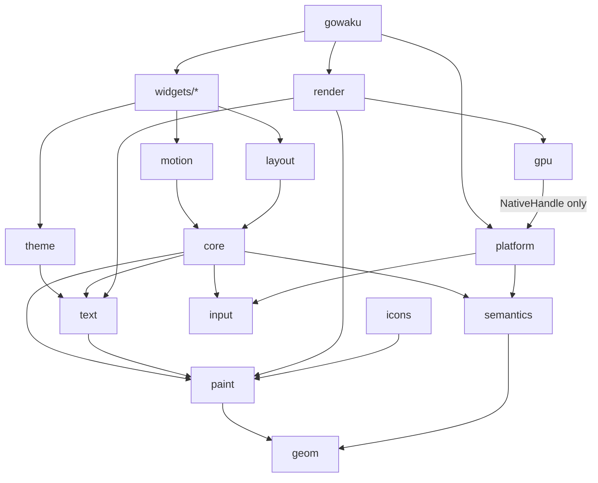

# Architecture

[日本語](ARCHITECTURE.ja.md)

This document describes how gowaku is built: the layers, what each package does, how a frame runs, and which package may import which. It describes the code as it is. The reasons behind individual decisions are in [docs/ADR/](ADR/) (Japanese); the links below marked "background" point there.

## What gowaku is

gowaku is a desktop UI library for Go. Its design is declarative and Flutter-like, with three trees (Widget, Element, RenderObject) written as Go types; it draws shapes, text and shadows on the GPU, and does no work at all when nothing changes. It calls Direct3D 11 and Win32 on Windows, Vulkan with X11 or Wayland on Linux, and Metal with AppKit on macOS (Apple Silicon), all from pure Go: no cgo and no C compiler on any OS. Japanese text is a first-class case: line breaking follows JLReq, ruby and vertical writing are built in, and the IME composes inline with clause highlighting.

## Layers

```
┌──────────────────────────────────────────────────────────────────┐
│ application       Widget / State / Build                         │
├──────────────────────────────────────────────────────────────────┤
│ gowaku (root)     Run, App, windows, Post; ties the layers below │
├──────────────────────────────────────────────────────────────────┤
│ widgets/*         standard widgets, in layers                    │
│ motion  theme     animation; design tokens                       │
├──────────────────────────────────────────────────────────────────┤
│ layout            standard render objects                        │
│ core              Widget → Element → RenderObject, reconcile,    │
│                   scheduling, focus, semantics tree              │
├──────────────────────────────────────────────────────────────────┤
│ text              fonts, shaping, JLReq line breaking, atlas     │
│ paint  icons      Canvas records a DisplayList; stock icons      │
├──────────────────────────────────────────────────────────────────┤
│ render            DisplayList → gpu.Batch                        │
│ gpu               Backend interface; d3d11, vulkan, metal, soft  │
├──────────────────────────────────────────────────────────────────┤
│ platform          Platform / Window interfaces;                  │
│                   win32, x11, wayland, cocoa, dbus               │
├──────────────────────────────────────────────────────────────────┤
│ semantics  input  geom   shared value types at the bottom        │
└──────────────────────────────────────────────────────────────────┘
```

`core` knows nothing of the GPU. It emits drawing commands into a `paint.Canvas`, and only `render` turns them into GPU work. As a result `core`, `layout`, `paint`, `text`, `theme`, `motion` and the widgets run under plain `go test`, with no GPU and no window.

## core: the three trees

| Tree | Lifetime | Role | Go form |
|---|---|---|---|
| Widget | Made on every Build, then dropped | Immutable description of part of the UI | A value-type struct |
| Element | As long as it stays in the tree | Links a widget to its render object, holds State, unit of diffing | Unexported type |
| RenderObject | Same as its element | Layout, painting, hit testing, semantics | `core.RenderObject` interface |

```go
type Widget interface{ Key() Key }
type StatelessWidget interface { Widget; Build(ctx BuildContext) Widget }
type StatefulWidget  interface { Widget; CreateState() State }
type RenderWidget    interface { Widget; CreateRenderObject() RenderObject; UpdateRenderObject(RenderObject) }

type State interface {
    Build(ctx BuildContext) Widget
    InitState(); DidUpdateWidget(old Widget); Dispose()
    // unexported methods: implementations embed StateBase
}
```

- A widget embeds `StatelessBase` or `StatefulBase`, and a state embeds `StateBase` (or `StateOf[W]`, whose `Widget()` returns the typed widget). `RenderObject` implementations embed `RenderBase`. The unexported methods make the embedding mandatory, so that methods can be added to the interfaces later without breaking user code. Background: [ADR 0006](ADR/0006-core-tree-api.md), [ADR 0029](ADR/0029-typed-state-widget.md).
- **Reconcile** is the common keyed reconciliation of declarative UI toolkits. Two widgets match when their dynamic types and keys are equal. The type comparison looks at the interface's type word; it never walks struct fields with reflect. Lists of children are matched from the front, then from the back, then by key, in O(n).
- `type Key = any`. `Keyed(key, widget)` gives a widget a key. A key that is not comparable panics.
- **Scheduling.** `SetState` runs its function and marks the element dirty. At the start of a frame, dirty elements are sorted by depth and rebuilt from the parent down. `SetState` during Build panics.
- `BuildContext` gives access to inherited values: `core.DependOn[T]` subscribes to an `Inherited[T]` above, `core.Lookup[T]` reads one without subscribing.
- `core.Tree` holds the element and render trees of one window. A frame calls `Build`, `Layout` and `Paint` (or `Repaint`) in that order. The tree also dispatches pointer, key, text, composition and drag events, owns focus, and runs tickers.
- `core.Ticker` is the only way to ask for frames. Tickers follow the display's refresh, and the tree sleeps when none is active.

reflect is used only for the type identity of widgets and for resolving the type parameter of `DependOn`. No struct fields or tags are read.

### API conventions

- Struct literals are the primary way to build a tree. For the common "just children" case, `widgets/basic` has one-line helpers: `VStack`, `HStack`, `Layers`, `Pad`.
- Every widget is a value type whose zero value works. Its fields are its whole API: no functional options, no builder chains.
- UI files import the widget layers they use (`widgets/basic`, `widgets/control`, ...). The root package `gowaku` keeps only the entry points for applications and windows, plus aliases of the types every widget writes: `Widget`, `BuildContext`, `State`, `StateBase`, `StateOf`, `StatelessBase`, `StatefulBase`, `Key`. It does not re-export widgets or lower-layer types. Background: [ADR 0081](ADR/0081-widget-layers.md).
- Initialization failures return `error`. Contract violations at run time panic with a message starting `gowaku:` that says how to fix the call. The library never recovers.

## layout: the constraint protocol

```go
type Constraints struct{ MinW, MaxW, MinH, MaxH float32 } // geom.Constraints; geom.Inf is unbounded

type RenderObject interface {
    Layout(c geom.Constraints) geom.Size
    Paint(cv *paint.Canvas, off geom.Offset)
    HitTest(pos geom.Offset, r *HitTestResult) bool
    Semantics(sb *SemanticsBuilder)
    Parent() RenderObject; ChildCount() int; ChildAt(i int) RenderObject
    Size() geom.Size; Offset() geom.Offset; SetOffset(off geom.Offset)
    MarkNeedsLayout(); MarkNeedsPaint()
}
```

- Constraints go down, sizes come up, and the parent sets each child's offset. Children are laid out with `core.LayoutChild`.
- Layout restarts from the nearest relayout boundary (an object with tight constraints). A change of color only calls `MarkNeedsPaint` and does not lay out.
- `layout` holds the standard render objects: `RenderPadding`, `RenderAlign`, `RenderConstrainedBox`, `RenderFlex`, `RenderStack`, `RenderWrap`, `RenderGrid`, `RenderViewport`, `RenderList`, `RenderCustomLayout` (with a `Delegate`), `RenderDecoratedBox`, the effect objects, and so on. `layout` implements `core.RenderObject`; `core` does not know `layout`.
- `Scroll`, lists and `Grid` placed where their length is unbounded, `CrossStretch` with unbounded cross size, and `Expanded` without bounded room panic with a message that says how to fix the tree. Background: [ADR 0026](ADR/0026-unbounded-room.md).
- `Alignment` runs from 0 to 1 and has named values such as `AlignCenter`. Background: [ADR 0031](ADR/0031-style-copy-and-named-alignments.md).

## paint: recording drawing commands

`paint.Canvas` records calls into a `DisplayList`. It does not draw.

```go
func (c *Canvas) DrawRRect(rr geom.RRect, p Paint)
func (c *Canvas) DrawPath(p *Path, pt Paint)
func (c *Canvas) DrawImage(img *Image, dst geom.Rect, opacity float32)
func (c *Canvas) DrawGlyphs(run *GlyphRun, off geom.Offset, color geom.Color)
func (c *Canvas) DrawShadow(rr geom.RRect, blur float32, color geom.Color, offset geom.Offset)
func (c *Canvas) DrawBackdrop(rr geom.RRect, sigma float32)
func (c *Canvas) DrawShader(dst geom.Rect, call ShaderCall)
func (c *Canvas) DrawLayer(l *Layer, off geom.Offset)
func (c *Canvas) ClipRect / ClipRRect / ClipPath, Save / Restore
func (c *Canvas) Translate / Scale / Transform(geom.Affine), PushOpacity, PushBlend, PushGroup / PopGroup

type Paint struct {
    Color    geom.Color
    Gradient *Gradient  // linear, radial, focal or sweep, with stops
    Stroke   *Stroke    // nil fills
    Blend    BlendMode  // zero is source-over
}
```

- A border, a gradient and a shadow are parameters of one rounded rectangle, so one rectangle is one GPU instance.
- Blend modes cover the Porter-Duff operators and the W3C separable and non-separable modes. Modes that read the backdrop cost a copy of the pixels below. Background: [ADR 0044](ADR/0044-drawing-extensions.md).
- `PushGroup` draws a subtree into an offscreen picture with masks and filters. `GroupCache` keeps that picture across frames. Background: [ADR 0114](ADR/0114-gpu-layers-masks-filters.md), [ADR 0115](ADR/0115-cached-groups.md).
- `paint.SVG` parses a static SVG subset (shapes, paths, groups, transforms, paint, clips, masks, a set of filters, text) into drawing commands. Background: [ADR 0112](ADR/0112-svg-structure-paint-clip.md), [ADR 0113](ADR/0113-svg-filters-text.md).
- `paint.Shader` carries a user shader compiled ahead of time by `cmd/gowaku-shader`. Background: [ADR 0045](ADR/0045-shaders-svg-animated-images.md).
- Colors are `geom.Color{R, G, B, A float32}`, not premultiplied, in sRGB. Compositing happens on sRGB values.

### Layers

`basic.RepaintBoundary` puts a `core.RenderRepaintBoundary` in the tree. It records its subtree into a `paint.Layer`, a display list of its own with a version number. `MarkNeedsPaint` climbs to the nearest boundary and stops there, so only dirty boundaries record again. `render` rasterizes a layer into a texture page and composites the pages over the full frame every time. Layers that cannot be cached (under scale or opacity, with paths or shaped clips, larger than a page, or changing every frame) are drawn inline, so the picture is the same either way. Presenting only dirty rectangles was measured and rejected. Background: [ADR 0019](ADR/0019-layers.md).

## render and gpu: batching

A desktop UI is many small rectangles and glyphs, with the occasional image or path. gowaku draws them with one large instance buffer and a few pipelines.

| Pipeline | Input | Use |
|---|---|---|
| P1 quad + SDF | Instanced quads | Rounded rectangles, borders, gradients, shadows, glyphs, images, blurred backdrops, all in one pixel shader that branches on `gpu.InstanceKind` |
| P2 path + stencil | Triangle fans | Marks the coverage of a path (no color output) |
| P3 quad + cover | Bounding quad | Fills where the stencil is set |

Custom shaders and the passes of group effects run as further pipelines on the same quads (`InstanceShader`, `InstanceEffect`).

```go
type Backend interface {
    CreateSurface(h platform.NativeHandle, physicalWidth, physicalHeight int, scale float32) (Surface, error)
    BeginFrame(s Surface, background geom.Color) error
    Draw(s Surface, batch *Batch) error
    EndFrame(s Surface) error // presents
    CreateTexture(width, height int, format TextureFormat) (Texture, error)
    UpdateTexture(t Texture, region image.Rectangle, pix []byte, stride int) error
    CreateTarget(width, height int) (Texture, error)
    DrawToTarget(t Texture, batch *Batch, scale float32) error
    PrepareShader(s *Shader) error
    Destroy()
}
```

- `render.Encode` turns a `paint.DisplayList` into a `gpu.Batch`: instances plus a list of `DrawCall`s (`DrawQuads`, `DrawFill`, `DrawClipPush`, `DrawClipPop`). Each draw call binds at most one texture. `render.Resources` owns the glyph atlas pages, images and layer pages shared by every window.
- **Shadows** are the SDF approximation of a Gaussian-blurred rounded rectangle, drawn in P1. There is no separate blur pass for them. Real blurs (`BackdropFilter`, `ImageFiltered`) use separable passes over a downsampled copy.
- **Antialiasing.** SDF shapes resolve their edges in the shader. Paths and shaped clips need 4x MSAA, which is used only on frames whose batch contains them (`Batch.Multisampled`). Background: [ADR 0009](ADR/0009-paths-and-clips.md), [ADR 0017](ADR/0017-multisample-on-demand.md).
- **Clips.** Axis-aligned rectangles use the scissor. Rounded rectangles and paths use levels in the depth buffer. The stencil is only for filling paths.
- **Coordinates.** A constant buffer carries viewport and scale, so the batch is in logical pixels. HiDPI changes only the scale.
- **Paths** are flattened on the CPU, then filled with stencil and cover (non-zero or even-odd). Small paths such as icons are rasterized on the CPU with `golang.org/x/image/vector` into the atlas instead.
- **Shaders.** One HLSL source in `gpu/shaders` is compiled ahead of time to DXBC for D3D11 (fxc) and SPIR-V for Vulkan (dxc), embedded with `go:embed`; `go generate ./gpu/...` regenerates them. Metal has an MSL port that the driver compiles when the device is created, so nothing is generated for macOS.
- **Backends.** `gpu/d3d11` calls COM vtables with `syscall.SyscallN`. `gpu/vulkan` opens the loader with purego on Linux (and `LoadLibrary` on Windows, for comparison tests only) and resolves functions through `vkGetInstanceProcAddr`. `gpu/metal` calls the Objective-C runtime through purego and builds on darwin/arm64 only. `gpu/soft` is a CPU reference that mirrors the shader math; it serves tests, headless screenshots and the catalog, not applications. Background: [ADR 0013](ADR/0013-vulkan-backend.md), [ADR 0020](ADR/0020-pixel-goldens.md), [ADR 0082](ADR/0082-macos-cocoa-metal.md).
- Pixel goldens drawn with `gpu/soft` run in CI. `go test -tags gpu ./internal/golden` compares D3D11 and Vulkan against the same goldens on a local machine.

## text: shaping and Japanese typesetting

```
string + text.Style
  → font lookup with fontscan, split into runs by script, with fallback
  → shaping with go-text/typesetting (glyph IDs, advances, offsets)
  → break opportunities by UAX #14
  → Japanese rules from text/jlreq
  → BiDi reordering (UAX #9), line wrapping → text.Layout   (cached)
  → at paint time: glyphs → atlas coordinates (rasterized and uploaded on first use)
```

`text/jlreq` works on units of a rune and a measured advance, and knows nothing about fonts, so every rule is testable with made-up metrics.

| Rule | Behavior |
|---|---|
| Line start prohibition | Closing brackets, small kana, 。、ー々 etc. do not start a line. Strength is `Style.LineBreak` (`Strict`, normal, loose). |
| Line end prohibition | Opening brackets do not end a line. |
| Unbreakable sequences | —, …, ‥ runs and numbers with their units stay together. |
| Resolution | `Style.Kinsoku`: `Oidashi` (push out) or `Oikomi` (squeeze in). |
| Punctuation squeezing | Adjacent punctuation loses its half-width space (`Style.Punctuation`). |
| Hanging punctuation | Commas and full stops may stick past the line end (`Style.Hanging`, off by default). |
| Japanese–Western spacing | A quarter em between Japanese and Latin text (`Style.WesternSpacing`). |
| Ruby | Mono and group ruby, with control of overhang onto neighbors. `text/aozora` reads Aozora Bunko notation. |

- **Vertical writing**: `Style.Orientation`. Layout works on an inline and a cross axis, so carets, selections and the IME candidate position all go through the same transform. `vert`/`vrt2` substitution, tate-chu-yoko and vertical ruby are supported. Background: [ADR 0023](ADR/0023-vertical-text.md).
- Also in `text.Style`: alignment including justification, `Indent`, `HangingIndent`, `TabStop`, `Hyphenate` (Liang's algorithm in `text/hyphen`), variable font `Variations`, and base `Direction`. Faces without an italic get a synthetic slant. Background: [ADR 0024](ADR/0024-color-emoji-bidi-variable-hyphen-incremental.md), [ADR 0101](ADR/0101-synthetic-italic.md).
- **Fonts**: system fonts found with fontscan. The default families are Yu Gothic, Noto Sans CJK JP, Hiragino Sans and Meiryo. Yu Gothic UI is left out because its kana and punctuation are proportional, which JLReq does not assume. Background: [ADR 0007](ADR/0007-text-architecture.md).
- **Color emoji**: COLRv0, COLRv1, CBDT and sbix, on RGBA pages of the atlas.
- **Glyph atlas**: 2048² pages, R8 for outlines and RGBA8 for color, quarter-pixel horizontal positions, no hinting. Least recently used glyphs make room when the pages are full. Background: [ADR 0079](ADR/0079-atlas-lru.md).
- **Editing**: `Layout.HitTest`, `CaretRect`, `SelectionRects` and word and line motions work on grapheme clusters. Edits re-shape only the paragraphs they touch.
- The typesetting library stays behind `text`. The result of a layout is a list of `paint.GlyphRun`, so `paint` needs no fonts.

## Widgets

The standard widgets live in eight packages under `widgets/`, in layers. A package imports only layers below it, never one beside it. `widgets` itself holds no code.

| Layer | Package | Contents |
|---|---|---|
| 1 | `widgets/basic` | Theme, MediaQuery, localized strings; boxes and flex (`Container`, `Padding`, `SizedBox`, `Align`, `Row`, `Column`, `Stack`, `Wrap`, `Grid`, `AspectRatio`, `CustomLayout`, `LayoutBuilder`); effects (`Opacity`, `Blend`, `BackdropFilter`, `ShaderMask`, `Transform`); implicit animations; `Text`, `RichText`, `Icon`, `Image`, `SVG`; `Scroll`; `RepaintBoundary` |
| 2 | `widgets/interact` | `GestureDetector`, `MouseRegion`, `Listener`, `Focus`, `FocusRing`, `Pressable`, `Shortcut`/`Actions`, `Draggable`/`DragTarget`, `Semantics`, `InteractiveViewer` |
| 3 | `widgets/control` | `Button`, `Checkbox`, `Switch`, `Slider`, `RangeSlider`, `SegmentedControl`, `Radio`, `Chip`, `Card`, `NumberStepper`, `Tabs`, `SplitPane`, `Badge`, progress, `Disclosure`, `Link`, `InfoBar`, `Skeleton`, `Sparkline`, `CustomPaint` |
| 4 | `widgets/overlay` | `Overlay`, `Dialog`, `Sheet`, `Toast`, `Tooltip`, `MenuBar`, `ContextMenu`, popup menus |
| 5 | `widgets/field` | `Input` (single and multi-line, IME, selection, undo), `Search`, `Form`, `Autocomplete`, `DropdownMenu`, `NumberField`, `TokenField`, `ColorPicker`, `Calendar`, date and time pickers, `SelectionArea`, `CommandPalette` |
| 5 | `widgets/nav` | `Navigator` and routes, `Hero`, `BackButton`, `Breadcrumb`, `Steps`, `TabBar`, `Toolbar`, `StatusBar`, `DockLayout` |
| 6 | `widgets/collection` | `List`, `GridView`, `ReorderableList`, `Tree`, `Table`, `PropertyGrid`, `Group`, `Sidebar` |
| 6 | `widgets/editor` | `Editor`, a long-document editing surface with search, line styles and decorations |

Shared internals stay internal: `widgets/internal/kit` (below `basic`) holds small helpers, and `widgets/internal/behavior` (between `interact` and `control`) holds the hover, focus and press behavior that controls share. The full list, with pictures, is in the [widget catalog](catalog/en/README.md).

`markdown` is a separate module (`github.com/bankai-tensei/gowaku/markdown`) with its own CommonMark parser, so the main module keeps its short list of dependencies. Nothing in gowaku imports it. Background: [ADR 0099](ADR/0099-markdown-module.md).

## theme

The design itself is in [DESIGN.md](DESIGN.md) (Japanese). `theme` holds its tokens.

- `theme.Theme` has `Color` (roles derived from one accent, for light and dark), `Text` (a type scale of eight roles set for Japanese), and `Radius`. `Lift` gives two-layer shadows, as the `paint.BoxShadow` that `basic.Container` takes.
- `theme.Set` is a light and dark pair. `FromAccent` builds one from a color; `Default` is the built-in one. The application follows the OS brightness unless `App.ThemeMode` fixes it.
- Colors come from the HCT color space (CAM16 and L*), ported from material-color-utilities and checked against its test vectors.
- `theme.Extension[T]` lets applications add their own tokens.
- `basic.ThemeOf(ctx)` lives in `widgets/basic`, so that `theme` does not know `core`.

## motion

- `motion.AnimationController` runs a value from 0 to 1 over a duration, with a `Curve`: forward, reverse, repeat, stop.
- Curves: `Linear`, `EaseInCubic`, `EaseOutCubic`, `EaseInOutCubic`, `EaseOutBack`, `ElasticOut`, `BounceOut`, `Standard`, `CubicBezier`, and others.
- `SpringSimulation` carries velocity over, for returns after a drag and for scroll physics.
- `Tween[T]` and the `Lerp*` functions interpolate floats, colors, offsets, sizes, rects, rounded rects, insets and affines.
- `motion.Implicit` is the machinery behind implicit animations: a state keeps the previous widget values and re-targets them in `DidUpdateWidget`. The `Animated*` widgets of `widgets/basic` (`AnimatedContainer`, `AnimatedOpacity`, `AnimatedPositioned`, `AnimatedAlign`, `AnimatedSwitcher`) use it.
- Any number of tickers produce at most one build, layout and paint per frame. When the OS asks for reduced motion, `MediaQueryData.ReduceMotion` is set, and the standard widgets jump instead of moving or resizing, while keeping their fades.
- `motion` never reads the clock. Time comes from `core` tickers, so tests inject it and compare value sequences.

## Semantics and accessibility

- `RenderObject.Semantics(sb)` adds nodes to the accessibility tree through `core.SemanticsBuilder`. A `semantics.Node` has a role, label, value, hint, state, actions, live region, range, and text information for fields. The default walks the children.
- Standard widgets always report a role and a label.
- A subtree whose `core.Hider` reports hidden (such as `Opacity` at zero) is left out of semantics, hit testing and Tab traversal. It cannot be heard, pressed or focused. Background: [ADR 0027](ADR/0027-hidden-subtrees.md).
- After each frame, and only while a screen reader listens, the root package compares the new tree with the last one (`semantics.Compare`) and hands the difference to the window's `platform.Accessibility` bridge: UI Automation on Windows (COM objects implemented in Go in `platform/win32/com`), AT-SPI2 over D-Bus on Linux (`platform/dbus`), and NSAccessibility on macOS. Background: [ADR 0042](ADR/0042-accessibility-windows.md), [ADR 0043](ADR/0043-accessibility-linux.md), [ADR 0085](ADR/0085-accessibility-macos.md).
- `semantics` sits below both `core` and `platform` and imports only `geom`, so the platform layer knows the tree without knowing `core`.

## Frames and threads

```
event loop:
  for windows remain {
      ev := platform.WaitEvent(timeout)  // blocks; an idle app uses no CPU
      handle(ev)                         // hit test → handler → SetState
      pump()                             // runs posted functions, then a frame
  }                                      // for every window that needs one

frame():
  1. build   dirty elements, by depth, with reconcile
  2. layout  from relayout boundaries (build and layout repeat at most 3 times
             if layout asked for a rebuild)
  3. paint   record into the canvas; only dirty repaint boundaries record again
  4. render  DisplayList → Batch → Backend: BeginFrame, Draw, EndFrame (present)
  5. speak   semantics difference to the screen reader, if one listens
```

- Frames run only while something is dirty or a ticker is active. Present waits for vsync (D3D11 sync interval 1, Vulkan FIFO), which paces animation. Otherwise the loop sleeps in `WaitEvent`.
- During an OS modal loop, such as a window drag-resize on Windows, the platform calls back into the same pump so frames keep coming. Background: [ADR 0001](ADR/0001-win32-modal-loop.md).
- At start, the GPU device is created while fonts load, in parallel. Background: [ADR 0018](ADR/0018-parallel-startup.md), [ADR 0080](ADR/0080-startup.md).

### Thread model

- The goroutine that calls `gowaku.Run` becomes the UI goroutine. The platform locks it to its OS thread (Win32 message queues, the D3D11 immediate context and AppKit all have thread affinity). On macOS it must be the main goroutine.
- Build, layout, paint, `SetState` and every callback run on the UI goroutine. Other goroutines call `gowaku.Post(fn)`, which queues `fn` and wakes the loop: `PostMessageW` on Windows, a self-pipe on X11 and Wayland, a posted event on macOS.
- `Run` returns an error only for failed initialization. A lost device during a frame panics.
- Building with `-tags gowakudebug` adds the Inspector (F12 or `gowaku.OpenInspector`), a separate window that shows the trees, layout bounds, repaints, frame times and the semantics tree. Without the tag none of it is linked. Background: [ADR 0073](ADR/0073-inspector.md).

### Multiple windows

- One process has one GPU device. Each window has its own surface (swap chain and render targets), its own `core.Tree` and its own scheduling. The shaper, glyph atlas, pipelines and images are shared.
- There is one event loop. Every event carries a window ID.
- `gowaku.OpenWindow(opts, root)` opens a window and returns a `*WindowHandle`. `gowaku.ShowModal(ctx, opts, root)` opens a modal window that blocks input to its owner. `overlay.ShowDialog` is an overlay inside the same window. Background: [ADR 0047](ADR/0047-modal-windows.md).

## platform: the window layer

```go
type Platform interface {
    CreateWindow(opts WindowOptions) (Window, error)
    WaitEvent(timeout time.Duration) Event
    Brightness() Brightness
    ReduceMotion() bool
    Locale() string
    Wake()                     // from any goroutine
    SetModalHandler(fn func())
    Trays
    Destroy()
}

type Window interface {
    ID() WindowID
    PhysicalSize() (w, h int); Scale() float32
    NativeHandle() NativeHandle // what gpu needs for a surface
    SetIMEEnabled(bool); SetIMECursorRect(x, y, w, h int); SetIMEVertical(bool); CancelComposition()
    SetCursor(input.Cursor); ClipboardText() string; SetClipboardText(string)
    Clipboard; Dragging; Placement
    ShowFileDialog(opts FileDialogOptions, done func(paths []string, err error))
    Accessibility() Accessibility
    // title, decorations, icon, size limits, full screen, ...
}
```

| | Windows `platform/win32` | X11 `platform/x11` | Wayland `platform/wayland` | macOS `platform/cocoa` |
|---|---|---|---|---|
| Calls | Win32 through `syscall` and `x/sys/windows` | libX11 through purego | libwayland-client and libxkbcommon through purego; bindings generated by `cmd/gowaku-bindgen` | AppKit through purego/objc |
| GPU surface | D3D11 swap chain on the HWND | `VK_KHR_xlib_surface` | `VK_KHR_wayland_surface` | `CAMetalLayer` |
| IME | `WM_IME_COMPOSITION` with clauses and attributes; candidate window at the caret | XIM; commits only, the input method draws its own composition | `text-input-v3`; inline composition with a cursor range, no clause attributes | `NSTextInputClient`; clauses and the focused clause |
| HiDPI | Per-monitor v2, `WM_DPICHANGED` | `Xft.dpi` | `fractional-scale-v1` with `viewporter` | `backingScaleFactor` |
| Title bar | OS, or custom (`WM_NCCALCSIZE`, `WM_NCHITTEST`) | OS, or custom (`_MOTIF_WM_HINTS`) | `xdg-decoration`, or drawn by gowaku | OS, or transparent |
| Accessibility | UI Automation | AT-SPI2 over D-Bus | AT-SPI2 over D-Bus | NSAccessibility |
| File dialog | `IFileOpenDialog` / `IFileSaveDialog` | xdg-desktop-portal | xdg-desktop-portal | `NSOpenPanel` / `NSSavePanel` |

- On Linux, `Run` picks Wayland when `WAYLAND_DISPLAY` is set and X11 otherwise. `GOWAKU_BACKEND=x11` or `wayland` forces one. Background: [ADR 0014](ADR/0014-x11-platform.md), [ADR 0021](ADR/0021-wayland-platform.md).
- `platform/dbus` holds what both Linux platforms ask over D-Bus (with godbus, pure Go): the portal's color scheme and animation setting, the file chooser, AT-SPI2, tray and notifications. Without a session bus each feature reports that it cannot, and the reason goes to `slog.Debug`. Background: [ADR 0022](ADR/0022-linux-ime-dbus-file-dialog.md).
- The platform layer also covers menus (`NSMenu` for the macOS menu bar, drawn by gowaku elsewhere), the clipboard beyond text (images, files, HTML), drag and drop with the OS, tray icons and notifications, touch, pen and touchpad pinch, and window decorations. Background: [ADR 0046](ADR/0046-menus-and-shortcuts.md)–[ADR 0052](ADR/0052-pinch-touch-and-pen.md), [ADR 0111](ADR/0111-window-decorations.md).
- `platform/internal/*` holds code that several platforms share: key symbols, the event queue, clipboard formats, icons, desktop settings.

## Packages

```
gowaku/                 Run, App, windows, Post, tray, clipboard, file dialog, Inspector
├── geom/               Offset, Size, Rect, RRect, Affine, Color, Constraints, Insets
├── input/              keys, modifiers, pointer buttons, cursors, IME compositions
├── semantics/          accessibility tree nodes, roles, actions, tree difference
├── paint/              Canvas, DisplayList, Path, Paint, Gradient, Layer, SVG, Shader
├── text/               Shaper, Layout, Style, Atlas
│   ├── jlreq/          JLReq line breaking
│   ├── hyphen/         Liang hyphenation
│   └── aozora/         Aozora Bunko ruby notation
├── core/               Widget, Element, State, RenderObject, reconcile, Tree, Ticker
├── layout/             standard render objects
├── theme/              tokens, HCT
├── motion/             controllers, curves, springs, tweens, implicit animation
├── widgets/            basic, interact, control, overlay, field, nav, collection, editor
├── render/             DisplayList → gpu.Batch
├── gpu/                Backend interface, shared shaders
│   └── d3d11/ vulkan/ metal/ soft/
├── platform/           Platform, Window, Event, NativeHandle
│   └── win32/ (com/) x11/ wayland/ cocoa/ dbus/
├── gowakutest/         run a tree in a test: find, tap, type, advance time, screenshot
├── gowakupreview/      draw Preview functions to PNG with a report
├── cmd/                gowaku-preview, gowaku-shader, gowaku-bindgen
├── markdown/           separate module: Markdown as widgets
├── internal/           goldens, test helpers, shader tools, catalog generator
└── examples/
```

The public API is `gowaku`, `gowakutest`, `gowakupreview`, `core`, `layout`, `paint`, `icons`, `text`, `theme`, `motion`, `widgets/*`, `geom` and `input`. Packages under `gpu`, `platform` and `render` are exported only so the root package can reach them; they make no compatibility promise. Background: [ADR 0016](ADR/0016-public-api.md).

## Dependency rule

Imports go down only. A package never imports a package beside it; shared code moves down a layer.



`geom` is at the bottom and imports only the standard library; `input` imports nothing. Arrows to `geom` from the other packages are left out.

| Package | May import |
|---|---|
| `widgets/*` | core, layout, paint, icons, text, theme, motion, input, semantics, geom, and lower widget layers |
| `motion` | core, geom |
| `theme` | text, geom |
| `layout` | core, paint, input, semantics, geom |
| `core` | paint, text, input, semantics, geom |
| `text` | paint (types only), geom |
| `icons` | paint, geom |
| `paint` | geom |
| `render` | paint, text, gpu, geom |
| `gpu` | platform (NativeHandle only), geom |
| `platform` | input, semantics, geom |
| `semantics` | geom |
| `input`, `geom` | standard library only |
| `gowaku` (root) | everything |

- `core` does not know `layout`. The standard render objects live in `layout` and implement `core.RenderObject`.
- `core`, `layout`, `paint`, `text`, `theme`, `motion` and `widgets` never import `gpu`, `platform` or `render`. That is what lets them run without a GPU.
- Within `widgets`, the order is `internal/kit` → `basic` → `interact` → `internal/behavior` → `control` → `overlay` → `field`, `nav` → `collection`, `editor`.
- `unsafe`, `syscall`, `x/sys` and purego are allowed only in `platform/win32`, `platform/x11`, `platform/wayland`, `platform/cocoa`, `gpu/d3d11`, `gpu/vulkan` and `gpu/metal`.
- `reflect` is allowed only in `core` (plus test helpers and the Inspector).

The depguard rules in `.golangci.yml` enforce all of this, and `golangci-lint run` fails on a violation. The conventions are in [CODING_STYLE.md](CODING_STYLE.md) §3 (Japanese).

## Dependencies

All pure Go: `github.com/ebitengine/purego` (C calls on Linux and macOS, and purego/objc), `golang.org/x/sys` (Win32), `github.com/go-text/typesetting` (shaping and font lookup), `golang.org/x/image` (glyph rasterization, WebP), `golang.org/x/text` (BiDi, locales), `github.com/godbus/dbus/v5` (D-Bus on Linux).
