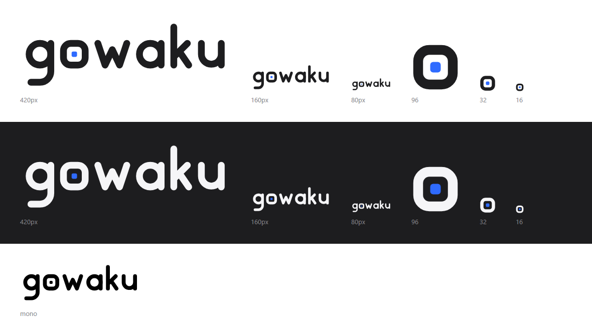

# gowaku logo

[English](#english) | [日本語](#日本語)

## English

A wordmark of lowercase `gowaku` in which the o is a rounded square (an outline). The blue dot inside is the only accent color.

| File | Use |
| --- | --- |
| `gowaku-wordmark.svg` | Light backgrounds |
| `gowaku-wordmark-dark.svg` | Dark backgrounds (transparent background) |
| `gowaku-wordmark-mono.svg` | Single color. Drawn with `currentColor`, so the dot has the same color as the letters |
| `gowaku-mark.svg` / `gowaku-mark-dark.svg` | The symbol alone. Favicons and icons |

- Colors: ink `#1d1d1f`, white `#f5f5f7`, accent `#2f6bff`
- Stroke width is about 1/4 of the x-height; ends and corners are round
- Below 120px wide, use the symbol instead of the wordmark (the dot gets lost)
- Do not change the aspect ratio, do not color the letters blue, do not give the dot another color

## 日本語

小文字の `gowaku` のうち、o を角丸の四角（枠線）にしたワードマークである。中にある青い点が唯一の差し色になっている。

| ファイル | 用途 |
| --- | --- |
| `gowaku-wordmark.svg` | ライト背景 |
| `gowaku-wordmark-dark.svg` | ダーク背景（背景は透過） |
| `gowaku-wordmark-mono.svg` | 単色。`currentColor` で描画するので、点も文字と同じ色になる |
| `gowaku-mark.svg` / `gowaku-mark-dark.svg` | シンボル単体。ファビコンやアイコンに使う |

- 色: 墨 `#1d1d1f`、白 `#f5f5f7`、アクセント `#2f6bff`
- 線幅は x ハイトの約 1/4 で、線端と角は丸める
- 幅が 120px 未満になる場所では、ワードマークではなくシンボルを使う（点が潰れて見えなくなるため）
- 縦横比を変えない。文字を青くしない。点を別の色にしない
