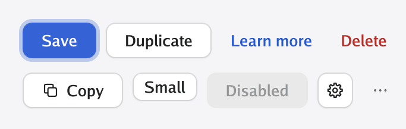
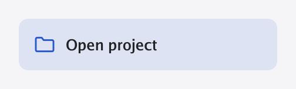
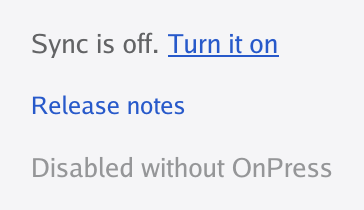

<!-- Code generated by internal/cmd/catalog; DO NOT EDIT. -->

# Buttons and actions

[Catalog contents](README.md) · [日本語](../ja/actions.md) · [Searchable site](https://bankai-tensei.github.io/gowaku/catalog/actions/)

Controls that do something when pressed. One `control.Button` covers every button; its `Style` picks one of four looks.

> The lower-case functions in the examples (`themed`, `colored`, `tile`, and shapes such as `squareIcon`) are small helpers in [internal/catalog/helpers.go](../../../internal/catalog/helpers.go); `themed` is a `basic.Builder` that reads `basic.ThemeOf(ctx)`. `core.Widget` and `core.BuildContext` in the examples are the same types as `gowaku.Widget` and `gowaku.BuildContext`.

[control.Button](#controlbutton) · [interact.Pressable](#interactpressable) · [control.Link](#controllink)

## control.Button

Runs `OnPress` when pressed. `Style` picks normal, primary, quiet or danger, and `Size` the height. Without `OnPress` it is disabled.

Package: [`github.com/bankai-tensei/gowaku/widgets/control`](https://pkg.go.dev/github.com/bankai-tensei/gowaku/widgets/control)

<picture>
  <source media="(prefers-color-scheme: dark)" srcset="../img/control-button-dark.png">
  
</picture>

```go
save := func() {}
return basic.Column{Size: layout.MainMin, Cross: layout.CrossStart, Spacing: theme.Space12, Children: []core.Widget{
	basic.Row{Size: layout.MainMin, Spacing: theme.Space8, Children: []core.Widget{
		control.Button{Label: "Save", Style: control.ButtonPrimary, OnPress: save},
		control.Button{Label: "Duplicate", OnPress: save},
		control.Button{Label: "Learn more", Style: control.ButtonQuiet, OnPress: save},
		control.Button{Label: "Delete", Style: control.ButtonDanger, OnPress: save},
	}},
	basic.Row{Size: layout.MainMin, Spacing: theme.Space8, Children: []core.Widget{
		control.Button{Label: "Copy", Icon: icons.Copy(), OnPress: save},
		control.Button{Label: "Small", Size: control.ButtonSmall, OnPress: save},
		control.Button{Label: "Disabled"},
		control.Button{Label: "Settings", Icon: icons.Settings(), HideLabel: true, OnPress: save},
		control.Button{Label: "More", Icon: icons.More(), HideLabel: true, Style: control.ButtonQuiet, OnPress: save},
	}},
}}
```

API: [`control.Button`](https://pkg.go.dev/github.com/bankai-tensei/gowaku/widgets/control#Button) · [`control.ButtonStyle`](https://pkg.go.dev/github.com/bankai-tensei/gowaku/widgets/control#ButtonStyle) · [`control.ButtonSize`](https://pkg.go.dev/github.com/bankai-tensei/gowaku/widgets/control#ButtonSize)

## interact.Pressable

The base for a pressable area with a look of your own: `Build` gets the hover, press and focus `PressState` and returns the content.

Package: [`github.com/bankai-tensei/gowaku/widgets/interact`](https://pkg.go.dev/github.com/bankai-tensei/gowaku/widgets/interact)

<picture>
  <source media="(prefers-color-scheme: dark)" srcset="../img/interact-pressable-dark.png">
  
</picture>

```go
interact.Pressable{Label: "Open project", OnPress: func() {}, Build: func(s interact.PressState) core.Widget {
	return themed(func(th *theme.Theme) core.Widget {
		ground := th.Color.Card
		if s.Hovered {
			ground = th.Color.AccentTint
		}
		return interact.FocusRing{Visible: s.FocusVisible, Radius: th.Radius.Control, Child: basic.Container{
			Width: 220, Padding: geom.All(theme.Space12), Radius: th.Radius.Control, Color: ground,
			Child: basic.Row{Spacing: theme.Space8, Children: []core.Widget{
				basic.Icon{Path: icons.Folder(), Size: 20, Color: th.Color.AccentInk},
				basic.Text{Content: "Open project", Style: colored(th.Text.Control, th.Color.Ink)},
			}},
		}}
	})
}}
```

API: [`interact.Pressable`](https://pkg.go.dev/github.com/bankai-tensei/gowaku/widgets/interact#Pressable) · [`interact.PressState`](https://pkg.go.dev/github.com/bankai-tensei/gowaku/widgets/interact#PressState)

## control.Link

A short text beside the text it belongs to that does something when pressed. It is set in the accent ink and underlined under the pointer. Enter presses it, Space does not. Without `OnPress` it is disabled.

Package: [`github.com/bankai-tensei/gowaku/widgets/control`](https://pkg.go.dev/github.com/bankai-tensei/gowaku/widgets/control)

<picture>
  <source media="(prefers-color-scheme: dark)" srcset="../img/control-link-dark.png">
  
</picture>

```go
basic.Row{Size: layout.MainMin, Spacing: theme.Space4, Children: []core.Widget{
	basic.Text{Content: "Sync is off.", Style: note},
	control.Link{Label: "Turn it on", OnPress: func() {}},
}},
control.Link{Label: "Release notes", Style: th.Text.Caption, OnPress: func() {}},
control.Link{Label: "Disabled without OnPress"},
```

API: [`control.Link`](https://pkg.go.dev/github.com/bankai-tensei/gowaku/widgets/control#Link)
