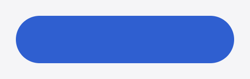
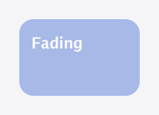
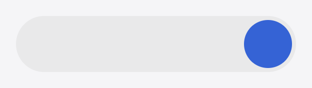
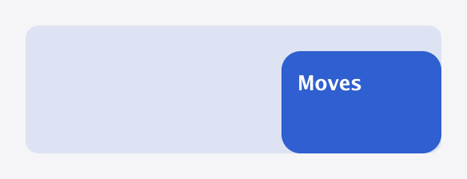
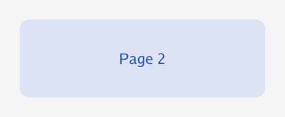
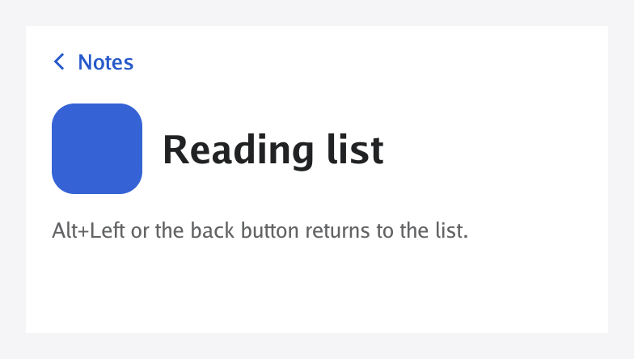

<!-- Code generated by internal/cmd/catalog; DO NOT EDIT. -->

# Animation

[Catalog contents](README.md) · [日本語](../ja/animation.md) · [Searchable site](https://bankai-tensei.github.io/gowaku/catalog/animation/)

Widgets that move to new values over time. When the OS asks for less motion they jump instead.

> The lower-case functions in the examples (`themed`, `colored`, `tile`, and shapes such as `squareIcon`) are small helpers in [internal/catalog/helpers.go](../../../internal/catalog/helpers.go); `themed` is a `basic.Builder` that reads `basic.ThemeOf(ctx)`. `core.Widget` and `core.BuildContext` in the examples are the same types as `gowaku.Widget` and `gowaku.BuildContext`.

[basic.AnimatedContainer](#basicanimatedcontainer) · [basic.AnimatedOpacity](#basicanimatedopacity) · [basic.AnimatedAlign](#basicanimatedalign) · [basic.AnimatedPositioned](#basicanimatedpositioned) · [basic.AnimatedSwitcher](#basicanimatedswitcher) · [nav.Hero](#navhero)

## basic.AnimatedContainer

A `Container` that moves to new colors, sizes, padding, corners, borders and shadows over time.

Package: [`github.com/bankai-tensei/gowaku/widgets/basic`](https://pkg.go.dev/github.com/bankai-tensei/gowaku/widgets/basic)

<picture>
  <source media="(prefers-color-scheme: dark)" srcset="../img/basic-animatedcontainer-dark.png">
  
</picture>

```go
expanded := true // a field of the State; SetState changes it
w, c := float32(120), geom.Hex(0x8a8a8e)
if expanded {
	w, c = 220, geom.Hex(0x2f5fd0)
}
return basic.AnimatedContainer{Duration: 250 * time.Millisecond, Width: w, Height: 48, Radius: 24, Color: c}
```

API: [`basic.AnimatedContainer`](https://pkg.go.dev/github.com/bankai-tensei/gowaku/widgets/basic#AnimatedContainer)

## basic.AnimatedOpacity

An `Opacity` that fades to a new value.

Package: [`github.com/bankai-tensei/gowaku/widgets/basic`](https://pkg.go.dev/github.com/bankai-tensei/gowaku/widgets/basic)

<picture>
  <source media="(prefers-color-scheme: dark)" srcset="../img/basic-animatedopacity-dark.png">
  
</picture>

```go
visible := false // a field of the State
var o float32 = 1
if !visible {
	o = 0.4
}
return basic.AnimatedOpacity{Opacity: o, Child: swatch("Fading", geom.Hex(0x2f5fd0))}
```

API: [`basic.AnimatedOpacity`](https://pkg.go.dev/github.com/bankai-tensei/gowaku/widgets/basic#AnimatedOpacity)

## basic.AnimatedAlign

An `Align` that moves to a new alignment.

Package: [`github.com/bankai-tensei/gowaku/widgets/basic`](https://pkg.go.dev/github.com/bankai-tensei/gowaku/widgets/basic)

<picture>
  <source media="(prefers-color-scheme: dark)" srcset="../img/basic-animatedalign-dark.png">
  
</picture>

```go
themed(func(th *theme.Theme) core.Widget {
	return basic.Container{Width: 280, Height: 56, Radius: 28, Color: th.Color.Fill, Padding: geom.All(4),
		Child: basic.AnimatedAlign{Alignment: a, Child: basic.Container{Width: 48, Height: 48, Radius: 24, Color: th.Color.Accent}}}
})
```

API: [`basic.AnimatedAlign`](https://pkg.go.dev/github.com/bankai-tensei/gowaku/widgets/basic#AnimatedAlign)

## basic.AnimatedPositioned

A `Positioned` that moves to a new place in its `Stack`.

Package: [`github.com/bankai-tensei/gowaku/widgets/basic`](https://pkg.go.dev/github.com/bankai-tensei/gowaku/widgets/basic)

<picture>
  <source media="(prefers-color-scheme: dark)" srcset="../img/basic-animatedpositioned-dark.png">
  
</picture>

```go
moved := true // a field of the State
var left float32 = 8
if moved {
	left = 160
}
return basic.SizedBox{Width: 260, Height: 80, Child: basic.Stack{Children: []core.Widget{
	tile("", 260, 80),
	basic.AnimatedPositioned{Left: left, Top: 16, Child: swatch("Moves", geom.Hex(0x2f5fd0))},
}}}
```

API: [`basic.AnimatedPositioned`](https://pkg.go.dev/github.com/bankai-tensei/gowaku/widgets/basic#AnimatedPositioned)

## basic.AnimatedSwitcher

Crossfades or slides from an old child to a new one. Tell children of one type apart with `core.Keyed`.

Package: [`github.com/bankai-tensei/gowaku/widgets/basic`](https://pkg.go.dev/github.com/bankai-tensei/gowaku/widgets/basic)

<picture>
  <source media="(prefers-color-scheme: dark)" srcset="../img/basic-animatedswitcher-dark.png">
  
</picture>

```go
page := 1 // a field of the State
return basic.AnimatedSwitcher{
	Duration:   250 * time.Millisecond,
	Transition: basic.SlideTransition(0.04, 0),
	Child:      core.Keyed(page, tile("Page "+strconv.Itoa(page+1), 200, 64)),
}
```

API: [`basic.AnimatedSwitcher`](https://pkg.go.dev/github.com/bankai-tensei/gowaku/widgets/basic#AnimatedSwitcher) · [`basic.SwitcherTransition`](https://pkg.go.dev/github.com/bankai-tensei/gowaku/widgets/basic#SwitcherTransition)

## nav.Hero

When a `Navigator` changes pages, the child with the same `Tag` flies from one place to the other. The picture shows the page after landing.

Package: [`github.com/bankai-tensei/gowaku/widgets/nav`](https://pkg.go.dev/github.com/bankai-tensei/gowaku/widgets/nav)

<picture>
  <source media="(prefers-color-scheme: dark)" srcset="../img/nav-hero-dark.png">
  
</picture>

```go
// In the row of the list:
row := basic.Row{Spacing: theme.Space12, Children: []core.Widget{nav.Hero{Tag: 1, Child: icon}, basic.Text{Content: "Trip to Kyoto"}}}
// On the page the row opens, with the same Tag:
header := basic.Row{Spacing: theme.Space12, Children: []core.Widget{nav.Hero{Tag: 1, Child: big}, basic.Text{Content: "Trip to Kyoto"}}}
```

API: [`nav.Hero`](https://pkg.go.dev/github.com/bankai-tensei/gowaku/widgets/nav#Hero)
