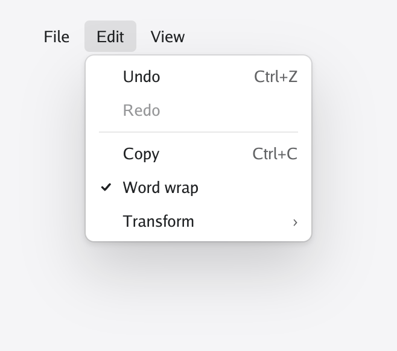
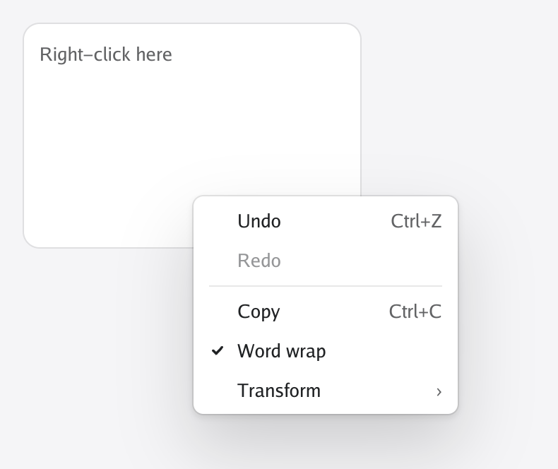
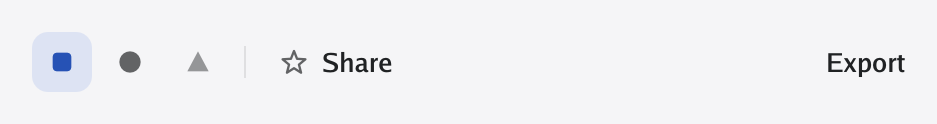
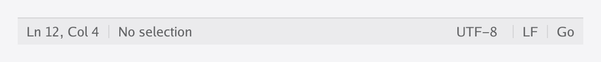
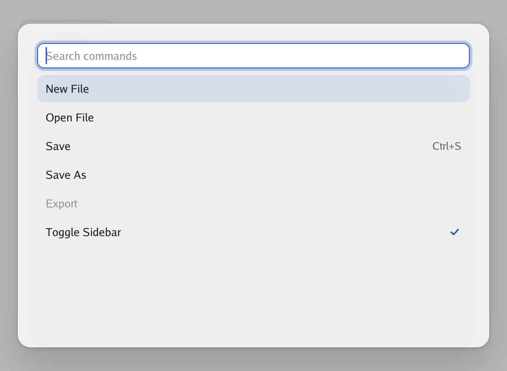
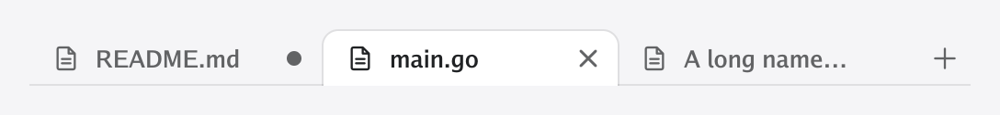
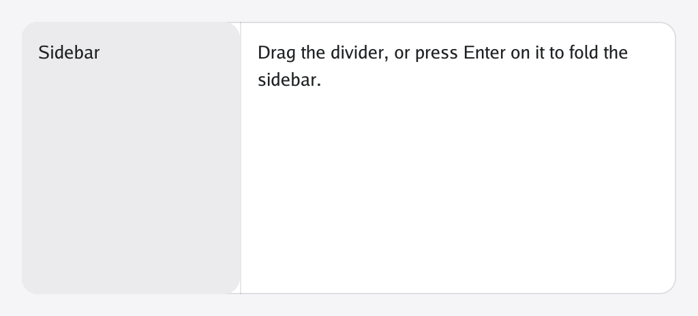
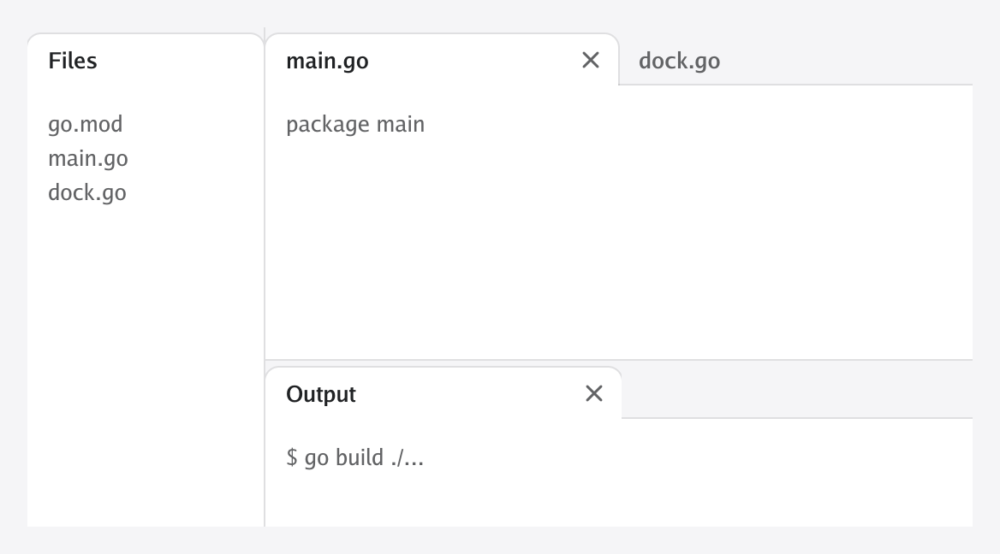

<!-- Code generated by internal/cmd/catalog; DO NOT EDIT. -->

# Desktop

[Catalog contents](README.md) · [日本語](../ja/desktop.md) · [Searchable site](https://bankai-tensei.github.io/gowaku/catalog/desktop/)

Widgets particular to desktop applications: the menu bar, context menus, toolbars, document tabs and split panes.

> The lower-case functions in the examples (`themed`, `colored`, `tile`, and shapes such as `squareIcon`) are small helpers in [internal/catalog/helpers.go](../../../internal/catalog/helpers.go); `themed` is a `basic.Builder` that reads `basic.ThemeOf(ctx)`. `core.Widget` and `core.BuildContext` in the examples are the same types as `gowaku.Widget` and `gowaku.BuildContext`.

[overlay.MenuBar](#overlaymenubar) · [overlay.ContextMenu](#overlaycontextmenu) · [nav.Toolbar](#navtoolbar) · [nav.StatusBar](#navstatusbar) · [field.CommandPalette](#fieldcommandpalette) · [nav.TabBar](#navtabbar) · [control.SplitPane](#controlsplitpane) · [nav.DockLayout](#navdocklayout)

## overlay.MenuBar

The menu bar at the top of a window. Each `Action` holds the label, the shortcut, the check mark and whether it can run.

Package: [`github.com/bankai-tensei/gowaku/widgets/overlay`](https://pkg.go.dev/github.com/bankai-tensei/gowaku/widgets/overlay)

<picture>
  <source media="(prefers-color-scheme: dark)" srcset="../img/overlay-menubar-dark.png">
  
</picture>

```go
run := func() {}
return basic.SizedBox{Width: 420, Child: overlay.MenuBar{Items: []overlay.MenuItem{
	{Action: interact.Action{Label: "&File"}, Items: []overlay.MenuItem{
		{Action: interact.Action{Label: "&Save", Shortcut: interact.Shortcut{Key: input.KeyS, Modifiers: input.ModControl}, OnInvoke: run}},
	}},
	{Action: interact.Action{Label: "&Edit"}, Items: editItems()},
	{Action: interact.Action{Label: "&View"}, Items: []overlay.MenuItem{
		{Action: interact.Action{Label: "Zoom &in", OnInvoke: run}},
	}},
}}}
```

API: [`overlay.MenuBar`](https://pkg.go.dev/github.com/bankai-tensei/gowaku/widgets/overlay#MenuBar) · [`overlay.MenuItem`](https://pkg.go.dev/github.com/bankai-tensei/gowaku/widgets/overlay#MenuItem) · [`interact.Action`](https://pkg.go.dev/github.com/bankai-tensei/gowaku/widgets/interact#Action) · [`interact.Actions`](https://pkg.go.dev/github.com/bankai-tensei/gowaku/widgets/interact#Actions) · [`interact.Shortcut`](https://pkg.go.dev/github.com/bankai-tensei/gowaku/widgets/interact#Shortcut)

## overlay.ContextMenu

Opens a menu over its child on a right click or the menu key.

Package: [`github.com/bankai-tensei/gowaku/widgets/overlay`](https://pkg.go.dev/github.com/bankai-tensei/gowaku/widgets/overlay)

<picture>
  <source media="(prefers-color-scheme: dark)" srcset="../img/overlay-contextmenu-dark.png">
  
</picture>

```go
overlay.ContextMenu{Items: editItems(), Child: themed(func(th *theme.Theme) core.Widget {
	return basic.Container{
		Width: 240, Height: 160, Radius: th.Radius.Group, Color: th.Color.Card,
		Border: paint.Stroke{Width: 1, Color: th.Color.Hair}, Padding: geom.All(theme.Space12),
		Child: basic.Text{Content: "Right-click here", Style: colored(th.Text.Body, th.Color.Ink2)},
	}
})}
```

API: [`overlay.ContextMenu`](https://pkg.go.dev/github.com/bankai-tensei/gowaku/widgets/overlay#ContextMenu)

## nav.Toolbar

A row of buttons. Items that do not fit move into a menu at the end; the arrow keys move between items.

Package: [`github.com/bankai-tensei/gowaku/widgets/nav`](https://pkg.go.dev/github.com/bankai-tensei/gowaku/widgets/nav)

<picture>
  <source media="(prefers-color-scheme: dark)" srcset="../img/nav-toolbar-dark.png">
  
</picture>

```go
run := func() {}
return basic.SizedBox{Width: 460, Child: nav.Toolbar{Label: "Format", Items: []nav.ToolbarItem{
	{Action: interact.Action{Label: "Bold", OnInvoke: run, Checkable: true, Checked: true}, Icon: squareIcon()},
	{Action: interact.Action{Label: "Italic", OnInvoke: run, Checkable: true}, Icon: circleIcon()},
	{Action: interact.Action{Label: "Shape"}, Icon: triangleIcon()},
	{Separator: true},
	{Action: interact.Action{Label: "Share", OnInvoke: run}, Icon: icons.Star(), ShowLabel: true},
	{Spacer: true},
	{Action: interact.Action{Label: "Export", OnInvoke: run}},
}}}
```

API: [`nav.Toolbar`](https://pkg.go.dev/github.com/bankai-tensei/gowaku/widgets/nav#Toolbar) · [`nav.ToolbarItem`](https://pkg.go.dev/github.com/bankai-tensei/gowaku/widgets/nav#ToolbarItem)

## nav.StatusBar

The band along the bottom of a window, with leading and trailing items. When narrow, items of low priority hide first.

Package: [`github.com/bankai-tensei/gowaku/widgets/nav`](https://pkg.go.dev/github.com/bankai-tensei/gowaku/widgets/nav)

<picture>
  <source media="(prefers-color-scheme: dark)" srcset="../img/nav-statusbar-dark.png">
  
</picture>

```go
basic.SizedBox{Width: 520, Child: nav.StatusBar{
	Leading: []nav.StatusItem{
		{Text: "Ln 12, Col 4", Priority: 2},
		{Text: "No selection"},
	},
	Trailing: []nav.StatusItem{
		{Text: "UTF-8", Tooltip: "Encoding", OnPress: func() {}, Priority: 1},
		{Text: "LF"},
		{Text: "Go", Priority: 1},
	},
}}
```

API: [`nav.StatusBar`](https://pkg.go.dev/github.com/bankai-tensei/gowaku/widgets/nav#StatusBar) · [`nav.StatusItem`](https://pkg.go.dev/github.com/bankai-tensei/gowaku/widgets/nav#StatusItem)

## field.CommandPalette

Finds a registered Action by fuzzy search and runs it. Ctrl+Shift+P opens it.

Package: [`github.com/bankai-tensei/gowaku/widgets/field`](https://pkg.go.dev/github.com/bankai-tensei/gowaku/widgets/field)

<picture>
  <source media="(prefers-color-scheme: dark)" srcset="../img/field-commandpalette-dark.png">
  
</picture>

```go
run := func() {}
actions := []interact.Action{
	{Label: "&New File", OnInvoke: run},
	{Label: "&Open File...", OnInvoke: run},
	{Label: "&Save", Shortcut: interact.Shortcut{Key: input.KeyS, Modifiers: input.ModControl}, OnInvoke: run},
	{Label: "Save &As...", OnInvoke: run},
	{Label: "&Export..."},
	{Label: "Toggle &Sidebar", Checkable: true, Checked: true, OnInvoke: run},
}
return basic.SizedBox{Width: 600, Height: 440, Child: field.CommandPalette{
	Actions: actions,
	Child: interact.Actions{Actions: actions, Child: basic.Builder{Content: func(ctx core.BuildContext) core.Widget {
		return basic.Align{Alignment: layout.AlignTopLeft, Child: control.Button{
			Label: "Open palette", OnPress: func() { field.OpenCommandPalette(ctx) },
		}}
	}}},
}}
```

API: [`field.CommandPalette`](https://pkg.go.dev/github.com/bankai-tensei/gowaku/widgets/field#CommandPalette) · [`field.PaletteItem`](https://pkg.go.dev/github.com/bankai-tensei/gowaku/widgets/field#PaletteItem)

## nav.TabBar

Document tabs that close, reorder, and tear off into another window. A tab with unsaved changes shows a dot, which turns into the close button under the pointer.

Package: [`github.com/bankai-tensei/gowaku/widgets/nav`](https://pkg.go.dev/github.com/bankai-tensei/gowaku/widgets/nav)

<picture>
  <source media="(prefers-color-scheme: dark)" srcset="../img/nav-tabbar-dark.png">
  
</picture>

```go
icon := icons.Document()
return basic.SizedBox{Width: 520, Child: nav.TabBar{
	Label: "Files", Selected: 1,
	Tabs: []nav.TabItem{
		{Key: "readme", Label: "README.md", Icon: icon, Modified: true},
		{Key: "main", Label: "main.go", Icon: icon},
		{Key: "long", Label: "A long name that does not fit.txt", Icon: icon},
	},
	OnSelect: func(int) {}, OnClose: func(int) {}, OnNew: func() {}, OnMove: func(int, int) {},
}}
```

API: [`nav.TabBar`](https://pkg.go.dev/github.com/bankai-tensei/gowaku/widgets/nav#TabBar) · [`nav.TabItem`](https://pkg.go.dev/github.com/bankai-tensei/gowaku/widgets/nav#TabItem) · [`nav.TabGroup`](https://pkg.go.dev/github.com/bankai-tensei/gowaku/widgets/nav#TabGroup) · [`nav.TabTearOff`](https://pkg.go.dev/github.com/bankai-tensei/gowaku/widgets/nav#TabTearOff)

## control.SplitPane

Two panes divided by a draggable divider. One of them can fold away.

Package: [`github.com/bankai-tensei/gowaku/widgets/control`](https://pkg.go.dev/github.com/bankai-tensei/gowaku/widgets/control)

<picture>
  <source media="(prefers-color-scheme: dark)" srcset="../img/control-splitpane-dark.png">
  
</picture>

```go
themed(func(th *theme.Theme) core.Widget {
	return basic.Container{
		Width: 480, Height: 200, Color: th.Color.Card, Radius: th.Radius.Group,
		Border: paint.Stroke{Width: 1, Color: th.Color.Hair},
		Child: control.SplitPane{
			Position: 160, Pixels: true, MinFirst: 120, MinSecond: 200, Collapsible: control.SplitCollapseFirst,
			First: basic.Container{Color: th.Color.Sidebar, Radius: th.Radius.Group, Padding: geom.All(theme.Space12),
				Child: basic.Text{Content: "Sidebar"}},
			Second: basic.Padding{Insets: geom.All(theme.Space12), Child: basic.Text{Content: "Drag the divider, or press Enter on it to fold the sidebar."}},
		},
	}
})
```

API: [`control.SplitPane`](https://pkg.go.dev/github.com/bankai-tensei/gowaku/widgets/control#SplitPane) · [`control.SplitCollapse`](https://pkg.go.dev/github.com/bankai-tensei/gowaku/widgets/control#SplitCollapse)

## nav.DockLayout

Arranges groups of tabs as an IDE does. Dragging a divider resizes, and dragging a tab moves it between groups or to an edge, keeping its state. The arrangement saves and restores as a `DockArrangement`.

Package: [`github.com/bankai-tensei/gowaku/widgets/nav`](https://pkg.go.dev/github.com/bankai-tensei/gowaku/widgets/nav)

<picture>
  <source media="(prefers-color-scheme: dark)" srcset="../img/nav-docklayout-dark.png">
  
</picture>

```go
panels := []nav.DockPanel{
	{ID: "files", Title: "Files", Build: note("go.mod\nmain.go\ndock.go")},
	{ID: "main", Title: "main.go", Closable: true, Build: note("package main")},
	{ID: "dock", Title: "dock.go", Closable: true, Build: note("package main")},
	{ID: "output", Title: "Output", Closable: true, Build: note("$ go build ./...")},
}
start := nav.DockArrangement{Root: nav.DockNode{
	Weights: []float32{1, 3},
	Children: []nav.DockNode{
		{Panels: []string{"files"}},
		{Axis: layout.Vertical, Weights: []float32{2, 1}, Children: []nav.DockNode{
			{Panels: []string{"main", "dock"}, Active: "main"},
			{Panels: []string{"output"}},
		}},
	},
}}
return basic.SizedBox{Width: 560, Height: 300, Child: nav.DockLayout{Panels: panels, Default: start, Label: "Panels"}}
```

API: [`nav.DockLayout`](https://pkg.go.dev/github.com/bankai-tensei/gowaku/widgets/nav#DockLayout) · [`nav.DockPanel`](https://pkg.go.dev/github.com/bankai-tensei/gowaku/widgets/nav#DockPanel) · [`nav.DockController`](https://pkg.go.dev/github.com/bankai-tensei/gowaku/widgets/nav#DockController) · [`nav.DockArrangement`](https://pkg.go.dev/github.com/bankai-tensei/gowaku/widgets/nav#DockArrangement) · [`nav.DockNode`](https://pkg.go.dev/github.com/bankai-tensei/gowaku/widgets/nav#DockNode) · [`nav.DockZone`](https://pkg.go.dev/github.com/bankai-tensei/gowaku/widgets/nav#DockZone)
