<!-- Code generated by internal/cmd/catalog; DO NOT EDIT. -->

# Display

[Catalog contents](README.md) · [日本語](../ja/display.md) · [Searchable site](https://bankai-tensei.github.io/gowaku/catalog/display/)

Widgets that show text, pictures and numbers, with no action of their own.

> The lower-case functions in the examples (`themed`, `colored`, `tile`, and shapes such as `squareIcon`) are small helpers in [internal/catalog/helpers.go](../../../internal/catalog/helpers.go); `themed` is a `basic.Builder` that reads `basic.ThemeOf(ctx)`. `core.Widget` and `core.BuildContext` in the examples are the same types as `gowaku.Widget` and `gowaku.BuildContext`.

[basic.Text](#basictext) · [basic.RichText](#basicrichtext) · [field.SelectionArea](#fieldselectionarea) · [basic.Icon](#basicicon) · [basic.Image](#basicimage) · [basic.SVG](#basicsvg) · [basic.AnimatedImage](#basicanimatedimage) · [control.Badge](#controlbadge) · [control.Card](#controlcard) · [control.Disclosure](#controldisclosure) · [interact.InteractiveViewer](#interactinteractiveviewer) · [basic.Divider](#basicdivider) · [control.Sparkline](#controlsparkline)

## basic.Text

Shows a string broken into lines by the rules of its `Style`, with Japanese line breaking, vertical text and justification. `Style.MaxLines` cuts it short with an ellipsis; a screen reader still reads it whole.

Package: [`github.com/bankai-tensei/gowaku/widgets/basic`](https://pkg.go.dev/github.com/bankai-tensei/gowaku/widgets/basic)

<picture>
  <source media="(prefers-color-scheme: dark)" srcset="../img/basic-text-dark.png">
  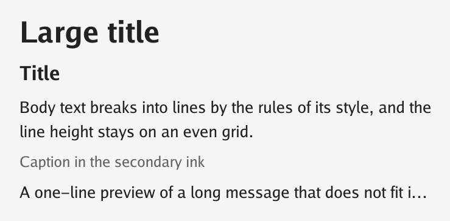
</picture>

```go
themed(func(th *theme.Theme) core.Widget {
	return basic.SizedBox{Width: 340, Child: basic.Column{Size: layout.MainMin, Cross: layout.CrossStart, Spacing: theme.Space6, Children: []core.Widget{
		basic.Text{Content: "Large title", Style: th.Text.LargeTitle},
		basic.Text{Content: "Title", Style: th.Text.Title},
		basic.Text{Content: "Body text breaks into lines by the rules of its style, and the line height stays on an even grid."},
		basic.Text{Content: "Caption in the secondary ink", Style: colored(th.Text.Caption, th.Color.Ink2)},
		// MaxLines cuts the text short with an ellipsis.
		basic.Text{Content: "A one-line preview of a long message that does not fit in the row", Style: th.Text.Body.WithMaxLines(1)},
	}}}
})
```

API: [`basic.Text`](https://pkg.go.dev/github.com/bankai-tensei/gowaku/widgets/basic#Text)

## basic.RichText

Mixes spans of different looks in one paragraph, with ruby and emphasis dots, and a `Background` behind a span, such as a match of a search. `Style.MaxLines` works as for `Text`.

Package: [`github.com/bankai-tensei/gowaku/widgets/basic`](https://pkg.go.dev/github.com/bankai-tensei/gowaku/widgets/basic)

<picture>
  <source media="(prefers-color-scheme: dark)" srcset="../img/basic-richtext-dark.png">
  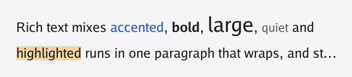
</picture>

```go
themed(func(th *theme.Theme) core.Widget {
	c := &th.Color
	return basic.SizedBox{Width: 320, Child: basic.RichText{Style: colored(th.Text.Body, c.Ink).WithMaxLines(2), Spans: []text.Span{
		{Text: "Rich text mixes "},
		{Text: "accented", Style: colored(th.Text.Body, c.AccentInk)},
		{Text: ", "},
		{Text: "bold", Style: colored(th.Text.Body, c.Ink).WithWeight(700)},
		{Text: ", "},
		{Text: "large", Style: text.Style{Size: 20, Color: c.Ink}},
		{Text: ", "},
		{Text: "quiet", Style: colored(th.Text.Caption, c.Ink2)},
		{Text: " and "},
		{Text: "highlighted", Background: c.Warning.WithAlpha(0.35)},
		{Text: " runs in one paragraph that wraps, and stops after two lines with an ellipsis."},
	}}}
})
```

API: [`basic.RichText`](https://pkg.go.dev/github.com/bankai-tensei/gowaku/widgets/basic#RichText)

## field.SelectionArea

Makes the `Text` and `RichText` below it selectable with the mouse and the keyboard, and copyable, across paragraphs; ruby copies as its base text.

Package: [`github.com/bankai-tensei/gowaku/widgets/field`](https://pkg.go.dev/github.com/bankai-tensei/gowaku/widgets/field)

<picture>
  <source media="(prefers-color-scheme: dark)" srcset="../img/field-selectionarea-dark.png">
  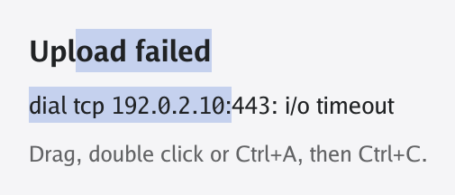
</picture>

```go
themed(func(th *theme.Theme) core.Widget {
	return basic.SizedBox{Width: 380, Child: field.SelectionArea{Child: basic.Column{
		Size: layout.MainMin, Cross: layout.CrossStart, Spacing: theme.Space8, Children: []core.Widget{
			basic.Text{Content: "Upload failed", Style: th.Text.Title},
			basic.Text{Content: "dial tcp 192.0.2.10:443: i/o timeout"},
			basic.Text{Content: "Drag, double click or Ctrl+A, then Ctrl+C.", Style: colored(th.Text.Caption, th.Color.Ink2)},
		},
	}}}
})
```

API: [`field.SelectionArea`](https://pkg.go.dev/github.com/bankai-tensei/gowaku/widgets/field#SelectionArea)

## basic.Icon

Draws a vector shape on a 24 unit grid. Without a `Label` it is decorative. Package `icons` holds 24 common shapes: folder, file, search, close, chevrons, gear, trash and more.

Package: [`github.com/bankai-tensei/gowaku/widgets/basic`](https://pkg.go.dev/github.com/bankai-tensei/gowaku/widgets/basic)

<picture>
  <source media="(prefers-color-scheme: dark)" srcset="../img/basic-icon-dark.png">
  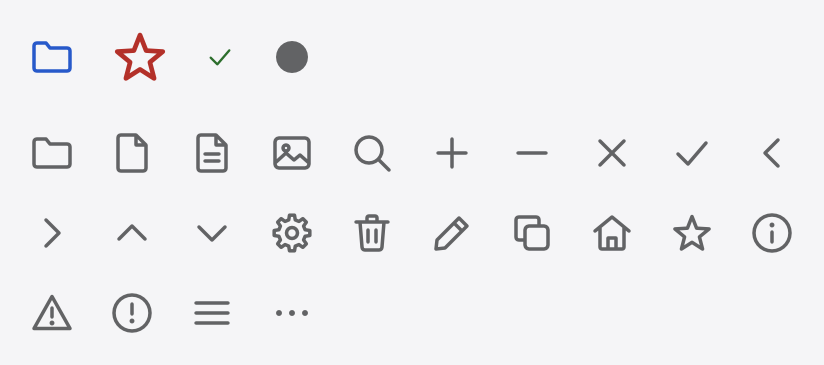
</picture>

```go
themed(func(th *theme.Theme) core.Widget {
	// The stock icons of package icons. Build them once and keep them, as
	// in InitState: each call makes a new path.
	set := []*paint.Path{
		icons.Folder(), icons.File(), icons.Document(), icons.Image(), icons.Search(), icons.Plus(),
		icons.Minus(), icons.Close(), icons.Check(), icons.ChevronLeft(), icons.ChevronRight(), icons.ChevronUp(),
		icons.ChevronDown(), icons.Settings(), icons.Trash(), icons.Edit(), icons.Copy(), icons.Home(),
		icons.Star(), icons.Info(), icons.Warning(), icons.Error(), icons.Menu(), icons.More(),
	}
	stock := make([]core.Widget, len(set))
	for i, p := range set {
		stock[i] = basic.Icon{Path: p, Color: th.Color.Ink2}
	}
	return basic.Column{Size: layout.MainMin, Cross: layout.CrossStart, Spacing: theme.Space20, Children: []core.Widget{
		basic.Row{Size: layout.MainMin, Spacing: theme.Space16, Cross: layout.CrossCenter, Children: []core.Widget{
			basic.Icon{Path: set[0], Color: th.Color.AccentInk, Label: "Folder"},
			basic.Icon{Path: set[18], Size: 32, Color: th.Color.Danger},
			basic.Icon{Path: set[8], Size: 16, Color: th.Color.Success},
			basic.Icon{Path: circleIcon(), Color: th.Color.Ink2}, // a path of your own
		}},
		basic.SizedBox{Width: 400, Child: basic.Wrap{Spacing: theme.Space16, RunSpacing: theme.Space16, Children: stock}},
	}}
})
```

API: [`basic.Icon`](https://pkg.go.dev/github.com/bankai-tensei/gowaku/widgets/basic#Icon)

## basic.Image

Shows a picture. `Fit` picks how it fills its box, `Radius` rounds it and `Quality` sets the filtering.

Package: [`github.com/bankai-tensei/gowaku/widgets/basic`](https://pkg.go.dev/github.com/bankai-tensei/gowaku/widgets/basic)

<picture>
  <source media="(prefers-color-scheme: dark)" srcset="../img/basic-image-dark.png">
  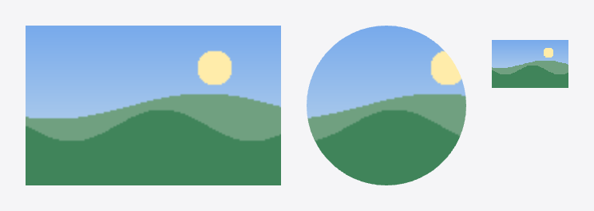
</picture>

```go
picture := photo() // paint.NewImage of an image.Image, made once and kept
return basic.Row{Size: layout.MainMin, Spacing: theme.Space16, Children: []core.Widget{
	basic.Image{Source: picture, Width: 160, Label: "Hills under a clear sky"},
	basic.Image{Source: picture, Width: 100, Height: 100, Fit: layout.FitCover, Radius: 50},
	basic.Image{Source: picture, Width: 48, Height: 48, Quality: paint.FilterNearest},
}}
```

API: [`basic.Image`](https://pkg.go.dev/github.com/bankai-tensei/gowaku/widgets/basic#Image)

## basic.SVG

Draws an SVG drawing fitted into a square. `Color` is the currentColor icon sets draw with.

Package: [`github.com/bankai-tensei/gowaku/widgets/basic`](https://pkg.go.dev/github.com/bankai-tensei/gowaku/widgets/basic)

<picture>
  <source media="(prefers-color-scheme: dark)" srcset="../img/basic-svg-dark.png">
  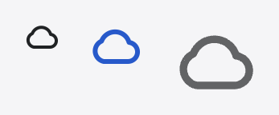
</picture>

```go
	cloud, err := paint.ParseSVG([]byte(`<svg viewBox="0 0 24 24" fill="none" stroke="currentColor" stroke-width="2" stroke-linecap="round" stroke-linejoin="round">
<path d="M7 18h10a4 4 0 0 0 .5-7.97A6 6 0 0 0 6.1 9.5 4.5 4.5 0 0 0 7 18z"/></svg>`))
	if err != nil {
		panic(err)
	}
	return themed(func(th *theme.Theme) core.Widget {
		return basic.Row{Size: layout.MainMin, Spacing: theme.Space16, Children: []core.Widget{
			basic.SVG{Data: cloud, Label: "Cloud"},
			basic.SVG{Data: cloud, Size: 36, Color: th.Color.AccentInk},
			basic.SVG{Data: cloud, Size: 56, Color: th.Color.Ink2},
		}}
	})
```

API: [`basic.SVG`](https://pkg.go.dev/github.com/bankai-tensei/gowaku/widgets/basic#SVG)

## basic.AnimatedImage

Plays an animated GIF, APNG or WebP. When the OS asks for less motion it shows the first frame.

Package: [`github.com/bankai-tensei/gowaku/widgets/basic`](https://pkg.go.dev/github.com/bankai-tensei/gowaku/widgets/basic)

<picture>
  <source media="(prefers-color-scheme: dark)" srcset="../img/basic-animatedimage-dark.png">
  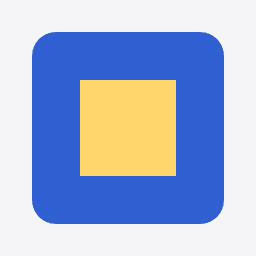
</picture>

```go
movie, err := paint.DecodeAnimation(bytes.NewReader(blinkGIF()))
if err != nil {
	panic(err)
}
return basic.AnimatedImage{Source: movie, Width: 96, Height: 96, Radius: 12, Quality: paint.FilterNearest, Label: "Blinking light"}
```

API: [`basic.AnimatedImage`](https://pkg.go.dev/github.com/bankai-tensei/gowaku/widgets/basic#AnimatedImage)

## control.Badge

A small mark for a count, a word or a dot. With a child it sits on the child's top right corner.

Package: [`github.com/bankai-tensei/gowaku/widgets/control`](https://pkg.go.dev/github.com/bankai-tensei/gowaku/widgets/control)

<picture>
  <source media="(prefers-color-scheme: dark)" srcset="../img/control-badge-dark.png">
  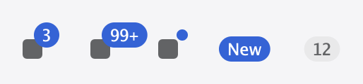
</picture>

```go
themed(func(th *theme.Theme) core.Widget {
	inbox := basic.Icon{Path: squareIcon(), Color: th.Color.Ink2}
	return basic.Row{Size: layout.MainMin, Spacing: theme.Space24, Cross: layout.CrossCenter, Children: []core.Widget{
		control.Badge{Count: 3, Child: inbox},
		control.Badge{Count: 120, Child: inbox},
		control.Badge{Dot: true, Child: inbox},
		control.Badge{Label: "New"},
		control.Badge{Count: 12, Quiet: true},
	}}
})
```

API: [`control.Badge`](https://pkg.go.dev/github.com/bankai-tensei/gowaku/widgets/control#Badge)

## control.Card

A surface that holds one piece of content. With `OnPress` the whole card is a button.

Package: [`github.com/bankai-tensei/gowaku/widgets/control`](https://pkg.go.dev/github.com/bankai-tensei/gowaku/widgets/control)

<picture>
  <source media="(prefers-color-scheme: dark)" srcset="../img/control-card-dark.png">
  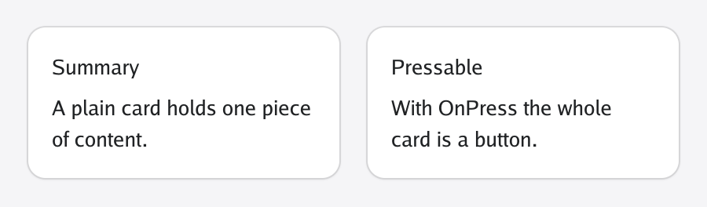
</picture>

```go
basic.Row{Size: layout.MainMin, Spacing: theme.Space16, Cross: layout.CrossStart, Children: []core.Widget{
	basic.SizedBox{Width: 200, Child: control.Card{Label: "Summary", Child: basic.Column{
		Size: layout.MainMin, Cross: layout.CrossStart, Spacing: theme.Space6, Children: []core.Widget{
			basic.Text{Content: "Summary"},
			basic.Text{Content: "A plain card holds one piece of content."},
		},
	}}},
	basic.SizedBox{Width: 200, Child: control.Card{Label: "Open note", OnPress: func() {}, Child: basic.Column{
		Size: layout.MainMin, Cross: layout.CrossStart, Spacing: theme.Space6, Children: []core.Widget{
			basic.Text{Content: "Pressable"},
			basic.Text{Content: "With OnPress the whole card is a button."},
		},
	}}},
}}
```

API: [`control.Card`](https://pkg.go.dev/github.com/bankai-tensei/gowaku/widgets/control#Card)

## control.Disclosure

A header that opens and closes the content below it. Closed content is not laid out, and Tab and assistive technology pass it by. With `OnChange` the parent keeps the state, which makes several in a row an accordion.

Package: [`github.com/bankai-tensei/gowaku/widgets/control`](https://pkg.go.dev/github.com/bankai-tensei/gowaku/widgets/control)

<picture>
  <source media="(prefers-color-scheme: dark)" srcset="../img/control-disclosure-dark.png">
  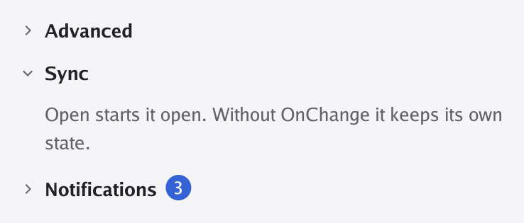
</picture>

```go
control.Disclosure{Title: "Advanced", Child: basic.Text{Content: "Closed, the content is not laid out.", Style: note}},
control.Disclosure{Title: "Sync", Open: true, Child: basic.Text{
	Content: "Open starts it open. Without OnChange it keeps its own state.", Style: note,
}},
control.Disclosure{Title: "Notifications", Header: basic.Row{Size: layout.MainMin, Spacing: theme.Space6, Children: []core.Widget{
	basic.Text{Content: "Notifications", Style: th.Text.Headline}, control.Badge{Count: 3},
}}, Child: basic.Text{Content: "A header can hold a badge.", Style: note}},
```

API: [`control.Disclosure`](https://pkg.go.dev/github.com/bankai-tensei/gowaku/widgets/control#Disclosure)

## interact.InteractiveViewer

Shows its child through a pan and a zoom: drag to move, Ctrl with the wheel or a pinch to zoom about the pointer. `WheelZooms` zooms with the plain wheel, as image viewers do. The arrow keys pan only while there is room to, and otherwise go on to the shortcuts of the app; `Keys` leaves them out, or keeps the viewer out of the focus. The child is laid out once, and the buttons in it keep working. `ViewerController` moves the view from outside.

Package: [`github.com/bankai-tensei/gowaku/widgets/interact`](https://pkg.go.dev/github.com/bankai-tensei/gowaku/widgets/interact)

<picture>
  <source media="(prefers-color-scheme: dark)" srcset="../img/interact-interactiveviewer-dark.png">
  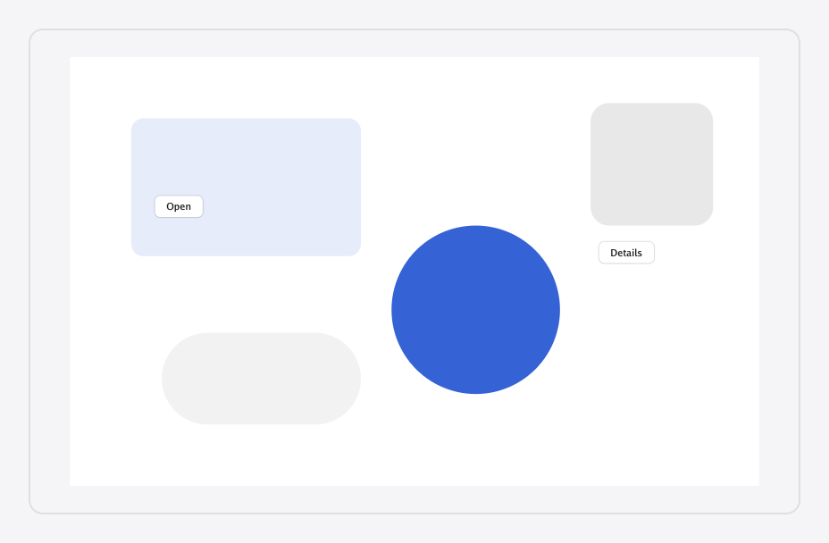
</picture>

```go
var view interact.ViewerController
view.Fit(false) // once the viewer knows its size
return basic.SizedBox{Width: 440, Height: 280, Child: basic.Container{
	Radius: th.Radius.Control, Border: paint.Stroke{Width: 1, Color: th.Color.Hair},
	Child: interact.InteractiveViewer{
		Controller: &view, MinScale: 0.2, MaxScale: 6, BoundaryMargin: 16,
		DoubleTapZoom: true, Label: "Drawing", Child: drawing,
	},
}}
```

API: [`interact.InteractiveViewer`](https://pkg.go.dev/github.com/bankai-tensei/gowaku/widgets/interact#InteractiveViewer) · [`interact.ViewerController`](https://pkg.go.dev/github.com/bankai-tensei/gowaku/widgets/interact#ViewerController) · [`interact.ViewerBoundary`](https://pkg.go.dev/github.com/bankai-tensei/gowaku/widgets/interact#ViewerBoundary) · [`interact.ViewerKeys`](https://pkg.go.dev/github.com/bankai-tensei/gowaku/widgets/interact#ViewerKeys)

## basic.Divider

A hairline between groups of content. `Indent` keeps it short of the edge, and `Axis` stands it up.

Package: [`github.com/bankai-tensei/gowaku/widgets/basic`](https://pkg.go.dev/github.com/bankai-tensei/gowaku/widgets/basic)

<picture>
  <source media="(prefers-color-scheme: dark)" srcset="../img/basic-divider-dark.png">
  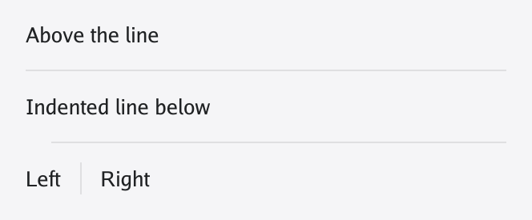
</picture>

```go
basic.SizedBox{Width: 300, Child: basic.Column{Size: layout.MainMin, Cross: layout.CrossStretch, Spacing: theme.Space12, Children: []core.Widget{
	basic.Text{Content: "Above the line"},
	basic.Divider{},
	basic.Text{Content: "Indented line below"},
	basic.Divider{Indent: theme.Space16},
	basic.Row{Size: layout.MainMin, Spacing: theme.Space12, Children: []core.Widget{
		basic.Text{Content: "Left"},
		basic.SizedBox{Height: 20, Child: basic.Divider{Axis: layout.Vertical}},
		basic.Text{Content: "Right"},
	}},
}}}
```

API: [`basic.Divider`](https://pkg.go.dev/github.com/bankai-tensei/gowaku/widgets/basic#Divider)

## control.Sparkline

A line or bar chart the size of a table cell, without axes or legend. NaN leaves a gap, and bars rise and fall from zero. Painting does not allocate.

Package: [`github.com/bankai-tensei/gowaku/widgets/control`](https://pkg.go.dev/github.com/bankai-tensei/gowaku/widgets/control)

<picture>
  <source media="(prefers-color-scheme: dark)" srcset="../img/control-sparkline-dark.png">
  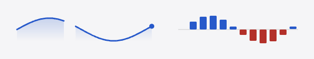
</picture>

```go
basic.Row{Size: layout.MainMin, Cross: layout.CrossCenter, Spacing: theme.Space24, Children: []core.Widget{
	basic.SizedBox{Width: 140, Height: 28, Child: control.Sparkline{
		Data: trend, Fill: true, MarkLast: true, Label: "Temperature, now 21.4 degrees",
	}},
	basic.SizedBox{Width: 120, Height: 28, Child: control.Sparkline{Kind: control.SparklineBars, Data: change}},
}}
```

API: [`control.Sparkline`](https://pkg.go.dev/github.com/bankai-tensei/gowaku/widgets/control#Sparkline) · [`control.SparklineKind`](https://pkg.go.dev/github.com/bankai-tensei/gowaku/widgets/control#SparklineKind)
