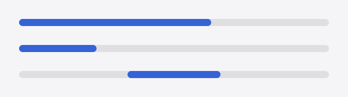
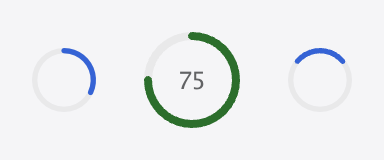
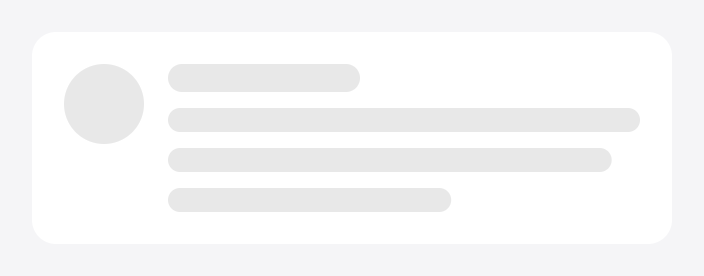
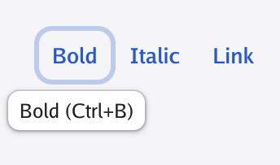
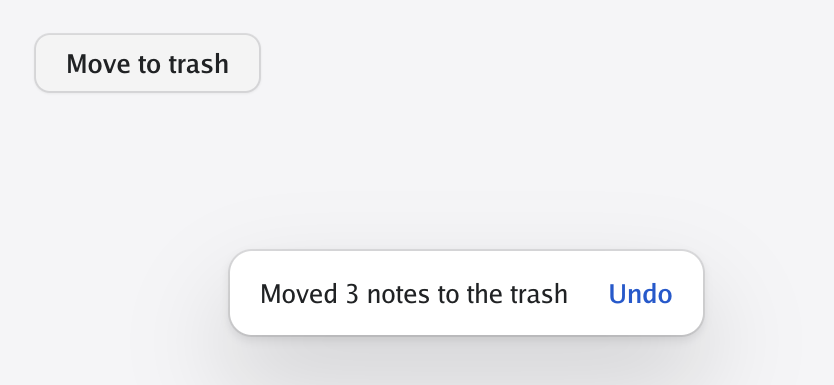
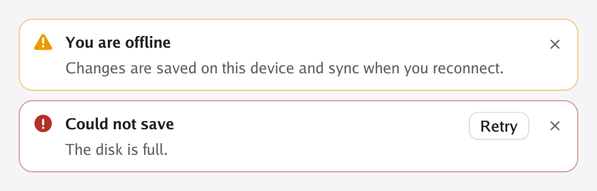
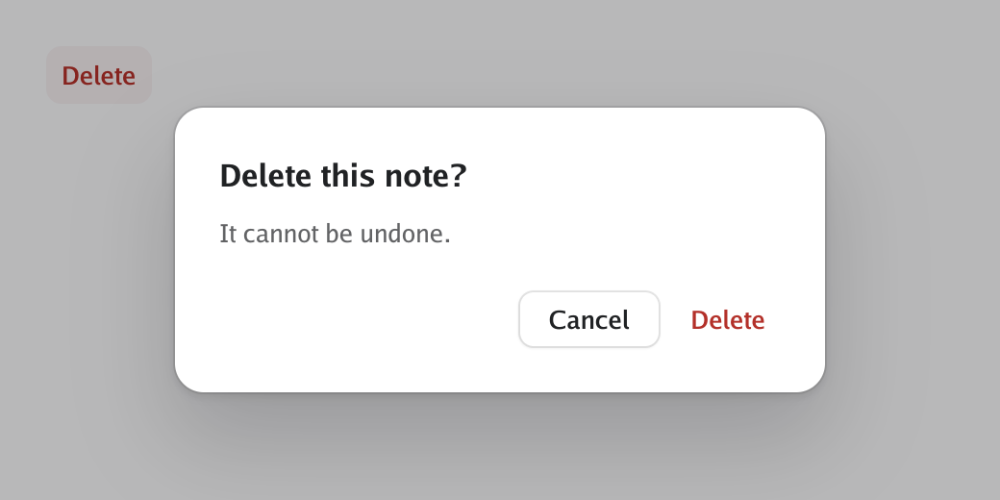
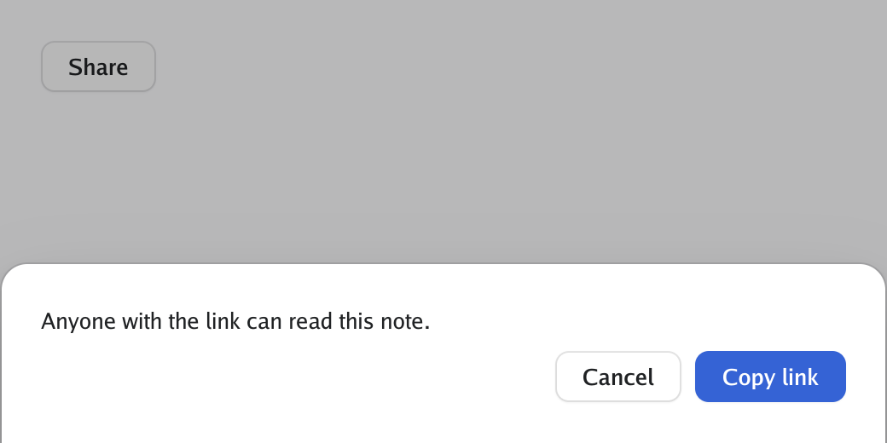

<!-- Code generated by internal/cmd/catalog; DO NOT EDIT. -->

# Feedback and overlays

[Catalog contents](README.md) · [日本語](../ja/feedback.md) · [Searchable site](https://bankai-tensei.github.io/gowaku/catalog/feedback/)

Widgets that report progress and results, and the ones that float above the page, shown with the `overlay.Show...` functions.

> The lower-case functions in the examples (`themed`, `colored`, `tile`, and shapes such as `squareIcon`) are small helpers in [internal/catalog/helpers.go](../../../internal/catalog/helpers.go); `themed` is a `basic.Builder` that reads `basic.ThemeOf(ctx)`. `core.Widget` and `core.BuildContext` in the examples are the same types as `gowaku.Widget` and `gowaku.BuildContext`.

[control.ProgressBar](#controlprogressbar) · [control.ProgressRing](#controlprogressring) · [control.Skeleton](#controlskeleton) · [overlay.Tooltip](#overlaytooltip) · [overlay.Toast](#overlaytoast) · [control.InfoBar](#controlinfobar) · [overlay.Dialog](#overlaydialog) · [overlay.Sheet](#overlaysheet)

## control.ProgressBar

Shows how much is done as a bar that fills from the left. A new value slides into place. With `Indeterminate` it shows work of unknown length as a band that crosses the bar again and again, and a screen reader hears a busy indicator with no value. The band moves only while it is seen, and stands in the middle when the window asks for less motion.

Package: [`github.com/bankai-tensei/gowaku/widgets/control`](https://pkg.go.dev/github.com/bankai-tensei/gowaku/widgets/control)

<picture>
  <source media="(prefers-color-scheme: dark)" srcset="../img/control-progressbar-dark.png">
  
</picture>

```go
basic.SizedBox{Width: 260, Child: basic.Column{Size: layout.MainMin, Cross: layout.CrossStretch, Spacing: theme.Space16, Children: []core.Widget{
	control.ProgressBar{Value: 0.62, Label: "Library sync"},
	control.ProgressBar{Value: 0.25, Label: "Upload"},
	control.ProgressBar{Indeterminate: true, Label: "Connecting"},
}}}
```

API: [`control.ProgressBar`](https://pkg.go.dev/github.com/bankai-tensei/gowaku/widgets/control#ProgressBar)

## control.ProgressRing

Shows how much is done as a ring that fills clockwise from twelve, with a child in its middle. With `Indeterminate` it is a spinner for work of unknown length: an arc turns around the ring. A screen reader hears a busy indicator with no value, named Loading in the language of the window when it has no label. The arc turns only while it is seen, and stands at twelve when the window asks for less motion.

Package: [`github.com/bankai-tensei/gowaku/widgets/control`](https://pkg.go.dev/github.com/bankai-tensei/gowaku/widgets/control)

<picture>
  <source media="(prefers-color-scheme: dark)" srcset="../img/control-progressring-dark.png">
  
</picture>

```go
themed(func(th *theme.Theme) core.Widget {
	return basic.Row{Size: layout.MainMin, Spacing: theme.Space24, Cross: layout.CrossCenter, Children: []core.Widget{
		control.ProgressRing{Value: 0.32, Label: "Album art"},
		control.ProgressRing{Value: 0.75, Size: 48, Color: th.Color.Success, Label: "Lyrics", Child: basic.Text{
			Content: "75", Style: colored(th.Text.Caption, th.Color.Ink2),
		}},
		control.ProgressRing{Indeterminate: true, Label: "Syncing"},
	}}
})
```

API: [`control.ProgressRing`](https://pkg.go.dev/github.com/bankai-tensei/gowaku/widgets/control#ProgressRing)

## control.Skeleton

Stands in for content that is still loading. One band of light crosses the window, only while a skeleton is seen, and stops when the OS asks for less motion. `SkeletonGroup` tells assistive technology that it is loading.

Package: [`github.com/bankai-tensei/gowaku/widgets/control`](https://pkg.go.dev/github.com/bankai-tensei/gowaku/widgets/control)

<picture>
  <source media="(prefers-color-scheme: dark)" srcset="../img/control-skeleton-dark.png">
  
</picture>

```go
themed(func(th *theme.Theme) core.Widget {
	return basic.Container{Width: 320, Color: th.Color.Card, Radius: th.Radius.Group, Padding: geom.All(theme.Space16), Child: control.SkeletonGroup{
		Label: "Loading messages",
		Child: basic.Row{Cross: layout.CrossStart, Spacing: theme.Space12, Children: []core.Widget{
			control.Skeleton{Shape: control.SkeletonCircle, Width: 40},
			basic.Expanded{Child: basic.Column{Size: layout.MainMin, Cross: layout.CrossStart, Spacing: theme.Space8, Children: []core.Widget{
				control.Skeleton{Width: 96, Height: 14},
				control.SkeletonText{Lines: 3},
			}}},
		}},
	}}
})
```

API: [`control.Skeleton`](https://pkg.go.dev/github.com/bankai-tensei/gowaku/widgets/control#Skeleton) · [`control.SkeletonShape`](https://pkg.go.dev/github.com/bankai-tensei/gowaku/widgets/control#SkeletonShape) · [`control.SkeletonText`](https://pkg.go.dev/github.com/bankai-tensei/gowaku/widgets/control#SkeletonText) · [`control.SkeletonGroup`](https://pkg.go.dev/github.com/bankai-tensei/gowaku/widgets/control#SkeletonGroup)

## overlay.Tooltip

A short label that shows when the pointer rests on its child or the keyboard moves to it. Assistive technology gets it as the description.

Package: [`github.com/bankai-tensei/gowaku/widgets/overlay`](https://pkg.go.dev/github.com/bankai-tensei/gowaku/widgets/overlay)

<picture>
  <source media="(prefers-color-scheme: dark)" srcset="../img/overlay-tooltip-dark.png">
  
</picture>

```go
tool := func(label, tip string) core.Widget {
	return overlay.Tooltip{Message: tip, Child: control.Button{Label: label, Style: control.ButtonQuiet, OnPress: func() {}}}
}
return basic.Row{Size: layout.MainMin, Spacing: theme.Space4, Children: []core.Widget{
	tool("Bold", "Bold (Ctrl+B)"),
	tool("Italic", "Italic (Ctrl+I)"),
	tool("Link", "Insert a link (Ctrl+K)"),
}}
```

API: [`overlay.Tooltip`](https://pkg.go.dev/github.com/bankai-tensei/gowaku/widgets/overlay#Tooltip)

## overlay.Toast

A short message at the bottom of the window for a few seconds, with an optional action such as Undo. Show it with `ShowToast`.

Package: [`github.com/bankai-tensei/gowaku/widgets/overlay`](https://pkg.go.dev/github.com/bankai-tensei/gowaku/widgets/overlay)

<picture>
  <source media="(prefers-color-scheme: dark)" srcset="../img/overlay-toast-dark.png">
  
</picture>

```go
basic.Builder{Content: func(ctx core.BuildContext) core.Widget {
	return control.Button{Label: "Move to trash", OnPress: func() {
		overlay.ShowToast(ctx, overlay.Toast{Message: "Moved 3 notes to the trash", Action: "Undo", OnAction: func() {}})
	}}
}}
```

API: [`overlay.Toast`](https://pkg.go.dev/github.com/bankai-tensei/gowaku/widgets/overlay#Toast)

## control.InfoBar

A notice that stays in the page: info, success, warning or error, with a close button and one action. The parent shows it with `Open`.

Package: [`github.com/bankai-tensei/gowaku/widgets/control`](https://pkg.go.dev/github.com/bankai-tensei/gowaku/widgets/control)

<picture>
  <source media="(prefers-color-scheme: dark)" srcset="../img/control-infobar-dark.png">
  
</picture>

```go
control.InfoBar{
	Open: true, Severity: control.SeverityWarning,
	Title: "You are offline", Message: "Changes are saved on this device and sync when you reconnect.",
	OnClose: closed,
},
control.InfoBar{
	Open: true, Severity: control.SeverityError,
	Title: "Could not save", Message: "The disk is full.",
	Action: "Retry", OnAction: func() {}, OnClose: closed,
},
```

API: [`control.InfoBar`](https://pkg.go.dev/github.com/bankai-tensei/gowaku/widgets/control#InfoBar) · [`control.InfoSeverity`](https://pkg.go.dev/github.com/bankai-tensei/gowaku/widgets/control#InfoSeverity)

## overlay.Dialog

A card that stops the work for an answer. Show it with `ShowDialog`; the focus stays inside. `Glass` blurs what is behind.

Package: [`github.com/bankai-tensei/gowaku/widgets/overlay`](https://pkg.go.dev/github.com/bankai-tensei/gowaku/widgets/overlay)

<picture>
  <source media="(prefers-color-scheme: dark)" srcset="../img/overlay-dialog-dark.png">
  
</picture>

```go
basic.Builder{Content: func(ctx core.BuildContext) core.Widget {
	return control.Button{Label: "Delete", Style: control.ButtonDanger, OnPress: func() {
		overlay.ShowDialog(ctx, func(dismiss func()) core.Widget {
			return overlay.Dialog{
				Title:   "Delete this note?",
				Message: "It cannot be undone.",
				Actions: []core.Widget{
					control.Button{Label: "Cancel", OnPress: dismiss},
					control.Button{Label: "Delete", Style: control.ButtonDanger, OnPress: dismiss},
				},
			}
		})
	}}
}}
```

API: [`overlay.Dialog`](https://pkg.go.dev/github.com/bankai-tensei/gowaku/widgets/overlay#Dialog)

## overlay.Sheet

A panel that slides in from the bottom or the side of the window. Show it with `ShowSheet`.

Package: [`github.com/bankai-tensei/gowaku/widgets/overlay`](https://pkg.go.dev/github.com/bankai-tensei/gowaku/widgets/overlay)

<picture>
  <source media="(prefers-color-scheme: dark)" srcset="../img/overlay-sheet-dark.png">
  
</picture>

```go
basic.Builder{Content: func(ctx core.BuildContext) core.Widget {
	return control.Button{Label: "Share", OnPress: func() {
		overlay.ShowSheet(ctx, overlay.Sheet{Label: "Share note"}, func(dismiss func()) core.Widget {
			return basic.Column{Size: layout.MainMin, Spacing: theme.Space8, Children: []core.Widget{
				basic.Text{Content: "Anyone with the link can read this note."},
				basic.Row{Main: layout.MainEnd, Spacing: theme.Space8, Children: []core.Widget{
					control.Button{Label: "Cancel", OnPress: dismiss},
					control.Button{Label: "Copy link", Style: control.ButtonPrimary, OnPress: dismiss},
				}},
			}}
		})
	}}
}}
```

API: [`overlay.Sheet`](https://pkg.go.dev/github.com/bankai-tensei/gowaku/widgets/overlay#Sheet) · [`overlay.SheetEdge`](https://pkg.go.dev/github.com/bankai-tensei/gowaku/widgets/overlay#SheetEdge)
