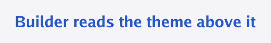
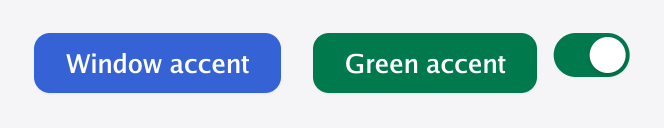
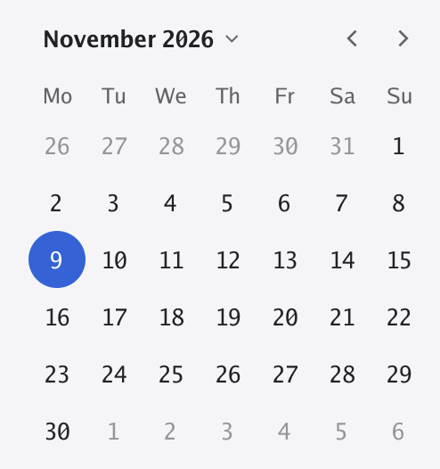

<!-- Code generated by internal/cmd/catalog; DO NOT EDIT. -->

# Tree services

[Catalog contents](README.md) · [日本語](../ja/infrastructure.md) · [Searchable site](https://bankai-tensei.github.io/gowaku/catalog/infrastructure/)

Widgets that hand the theme, the window, the words and a place for overlays to the widgets below. `gowaku.Run` puts each at the root of a window; use them to change a part.

> The lower-case functions in the examples (`themed`, `colored`, `tile`, and shapes such as `squareIcon`) are small helpers in [internal/catalog/helpers.go](../../../internal/catalog/helpers.go); `themed` is a `basic.Builder` that reads `basic.ThemeOf(ctx)`. `core.Widget` and `core.BuildContext` in the examples are the same types as `gowaku.Widget` and `gowaku.BuildContext`.

[basic.Builder](#basicbuilder) · [basic.Theme](#basictheme) · [basic.MediaQuery](#basicmediaquery) · [basic.Localizations](#basiclocalizations) · [overlay.Overlay](#overlayoverlay)

## basic.Builder

Builds its content with the `BuildContext` of its place, to read what is above, such as the theme.

Package: [`github.com/bankai-tensei/gowaku/widgets/basic`](https://pkg.go.dev/github.com/bankai-tensei/gowaku/widgets/basic)

<picture>
  <source media="(prefers-color-scheme: dark)" srcset="../img/basic-builder-dark.png">
  
</picture>

```go
basic.Builder{Content: func(ctx core.BuildContext) core.Widget {
	th := basic.ThemeOf(ctx)
	return basic.Text{Content: "Builder reads the theme above it", Style: colored(th.Text.Title, th.Color.AccentInk)}
}}
```

API: [`basic.Builder`](https://pkg.go.dev/github.com/bankai-tensei/gowaku/widgets/basic#Builder)

## basic.Theme

Gives the widgets below it their look, for a part of the window with another accent.

Package: [`github.com/bankai-tensei/gowaku/widgets/basic`](https://pkg.go.dev/github.com/bankai-tensei/gowaku/widgets/basic)

<picture>
  <source media="(prefers-color-scheme: dark)" srcset="../img/basic-theme-dark.png">
  
</picture>

```go
basic.Builder{Content: func(ctx core.BuildContext) core.Widget {
	green := theme.FromAccent(geom.Hex(0x1f8a5b)).For(basic.MediaQueryOf(ctx).Brightness)
	return basic.Row{Size: layout.MainMin, Spacing: theme.Space16, Children: []core.Widget{
		control.Button{Label: "Window accent", Style: control.ButtonPrimary, OnPress: func() {}},
		basic.Theme{Data: green, Child: basic.Row{Size: layout.MainMin, Spacing: theme.Space8, Children: []core.Widget{
			control.Button{Label: "Green accent", Style: control.ButtonPrimary, OnPress: func() {}},
			control.Switch{Value: true, Label: "Green", OnChange: func(bool) {}},
		}}},
	}}
}}
```

API: [`basic.Theme`](https://pkg.go.dev/github.com/bankai-tensei/gowaku/widgets/basic#Theme)

## basic.MediaQuery

Tells the widgets below about the window: brightness, scale, reduced motion, locale and the size of its content area. A widget that reads the size with `basic.WindowSizeOf` is rebuilt when the window is resized, and only it. Here the British locale starts the week on Monday.

Package: [`github.com/bankai-tensei/gowaku/widgets/basic`](https://pkg.go.dev/github.com/bankai-tensei/gowaku/widgets/basic)

<picture>
  <source media="(prefers-color-scheme: dark)" srcset="../img/basic-mediaquery-dark.png">
  
</picture>

```go
basic.Builder{Content: func(ctx core.BuildContext) core.Widget {
	data := basic.MediaQueryOf(ctx)
	data.Locale = language.BritishEnglish // weeks start on Monday
	return basic.MediaQuery{Data: data, Child: field.Calendar{
		Value: time.Date(2026, time.November, 9, 0, 0, 0, 0, time.UTC), OnChange: func(time.Time) {},
	}}
}}
```

API: [`basic.MediaQuery`](https://pkg.go.dev/github.com/bankai-tensei/gowaku/widgets/basic#MediaQuery) · [`basic.MediaQueryData`](https://pkg.go.dev/github.com/bankai-tensei/gowaku/widgets/basic#MediaQueryData)

## basic.Localizations

Hands the standard widgets the words of their locale. Japanese and English are bundled; add `Strings` for others.

Package: [`github.com/bankai-tensei/gowaku/widgets/basic`](https://pkg.go.dev/github.com/bankai-tensei/gowaku/widgets/basic)

*It draws nothing of its own, so it has no picture.*

```go
german := &basic.Strings{Language: language.German, Today: "Heute", Clear: "Löschen"}
return basic.Localizations{Strings: []*basic.Strings{german}, Child: field.DatePicker{
	ShowToday: true, ShowClear: true, OnChange: func(time.Time) {},
}}
```

API: [`basic.Localizations`](https://pkg.go.dev/github.com/bankai-tensei/gowaku/widgets/basic#Localizations) · [`basic.Strings`](https://pkg.go.dev/github.com/bankai-tensei/gowaku/widgets/basic#Strings)

## overlay.Overlay

A place to show entries on top of its child. Dialogs and menus show there too.

Package: [`github.com/bankai-tensei/gowaku/widgets/overlay`](https://pkg.go.dev/github.com/bankai-tensei/gowaku/widgets/overlay)

*It draws nothing of its own, so it has no picture.*

```go
basic.Builder{Content: func(ctx core.BuildContext) core.Widget {
	return control.Button{Label: "Show a hint", OnPress: func() {
		var entry *overlay.Entry
		entry = overlay.Of(ctx).Insert(func() core.Widget {
			return basic.Positioned{Left: 16, Top: 16, Child: control.Button{Label: "Close the hint", OnPress: func() { entry.Remove() }}}
		})
	}}
}}
```

API: [`overlay.Overlay`](https://pkg.go.dev/github.com/bankai-tensei/gowaku/widgets/overlay#Overlay) · [`overlay.Entry`](https://pkg.go.dev/github.com/bankai-tensei/gowaku/widgets/overlay#Entry) · [`overlay.Host`](https://pkg.go.dev/github.com/bankai-tensei/gowaku/widgets/overlay#Host)
