<!-- Code generated by internal/cmd/catalog; DO NOT EDIT. -->

# Input

[Catalog contents](README.md) · [日本語](../ja/input.md) · [Searchable site](https://bankai-tensei.github.io/gowaku/catalog/input/)

Controls that take text and numbers. Labels sit above the field or at the left of a `collection.GroupRow`.

> The lower-case functions in the examples (`themed`, `colored`, `tile`, and shapes such as `squareIcon`) are small helpers in [internal/catalog/helpers.go](../../../internal/catalog/helpers.go); `themed` is a `basic.Builder` that reads `basic.ThemeOf(ctx)`. `core.Widget` and `core.BuildContext` in the examples are the same types as `gowaku.Widget` and `gowaku.BuildContext`.

[field.Input](#fieldinput) · [field.Search](#fieldsearch) · [field.Autocomplete](#fieldautocomplete) · [editor.Editor](#editoreditor) · [control.NumberStepper](#controlnumberstepper) · [control.Slider](#controlslider) · [control.RangeSlider](#controlrangeslider) · [field.NumberField](#fieldnumberfield) · [field.TokenField](#fieldtokenfield) · [field.Form](#fieldform) · [field.TimePicker](#fieldtimepicker)

## field.Input

A single or multiline text field with its label above. It handles IMEs, ruby, vertical text and undo. A multiline field grows with its text where nothing sets its height, and fills the height that an `Expanded` or the like gives it, with or without a label. With `SubmitOnEnter`, a multiline field sends on Enter and breaks the line on Shift+Enter, as the box of a chat does. `Autofocus` gives it the keyboard when it first appears, also in a dialog. For long documents, use `editor.Editor`.

Package: [`github.com/bankai-tensei/gowaku/widgets/field`](https://pkg.go.dev/github.com/bankai-tensei/gowaku/widgets/field)

<picture>
  <source media="(prefers-color-scheme: dark)" srcset="../img/field-input-dark.png">
  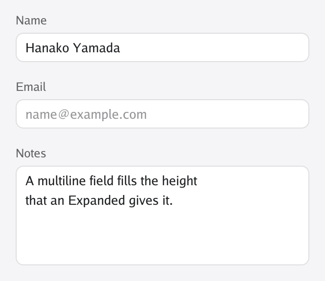
</picture>

```go
set := func(string) {}
return basic.SizedBox{Width: 300, Height: 260, Child: basic.Column{Cross: layout.CrossStretch, Spacing: theme.Space16, Children: []core.Widget{
	field.Input{Label: "Name", Value: "Hanako Yamada", OnChange: set},
	field.Input{Label: "Email", Placeholder: "name@example.com", OnChange: set},
	basic.Expanded{Child: field.Input{
		Label: "Notes", Multiline: true, Value: "A multiline field fills the height\nthat an Expanded gives it.", OnChange: set,
	}},
}}}
```

API: [`field.Input`](https://pkg.go.dev/github.com/bankai-tensei/gowaku/widgets/field#Input) · [`field.InputController`](https://pkg.go.dev/github.com/bankai-tensei/gowaku/widgets/field#InputController)

## field.Search

A text field for searching, with a magnifier and a clear button. Escape empties it.

Package: [`github.com/bankai-tensei/gowaku/widgets/field`](https://pkg.go.dev/github.com/bankai-tensei/gowaku/widgets/field)

<picture>
  <source media="(prefers-color-scheme: dark)" srcset="../img/field-search-dark.png">
  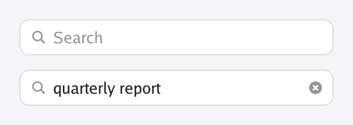
</picture>

```go
basic.SizedBox{Width: 260, Child: basic.Column{Size: layout.MainMin, Cross: layout.CrossStretch, Spacing: theme.Space12, Children: []core.Widget{
	field.Search{OnChange: func(string) {}},
	field.Search{Value: "quarterly report", OnChange: func(string) {}},
}}}
```

API: [`field.Search`](https://pkg.go.dev/github.com/bankai-tensei/gowaku/widgets/field#Search)

## field.Autocomplete

A text field that suggests choices below itself as you type. The arrows move through them; Enter or Tab takes one.

Package: [`github.com/bankai-tensei/gowaku/widgets/field`](https://pkg.go.dev/github.com/bankai-tensei/gowaku/widgets/field)

<picture>
  <source media="(prefers-color-scheme: dark)" srcset="../img/field-autocomplete-dark.png">
  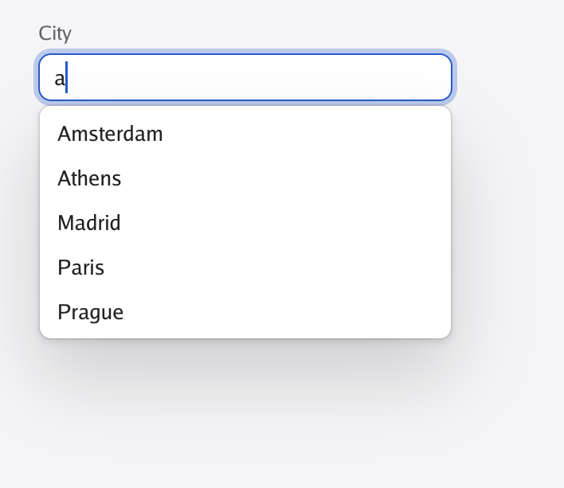
</picture>

```go
cities := []string{"Amsterdam", "Athens", "Berlin", "Lisbon", "Madrid", "Paris", "Prague", "Rome"}
return basic.SizedBox{Width: 260, Child: field.Autocomplete[string]{
	Label: "City", Placeholder: "Type a city", Options: cities, OnSelect: func(string) {},
}}
```

API: [`field.Autocomplete`](https://pkg.go.dev/github.com/bankai-tensei/gowaku/widgets/field#Autocomplete)

## editor.Editor

An editor for code and long text, with line numbers, decorations and find and replace. It lays out only the lines in view. While the find bar is open, the text keeps the room of the bar above its first line, and a match shows below the bar. Lines given through `Controller.SetSource`, as of a file, are read only where they are in view, and only the lines edited are held in memory, so that a file of gigabytes opens at once.

Package: [`github.com/bankai-tensei/gowaku/widgets/editor`](https://pkg.go.dev/github.com/bankai-tensei/gowaku/widgets/editor)

<picture>
  <source media="(prefers-color-scheme: dark)" srcset="../img/editor-editor-dark.png">
  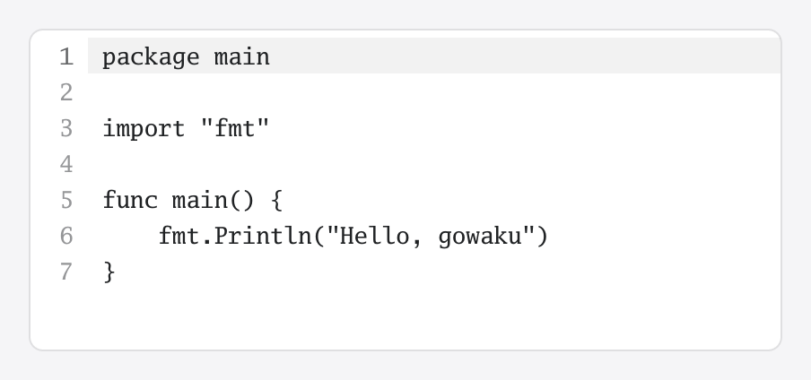
</picture>

```go
var doc editor.Controller
doc.SetText("package main\n\nimport \"fmt\"\n\nfunc main() {\n\tfmt.Println(\"Hello, gowaku\")\n}")
return basic.SizedBox{Width: 420, Height: 180, Child: editor.Editor{
	Controller: &doc, Label: "Source", LineNumbers: true, Border: true, HighlightCurrentLine: true,
}}
```

API: [`editor.Editor`](https://pkg.go.dev/github.com/bankai-tensei/gowaku/widgets/editor#Editor) · [`editor.Controller`](https://pkg.go.dev/github.com/bankai-tensei/gowaku/widgets/editor#Controller) · [`editor.Decoration`](https://pkg.go.dev/github.com/bankai-tensei/gowaku/widgets/editor#Decoration) · [`editor.TextPosition`](https://pkg.go.dev/github.com/bankai-tensei/gowaku/widgets/editor#TextPosition) · [`editor.TextRange`](https://pkg.go.dev/github.com/bankai-tensei/gowaku/widgets/editor#TextRange) · [`editor.FindOptions`](https://pkg.go.dev/github.com/bankai-tensei/gowaku/widgets/editor#FindOptions)

## control.NumberStepper

Changes a whole number with minus and plus buttons. `Format` adds a unit. For the steps of a wizard, see `nav.Steps`.

Package: [`github.com/bankai-tensei/gowaku/widgets/control`](https://pkg.go.dev/github.com/bankai-tensei/gowaku/widgets/control)

<picture>
  <source media="(prefers-color-scheme: dark)" srcset="../img/control-numberstepper-dark.png">
  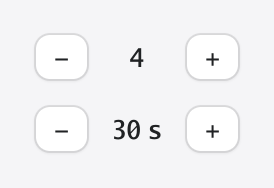
</picture>

```go
seconds := func(v int) string { return strconv.Itoa(v) + " s" }
return basic.Column{Size: layout.MainMin, Cross: layout.CrossStart, Spacing: theme.Space12, Children: []core.Widget{
	control.NumberStepper{Value: 4, Max: 12, Label: "Copies", OnChange: func(int) {}},
	control.NumberStepper{Value: 30, Max: 60, Step: 5, Format: seconds, Label: "Delay", OnChange: func(int) {}},
}}
```

API: [`control.NumberStepper`](https://pkg.go.dev/github.com/bankai-tensei/gowaku/widgets/control#NumberStepper)

## control.Slider

Picks a value in a range. `Snap` holds it to the grid of `Step`. The arrow keys move it too.

Package: [`github.com/bankai-tensei/gowaku/widgets/control`](https://pkg.go.dev/github.com/bankai-tensei/gowaku/widgets/control)

<picture>
  <source media="(prefers-color-scheme: dark)" srcset="../img/control-slider-dark.png">
  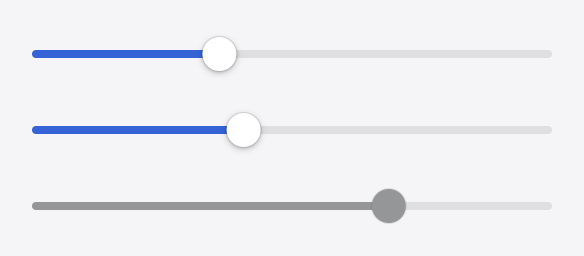
</picture>

```go
basic.SizedBox{Width: 260, Child: basic.Column{Size: layout.MainMin, Cross: layout.CrossStretch, Spacing: theme.Space16, Children: []core.Widget{
	control.Slider{Value: 0.35, Label: "Volume", OnChange: func(float32) {}},
	control.Slider{Value: 40, Min: 0, Max: 100, Step: 10, Snap: true, Label: "Zoom", OnChange: func(float32) {}},
	control.Slider{Value: 0.7, Label: "Disabled"},
}}}
```

API: [`control.Slider`](https://pkg.go.dev/github.com/bankai-tensei/gowaku/widgets/control#Slider)

## control.RangeSlider

A `Slider` with two thumbs that picks a range; dragging the band between them moves both. The thumbs stay `MinGap` apart, and each is a stop of Tab.

Package: [`github.com/bankai-tensei/gowaku/widgets/control`](https://pkg.go.dev/github.com/bankai-tensei/gowaku/widgets/control)

<picture>
  <source media="(prefers-color-scheme: dark)" srcset="../img/control-rangeslider-dark.png">
  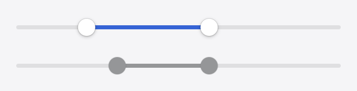
</picture>

```go
control.RangeSlider{
	Label: "Price", Low: 20000, High: 60000, Min: 0, Max: 100000,
	Step: 1000, Snap: true, MinGap: 5000, OnChange: set,
},
control.RangeSlider{Label: "Disabled", Low: 0.3, High: 0.6},
```

API: [`control.RangeSlider`](https://pkg.go.dev/github.com/bankai-tensei/gowaku/widgets/control#RangeSlider)

## field.NumberField

A field for a number, typed or stepped with the arrow keys, the wheel while it has the focus, or a drag of the handle at its end. It takes full-width digits, and the separators follow the locale. Enter takes the typed text as the value; inside a `FormItem` it then submits the `Form` around with the new value, and outside one it submits nothing.

Package: [`github.com/bankai-tensei/gowaku/widgets/field`](https://pkg.go.dev/github.com/bankai-tensei/gowaku/widgets/field)

<picture>
  <source media="(prefers-color-scheme: dark)" srcset="../img/field-numberfield-dark.png">
  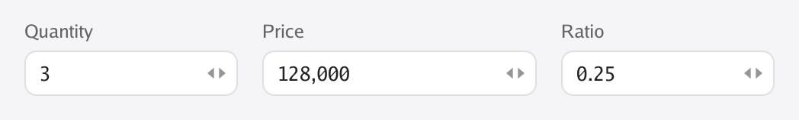
</picture>

```go
basic.SizedBox{Width: 140, Child: field.NumberField{Label: "Quantity", Value: 3, Min: 0, Max: 99, OnChange: set}},
basic.SizedBox{Width: 180, Child: field.NumberField{Label: "Price", Value: 128000, Step: 100, Grouping: true, OnChange: set}},
basic.SizedBox{Width: 140, Child: field.NumberField{Label: "Ratio", Value: 0.25, Min: 0, Max: 1, Step: 0.05, OnChange: set}},
```

API: [`field.NumberField`](https://pkg.go.dev/github.com/bankai-tensei/gowaku/widgets/field#NumberField)

## field.TokenField

Edits a list of short texts such as tags or addresses, each shown as a chip. Enter or a separator makes a token, but not while an IME converts. Two Backspaces at the start remove the last token.

Package: [`github.com/bankai-tensei/gowaku/widgets/field`](https://pkg.go.dev/github.com/bankai-tensei/gowaku/widgets/field)

<picture>
  <source media="(prefers-color-scheme: dark)" srcset="../img/field-tokenfield-dark.png">
  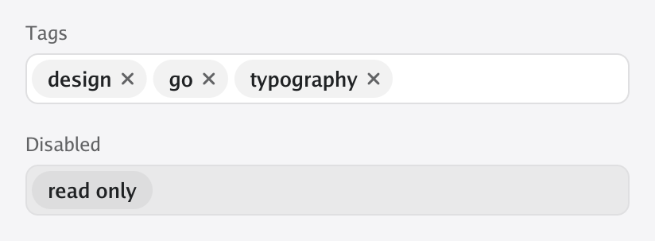
</picture>

```go
field.TokenField{Label: "Tags", Tokens: []string{"design", "go", "typography"}, Placeholder: "Add a tag", OnChange: set},
field.TokenField{Label: "Disabled", Tokens: []string{"read only"}},
```

API: [`field.TokenField`](https://pkg.go.dev/github.com/bankai-tensei/gowaku/widgets/field#TokenField)

## field.Form

Checks and submits the `FormItem`s below it together. Errors show below the fields, whose borders turn red, on submit and when a field loses the focus. The error of `Required` follows the control inside: Required for a text field, Choose one for a choice such as a `DropdownMenu` or a `DatePicker`, Check this box for a `Checkbox`; `RequiredMessage` replaces it. Enter in a single-line field of a `FormItem` submits the form.

Package: [`github.com/bankai-tensei/gowaku/widgets/field`](https://pkg.go.dev/github.com/bankai-tensei/gowaku/widgets/field)

<picture>
  <source media="(prefers-color-scheme: dark)" srcset="../img/field-form-dark.png">
  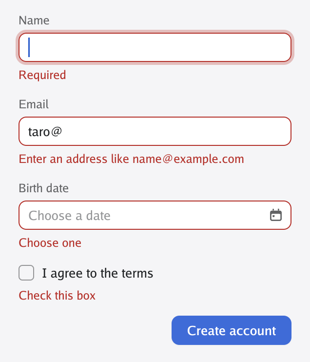
</picture>

```go
var form field.FormController
email := regexp.MustCompile(`[^@\s]+@[^@\s]+\.[^@\s]+`)
return basic.SizedBox{Width: 280, Child: field.Form{Controller: &form, Child: basic.Column{
	Size: layout.MainMin, Cross: layout.CrossStretch, Spacing: theme.Space12, Children: []core.Widget{
		field.FormItem[string]{Required: true, Child: field.Input{Label: "Name", OnChange: func(string) {}}},
		field.FormItem[string]{
			Value:      "taro@",
			Validators: []func(string) string{field.Pattern(email, "Enter an address like name@example.com")},
			Child:      field.Input{Label: "Email", Value: "taro@", OnChange: func(string) {}},
		},
		field.FormItem[time.Time]{Required: true, Child: field.DatePicker{
			Label: "Birth date", Placeholder: "Choose a date", OnChange: func(time.Time) {},
			InitialMonth: time.Date(1995, time.January, 1, 0, 0, 0, 0, time.UTC),
		}},
		field.FormItem[bool]{Required: true, Child: control.Checkbox{Label: "I agree to the terms", OnChange: func(bool) {}}},
		basic.Row{Main: layout.MainEnd, Children: []core.Widget{
			control.Button{Label: "Create account", Style: control.ButtonPrimary, OnPress: func() { form.Submit() }},
		}},
	},
}}}
```

API: [`field.Form`](https://pkg.go.dev/github.com/bankai-tensei/gowaku/widgets/field#Form) · [`field.FormItem`](https://pkg.go.dev/github.com/bankai-tensei/gowaku/widgets/field#FormItem) · [`field.FormController`](https://pkg.go.dev/github.com/bankai-tensei/gowaku/widgets/field#FormController)

## field.TimePicker

A field for a time of day, edited part by part with the arrows or digits. The locale picks the 12 or 24 hour clock.

Package: [`github.com/bankai-tensei/gowaku/widgets/field`](https://pkg.go.dev/github.com/bankai-tensei/gowaku/widgets/field)

<picture>
  <source media="(prefers-color-scheme: dark)" srcset="../img/field-timepicker-dark.png">
  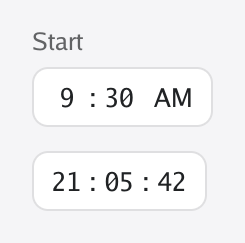
</picture>

```go
at := func(h, m int) time.Duration { return time.Duration(h)*time.Hour + time.Duration(m)*time.Minute }
return basic.Column{Size: layout.MainMin, Cross: layout.CrossStart, Spacing: theme.Space12, Children: []core.Widget{
	field.TimePicker{Label: "Start", Value: at(9, 30), MinuteStep: 15, OnChange: func(time.Duration) {}},
	field.TimePicker{Value: at(21, 5) + 42*time.Second, Seconds: true, HourCycle: field.HourCycle24, OnChange: func(time.Duration) {}},
}}
```

API: [`field.TimePicker`](https://pkg.go.dev/github.com/bankai-tensei/gowaku/widgets/field#TimePicker) · [`field.HourCycle`](https://pkg.go.dev/github.com/bankai-tensei/gowaku/widgets/field#HourCycle)
