<!-- Code generated by internal/cmd/catalog; DO NOT EDIT. -->

# Layout

[Catalog contents](README.md) · [日本語](../ja/layout.md) · [Searchable site](https://bankai-tensei.github.io/gowaku/catalog/layout/)

Widgets that place and size their children. Spacing uses the even steps of `theme.Space*`.

> The lower-case functions in the examples (`themed`, `colored`, `tile`, and shapes such as `squareIcon`) are small helpers in [internal/catalog/helpers.go](../../../internal/catalog/helpers.go); `themed` is a `basic.Builder` that reads `basic.ThemeOf(ctx)`. `core.Widget` and `core.BuildContext` in the examples are the same types as `gowaku.Widget` and `gowaku.BuildContext`.

[basic.Row](#basicrow) · [basic.Column](#basiccolumn) · [basic.Flex](#basicflex) · [basic.Expanded](#basicexpanded) · [basic.Flexible](#basicflexible) · [basic.Stack](#basicstack) · [basic.PositionedFill](#basicpositionedfill) · [basic.Wrap](#basicwrap) · [basic.Grid](#basicgrid) · [basic.Padding](#basicpadding) · [basic.Align](#basicalign) · [basic.Center](#basiccenter) · [basic.SizedBox](#basicsizedbox) · [basic.ConstrainedBox](#basicconstrainedbox) · [basic.Container](#basiccontainer) · [basic.DecoratedBox](#basicdecoratedbox) · [basic.Scroll](#basicscroll) · [basic.CustomLayout](#basiccustomlayout) · [basic.LayoutBuilder](#basiclayoutbuilder) · [basic.AspectRatio](#basicaspectratio)

## basic.Row

Lays out its children in a row. `Main` and `Cross` align them, and `Spacing` puts gaps between.

Package: [`github.com/bankai-tensei/gowaku/widgets/basic`](https://pkg.go.dev/github.com/bankai-tensei/gowaku/widgets/basic)

<picture>
  <source media="(prefers-color-scheme: dark)" srcset="../img/basic-row-dark.png">
  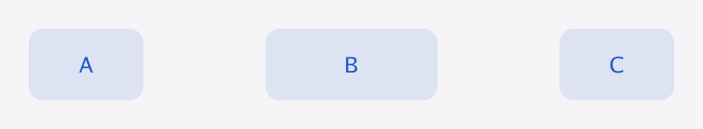
</picture>

```go
basic.SizedBox{Width: 360, Child: basic.Row{Spacing: theme.Space8, Main: layout.MainSpaceBetween, Children: []core.Widget{
	tile("A", 64, 40), tile("B", 96, 40), tile("C", 64, 40),
}}}
```

API: [`basic.Row`](https://pkg.go.dev/github.com/bankai-tensei/gowaku/widgets/basic#Row)

## basic.Column

Lays out its children in a column. `Size: layout.MainMin` shrinks it to its content.

Package: [`github.com/bankai-tensei/gowaku/widgets/basic`](https://pkg.go.dev/github.com/bankai-tensei/gowaku/widgets/basic)

<picture>
  <source media="(prefers-color-scheme: dark)" srcset="../img/basic-column-dark.png">
  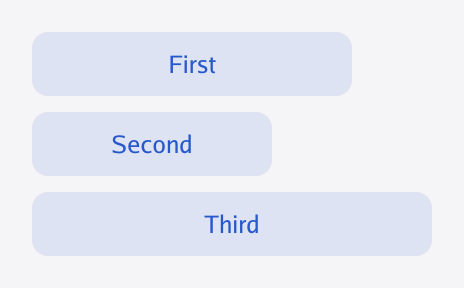
</picture>

```go
basic.Column{Size: layout.MainMin, Cross: layout.CrossStart, Spacing: theme.Space8, Children: []core.Widget{
	tile("First", 160, 32), tile("Second", 120, 32), tile("Third", 200, 32),
}}
```

API: [`basic.Column`](https://pkg.go.dev/github.com/bankai-tensei/gowaku/widgets/basic#Column)

## basic.Flex

The `Row` and `Column` with its axis as a field, for a direction chosen at run time.

Package: [`github.com/bankai-tensei/gowaku/widgets/basic`](https://pkg.go.dev/github.com/bankai-tensei/gowaku/widgets/basic)

<picture>
  <source media="(prefers-color-scheme: dark)" srcset="../img/basic-flex-dark.png">
  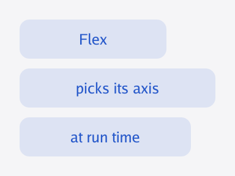
</picture>

```go
axis := layout.Vertical // chosen at run time, as by the width of the window
return basic.Flex{Axis: axis, Size: layout.MainMin, Spacing: theme.Space8, Children: []core.Widget{
	tile("Flex", 120, 32), tile("picks its axis", 160, 32), tile("at run time", 140, 32),
}}
```

API: [`basic.Flex`](https://pkg.go.dev/github.com/bankai-tensei/gowaku/widgets/basic#Flex)

## basic.Expanded

Fills the rest of a `Row` or `Column`, shared by the weights of `Flex`.

Package: [`github.com/bankai-tensei/gowaku/widgets/basic`](https://pkg.go.dev/github.com/bankai-tensei/gowaku/widgets/basic)

<picture>
  <source media="(prefers-color-scheme: dark)" srcset="../img/basic-expanded-dark.png">
  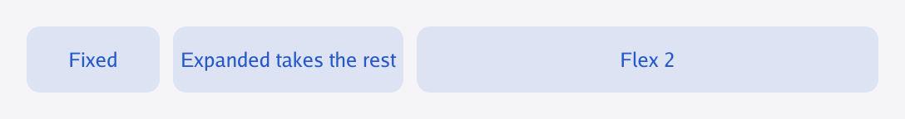
</picture>

```go
basic.SizedBox{Width: 520, Child: basic.Row{Spacing: theme.Space8, Children: []core.Widget{
	tile("Fixed", 80, 40),
	basic.Expanded{Child: tile("Expanded takes the rest", 0, 40)},
	basic.Expanded{Flex: 2, Child: tile("Flex 2", 0, 40)},
}}}
```

API: [`basic.Expanded`](https://pkg.go.dev/github.com/bankai-tensei/gowaku/widgets/basic#Expanded)

## basic.Flexible

Shares the free space, but the child may stay smaller than its share. `Fit: layout.FitTight` makes it an `Expanded`.

Package: [`github.com/bankai-tensei/gowaku/widgets/basic`](https://pkg.go.dev/github.com/bankai-tensei/gowaku/widgets/basic)

<picture>
  <source media="(prefers-color-scheme: dark)" srcset="../img/basic-flexible-dark.png">
  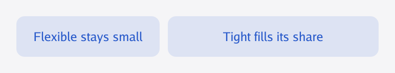
</picture>

```go
basic.SizedBox{Width: 420, Child: basic.Row{Spacing: theme.Space8, Children: []core.Widget{
	basic.Flexible{Child: tile("Flexible stays small", 140, 40)},
	basic.Flexible{Fit: layout.FitTight, Child: tile("Tight fills its share", 60, 40)},
}}}
```

API: [`basic.Flexible`](https://pkg.go.dev/github.com/bankai-tensei/gowaku/widgets/basic#Flexible)

## basic.Stack

Paints its children on top of each other. `Positioned` places a child from the edges.

Package: [`github.com/bankai-tensei/gowaku/widgets/basic`](https://pkg.go.dev/github.com/bankai-tensei/gowaku/widgets/basic)

<picture>
  <source media="(prefers-color-scheme: dark)" srcset="../img/basic-stack-dark.png">
  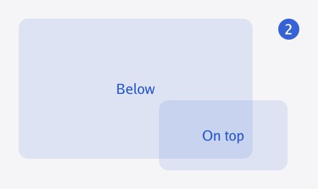
</picture>

```go
basic.SizedBox{Width: 240, Height: 140, Child: basic.Stack{Children: []core.Widget{
	tile("Below", 200, 120),
	basic.Positioned{Left: 120, Top: 70, Child: tile("On top", 110, 60)},
	basic.Positioned{AnchorRight: true, Right: 0, Top: 0, Child: control.Badge{Count: 2}},
}}}
```

API: [`basic.Stack`](https://pkg.go.dev/github.com/bankai-tensei/gowaku/widgets/basic#Stack) · [`basic.Positioned`](https://pkg.go.dev/github.com/bankai-tensei/gowaku/widgets/basic#Positioned)

## basic.PositionedFill

Stretches a child over the whole `Stack`, whose size the other children decide.

Package: [`github.com/bankai-tensei/gowaku/widgets/basic`](https://pkg.go.dev/github.com/bankai-tensei/gowaku/widgets/basic)

<picture>
  <source media="(prefers-color-scheme: dark)" srcset="../img/basic-positionedfill-dark.png">
  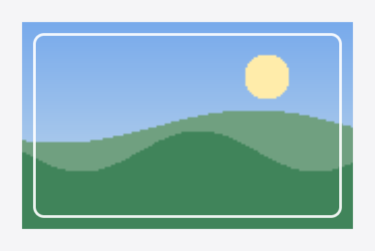
</picture>

```go
themed(func(th *theme.Theme) core.Widget {
	return basic.Stack{Children: []core.Widget{
		basic.Image{Source: photo(), Width: 240},
		basic.PositionedFill{Insets: geom.All(theme.Space8), Child: basic.Container{
			Radius: th.Radius.Control, Border: paint.Stroke{Width: 2, Color: geom.RGBA(1, 1, 1, 0.9)},
		}},
	}}
})
```

API: [`basic.PositionedFill`](https://pkg.go.dev/github.com/bankai-tensei/gowaku/widgets/basic#PositionedFill)

## basic.Wrap

A `Row` that starts a new run when the next child does not fit, for tags and chips.

Package: [`github.com/bankai-tensei/gowaku/widgets/basic`](https://pkg.go.dev/github.com/bankai-tensei/gowaku/widgets/basic)

<picture>
  <source media="(prefers-color-scheme: dark)" srcset="../img/basic-wrap-dark.png">
  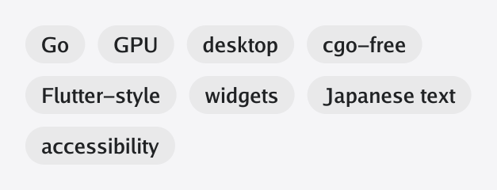
</picture>

```go
words := []string{"Go", "GPU", "desktop", "cgo-free", "Flutter-style", "widgets", "Japanese text", "accessibility"}
chips := make([]core.Widget, len(words))
for i, w := range words {
	chips[i] = control.Chip{Label: w}
}
return basic.SizedBox{Width: 300, Child: basic.Wrap{Spacing: theme.Space8, RunSpacing: theme.Space8, Children: chips}}
```

API: [`basic.Wrap`](https://pkg.go.dev/github.com/bankai-tensei/gowaku/widgets/basic#Wrap)

## basic.Grid

Lays out tiles in columns of the same width: a fixed number, or as many as a minimum width allows.

Package: [`github.com/bankai-tensei/gowaku/widgets/basic`](https://pkg.go.dev/github.com/bankai-tensei/gowaku/widgets/basic)

<picture>
  <source media="(prefers-color-scheme: dark)" srcset="../img/basic-grid-dark.png">
  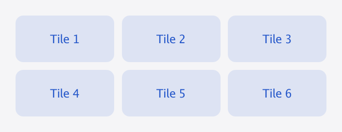
</picture>

```go
tiles := make([]core.Widget, 6)
for i := range tiles {
	tiles[i] = tile("Tile "+strconv.Itoa(i+1), 0, 0)
}
return basic.SizedBox{Width: 320, Child: basic.Grid{Columns: 3, Spacing: theme.Space8, RunSpacing: theme.Space8, TileHeight: 48, Children: tiles}}
```

API: [`basic.Grid`](https://pkg.go.dev/github.com/bankai-tensei/gowaku/widgets/basic#Grid)

## basic.Padding

Puts room around its child.

Package: [`github.com/bankai-tensei/gowaku/widgets/basic`](https://pkg.go.dev/github.com/bankai-tensei/gowaku/widgets/basic)

<picture>
  <source media="(prefers-color-scheme: dark)" srcset="../img/basic-padding-dark.png">
  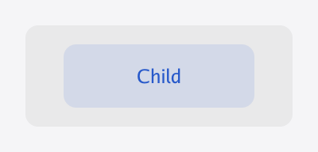
</picture>

```go
themed(func(th *theme.Theme) core.Widget {
	return basic.Container{Color: th.Color.Fill, Radius: th.Radius.Control, Child: basic.Padding{
		Insets: geom.Insets{Left: 24, Top: 12, Right: 24, Bottom: 12},
		Child:  tile("Child", 120, 40),
	}}
})
```

API: [`basic.Padding`](https://pkg.go.dev/github.com/bankai-tensei/gowaku/widgets/basic#Padding)

## basic.Align

Places its child within the space it is given, from 0 to 1 on each axis (not -1 to 1 as in Flutter).

Package: [`github.com/bankai-tensei/gowaku/widgets/basic`](https://pkg.go.dev/github.com/bankai-tensei/gowaku/widgets/basic)

<picture>
  <source media="(prefers-color-scheme: dark)" srcset="../img/basic-align-dark.png">
  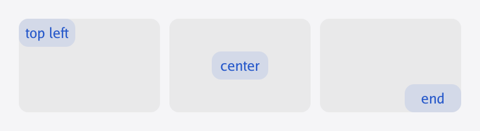
</picture>

```go
themed(func(th *theme.Theme) core.Widget {
	box := func(a layout.Alignment, label string) core.Widget {
		return basic.Container{Width: 120, Height: 80, Radius: th.Radius.Control, Color: th.Color.Fill,
			Child: basic.Align{Alignment: a, Child: tile(label, 48, 24)}}
	}
	return basic.Row{Size: layout.MainMin, Spacing: theme.Space8, Children: []core.Widget{
		box(layout.AlignTopLeft, "top left"), box(layout.AlignCenter, "center"), box(layout.AlignBottomRight, "end"),
	}}
})
```

API: [`basic.Align`](https://pkg.go.dev/github.com/bankai-tensei/gowaku/widgets/basic#Align)

## basic.Center

Places its child in the middle.

Package: [`github.com/bankai-tensei/gowaku/widgets/basic`](https://pkg.go.dev/github.com/bankai-tensei/gowaku/widgets/basic)

<picture>
  <source media="(prefers-color-scheme: dark)" srcset="../img/basic-center-dark.png">
  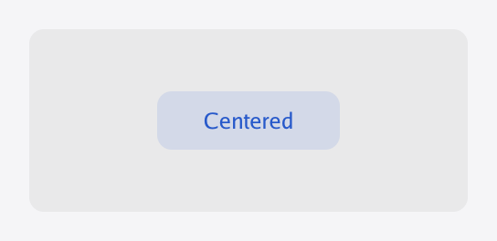
</picture>

```go
themed(func(th *theme.Theme) core.Widget {
	return basic.Container{Width: 240, Height: 100, Radius: th.Radius.Control, Color: th.Color.Fill,
		Child: basic.Center{Child: tile("Centered", 100, 32)}}
})
```

API: [`basic.Center`](https://pkg.go.dev/github.com/bankai-tensei/gowaku/widgets/basic#Center)

## basic.SizedBox

Forces a width, a height or both. Without a child it is an empty gap.

Package: [`github.com/bankai-tensei/gowaku/widgets/basic`](https://pkg.go.dev/github.com/bankai-tensei/gowaku/widgets/basic)

<picture>
  <source media="(prefers-color-scheme: dark)" srcset="../img/basic-sizedbox-dark.png">
  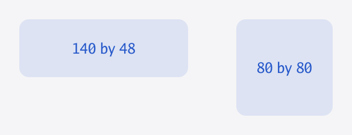
</picture>

```go
basic.Row{Size: layout.MainMin, Spacing: theme.Space8, Cross: layout.CrossStart, Children: []core.Widget{
	basic.SizedBox{Width: 140, Height: 48, Child: tile("140 by 48", 0, 0)},
	basic.SizedBox{Width: 24}, // an empty gap
	basic.SizedBox{Width: 80, Height: 80, Child: tile("80 by 80", 0, 0)},
}}
```

API: [`basic.SizedBox`](https://pkg.go.dev/github.com/bankai-tensei/gowaku/widgets/basic#SizedBox)

## basic.ConstrainedBox

Adds minimum and maximum sizes to its child.

Package: [`github.com/bankai-tensei/gowaku/widgets/basic`](https://pkg.go.dev/github.com/bankai-tensei/gowaku/widgets/basic)

<picture>
  <source media="(prefers-color-scheme: dark)" srcset="../img/basic-constrainedbox-dark.png">
  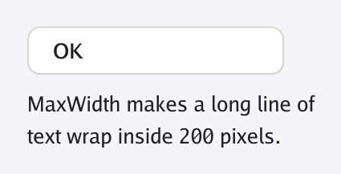
</picture>

```go
basic.Column{Size: layout.MainMin, Cross: layout.CrossStart, Spacing: theme.Space8, Children: []core.Widget{
	basic.ConstrainedBox{MinWidth: 160, Child: control.Button{Label: "OK", OnPress: func() {}}},
	basic.ConstrainedBox{MaxWidth: 200, Child: basic.Text{Content: "MaxWidth makes a long line of text wrap inside 200 pixels."}},
}}
```

API: [`basic.ConstrainedBox`](https://pkg.go.dev/github.com/bankai-tensei/gowaku/widgets/basic#ConstrainedBox)

## basic.Container

A box that combines size, padding, color, gradient, border, corners and shadows.

Package: [`github.com/bankai-tensei/gowaku/widgets/basic`](https://pkg.go.dev/github.com/bankai-tensei/gowaku/widgets/basic)

<picture>
  <source media="(prefers-color-scheme: dark)" srcset="../img/basic-container-dark.png">
  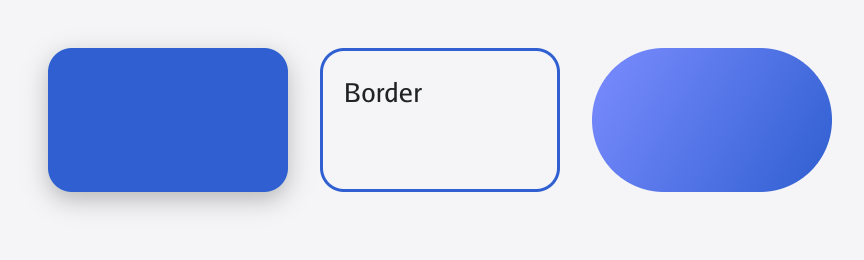
</picture>

```go
basic.Row{Size: layout.MainMin, Spacing: theme.Space16, Children: []core.Widget{
	basic.Container{Width: 120, Height: 72, Radius: 12, Color: geom.Hex(0x2f5fd0),
		Shadows: []paint.BoxShadow{{Color: geom.RGBA(0, 0, 0, 0.25), Blur: 12, Offset: geom.Offset{Y: 4}}}},
	basic.Container{Width: 120, Height: 72, Radius: 12, Border: paint.Stroke{Width: 1.5, Color: geom.Hex(0x2f5fd0)},
		Padding: geom.All(12), Child: basic.Text{Content: "Border"}},
	basic.Container{Width: 120, Height: 72, Radius: 36, Gradient: &paint.Gradient{
		End: geom.Offset{X: 120, Y: 72}, StartColor: geom.Hex(0x7b8cff), EndColor: geom.Hex(0x2f5fd0),
	}},
}}
```

API: [`basic.Container`](https://pkg.go.dev/github.com/bankai-tensei/gowaku/widgets/basic#Container)

## basic.DecoratedBox

Paints a `layout.Decoration` behind its child.

Package: [`github.com/bankai-tensei/gowaku/widgets/basic`](https://pkg.go.dev/github.com/bankai-tensei/gowaku/widgets/basic)

<picture>
  <source media="(prefers-color-scheme: dark)" srcset="../img/basic-decoratedbox-dark.png">
  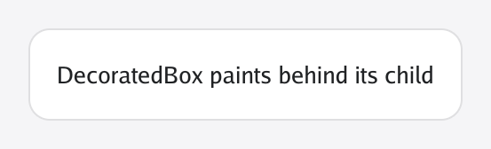
</picture>

```go
themed(func(th *theme.Theme) core.Widget {
	return basic.DecoratedBox{
		Decoration: layout.Decoration{Color: th.Color.Card, Radius: th.Radius.Group, Border: &paint.Stroke{Width: 1, Color: th.Color.Hair}},
		Child:      basic.Padding{Insets: geom.All(theme.Space16), Child: basic.Text{Content: "DecoratedBox paints behind its child"}},
	}
})
```

API: [`basic.DecoratedBox`](https://pkg.go.dev/github.com/bankai-tensei/gowaku/widgets/basic#DecoratedBox)

## basic.Scroll

Shows a child larger than itself, moved by the wheel and a scroll bar. Its parent must bound its size. `Reverse` starts it at the right end, or the bottom, so that a long vertical text opens at its first column. A `ScrollController` reads and sets the offset from code.

Package: [`github.com/bankai-tensei/gowaku/widgets/basic`](https://pkg.go.dev/github.com/bankai-tensei/gowaku/widgets/basic)

<picture>
  <source media="(prefers-color-scheme: dark)" srcset="../img/basic-scroll-dark.png">
  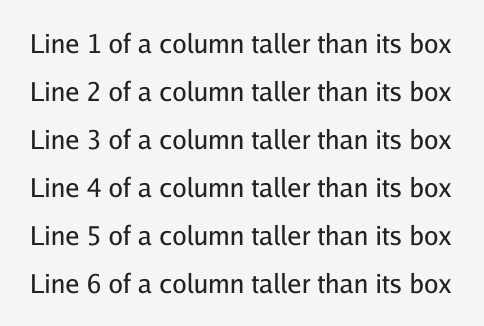
</picture>

```go
lines := make([]core.Widget, 12)
for i := range lines {
	lines[i] = basic.Text{Content: "Line " + strconv.Itoa(i+1) + " of a column taller than its box"}
}
return basic.SizedBox{Width: 300, Height: 140, Child: basic.Scroll{Child: basic.Column{
	Size: layout.MainMin, Cross: layout.CrossStart, Spacing: theme.Space4, Children: lines,
}}}
```

API: [`basic.Scroll`](https://pkg.go.dev/github.com/bankai-tensei/gowaku/widgets/basic#Scroll)

## basic.CustomLayout

Arranges its children with the algorithm of a `layout.Delegate`.

Package: [`github.com/bankai-tensei/gowaku/widgets/basic`](https://pkg.go.dev/github.com/bankai-tensei/gowaku/widgets/basic)

<picture>
  <source media="(prefers-color-scheme: dark)" srcset="../img/basic-customlayout-dark.png">
  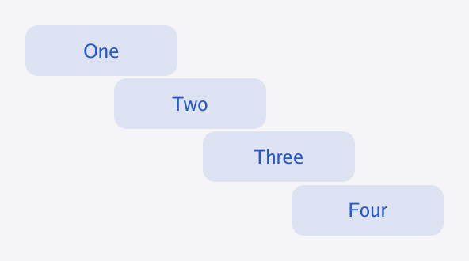
</picture>

```go
basic.CustomLayout{Delegate: diagonal{step: 56}, Children: []core.Widget{
	tile("One", 96, 32), tile("Two", 96, 32), tile("Three", 96, 32), tile("Four", 96, 32),
}}
```

API: [`basic.CustomLayout`](https://pkg.go.dev/github.com/bankai-tensei/gowaku/widgets/basic#CustomLayout)

## basic.LayoutBuilder

Builds its content with the constraints its parent gives it, to change with the room it has, such as one pane above the other when narrow and side by side when wide. The content is built again only when the constraints change or the parent rebuilds.

Package: [`github.com/bankai-tensei/gowaku/widgets/basic`](https://pkg.go.dev/github.com/bankai-tensei/gowaku/widgets/basic)

<picture>
  <source media="(prefers-color-scheme: dark)" srcset="../img/basic-layoutbuilder-dark.png">
  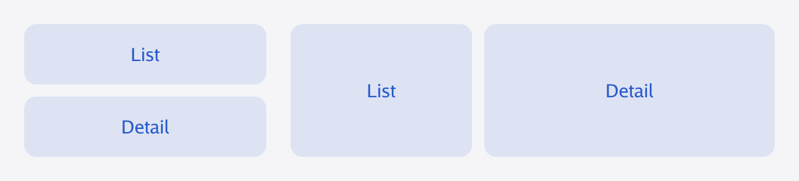
</picture>

```go
panes := basic.LayoutBuilder{Content: func(_ core.BuildContext, c layout.Constraints) core.Widget {
	if c.MaxW < 300 { // narrow: one above the other
		return basic.Column{Size: layout.MainMin, Spacing: theme.Space8, Children: []core.Widget{
			tile("List", c.MaxW, 40), tile("Detail", c.MaxW, 40),
		}}
	}
	return basic.Row{Size: layout.MainMin, Spacing: theme.Space8, Children: []core.Widget{
		tile("List", 120, 88), tile("Detail", c.MaxW-120-theme.Space8, 88),
	}}
}}
return basic.Row{Size: layout.MainMin, Spacing: theme.Space16, Cross: layout.CrossStart, Children: []core.Widget{
	basic.SizedBox{Width: 160, Child: panes},
	basic.SizedBox{Width: 320, Child: panes},
}}
```

API: [`basic.LayoutBuilder`](https://pkg.go.dev/github.com/bankai-tensei/gowaku/widgets/basic#LayoutBuilder)

## basic.AspectRatio

Sizes its child to a width over height of `Ratio`. It takes all the width it may, or all the height where that is too tall. Tight constraints leave no room for the ratio, so put it in a `Center`.

Package: [`github.com/bankai-tensei/gowaku/widgets/basic`](https://pkg.go.dev/github.com/bankai-tensei/gowaku/widgets/basic)

<picture>
  <source media="(prefers-color-scheme: dark)" srcset="../img/basic-aspectratio-dark.png">
  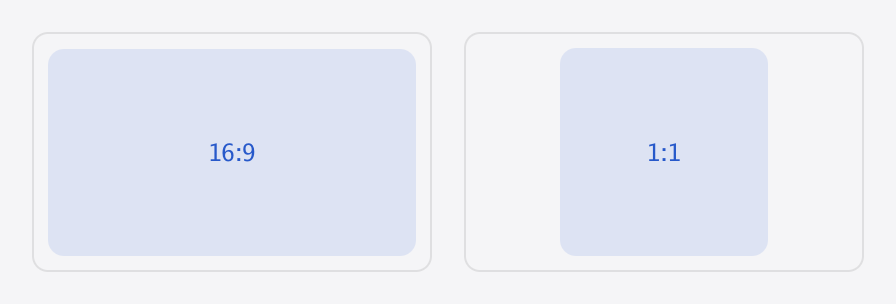
</picture>

```go
// box is a 200 by 120 frame with the largest rectangle of ratio in it.
box := func(ratio float32, label string) core.Widget {
	return basic.Container{
		Width: 200, Height: 120, Padding: geom.All(theme.Space8),
		Radius: th.Radius.Control, Border: paint.Stroke{Width: 1, Color: th.Color.Hair},
		Child: basic.Center{Child: basic.AspectRatio{Ratio: ratio, Child: tile(label, 0, 0)}},
	}
}
return basic.Row{Size: layout.MainMin, Spacing: theme.Space16, Children: []core.Widget{
	box(16.0/9, "16:9"), // as wide as the frame
	box(1, "1:1"),       // as tall as the frame
}}
```

API: [`basic.AspectRatio`](https://pkg.go.dev/github.com/bankai-tensei/gowaku/widgets/basic#AspectRatio)
