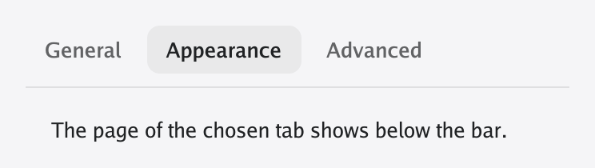
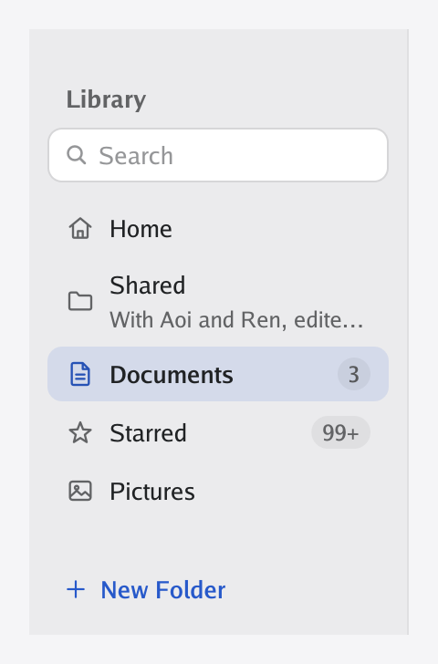
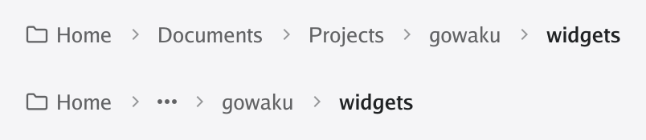
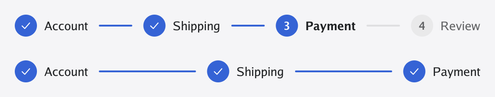
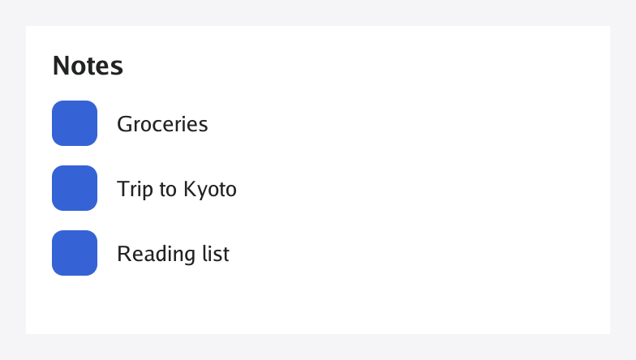
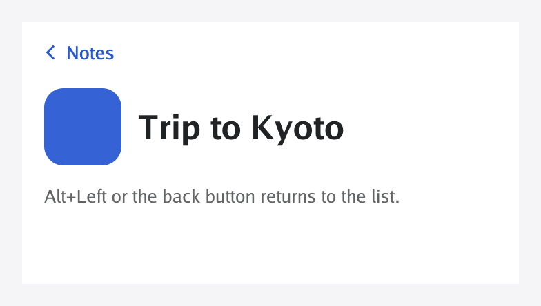

<!-- Code generated by internal/cmd/catalog; DO NOT EDIT. -->

# Navigation

[Catalog contents](README.md) · [日本語](../ja/navigation.md) · [Searchable site](https://bankai-tensei.github.io/gowaku/catalog/navigation/)

Widgets that move between pages and places. Only the current place takes the accent color.

> The lower-case functions in the examples (`themed`, `colored`, `tile`, and shapes such as `squareIcon`) are small helpers in [internal/catalog/helpers.go](../../../internal/catalog/helpers.go); `themed` is a `basic.Builder` that reads `basic.ThemeOf(ctx)`. `core.Widget` and `core.BuildContext` in the examples are the same types as `gowaku.Widget` and `gowaku.BuildContext`.

[control.Tabs](#controltabs) · [collection.Sidebar](#collectionsidebar) · [nav.Breadcrumb](#navbreadcrumb) · [nav.Steps](#navsteps) · [nav.Navigator](#navnavigator) · [nav.BackButton](#navbackbutton)

## control.Tabs

Switches between pages, with the chosen page below a row of underlined tabs.

Package: [`github.com/bankai-tensei/gowaku/widgets/control`](https://pkg.go.dev/github.com/bankai-tensei/gowaku/widgets/control)

<picture>
  <source media="(prefers-color-scheme: dark)" srcset="../img/control-tabs-dark.png">
  
</picture>

```go
basic.SizedBox{Width: 340, Height: 150, Child: control.Tabs{
	Label: "Settings", Selected: 1, OnChange: func(int) {},
	Pages: []control.TabPage{
		{Label: "General"},
		{Label: "Appearance", Child: basic.Padding{Insets: geom.All(theme.Space16), Child: basic.Text{
			Content: "The page of the chosen tab shows below the bar.",
		}}},
		{Label: "Advanced"},
	},
}}
```

API: [`control.Tabs`](https://pkg.go.dev/github.com/bankai-tensei/gowaku/widgets/control#Tabs) · [`control.TabPage`](https://pkg.go.dev/github.com/bankai-tensei/gowaku/widgets/control#TabPage)

## collection.Sidebar

The column of places at the left of a window. It draws its own ground and the hairline at its right edge; put it first in a `Row` with `CrossStretch`. `Width` sets its width, 208 when zero. When the rows do not fit, they alone scroll: the title, the `Header` under it, such as a search field, and the `Footer` pinned at the bottom, such as buttons, stay. The selected row takes the `AccentTint` ground. The `Count` of a `SidebarItem`, such as of unread messages, shows in a quiet pill at the end of the row, and a screen reader hears it once, as the value of the row. A `Detail` is a smaller second line in `Ink2` (on the selected row in the colors of `theme.Colors.OnTint`, which read on the tint, as is its count), such as the last message of a chat, cut to one line with an ellipsis; a row with one is 46 high, and a screen reader hears the whole detail once, as the description of the row. `Leading` puts a widget in place of the `Icon`, such as the colored dot of a mail label; on the selected row it is built under the `OnTint` theme, so that what takes the colors of the theme reads on the tint, while a color of its own, as that of the dot, stays.

Package: [`github.com/bankai-tensei/gowaku/widgets/collection`](https://pkg.go.dev/github.com/bankai-tensei/gowaku/widgets/collection)

<picture>
  <source media="(prefers-color-scheme: dark)" srcset="../img/collection-sidebar-dark.png">
  
</picture>

```go
open := func() {}
return basic.SizedBox{Height: 340, Child: collection.Sidebar{
	Title:  "Library",
	Header: field.Search{Placeholder: "Search", OnChange: func(string) {}},
	Children: []core.Widget{
		collection.SidebarItem{Label: "Home", Icon: icons.Home(), OnPress: open},
		collection.SidebarItem{Label: "Shared", Icon: icons.Folder(), Detail: "With Aoi and Ren, edited today", OnPress: open},
		collection.SidebarItem{Label: "Documents", Icon: icons.Document(), Count: 3, Selected: true, OnPress: open},
		collection.SidebarItem{Label: "Starred", Icon: icons.Star(), Count: 128, OnPress: open},
		collection.SidebarItem{Label: "Pictures", Icon: icons.Image(), OnPress: open},
	},
	Footer: control.Button{Label: "New Folder", Icon: icons.Plus(), Style: control.ButtonQuiet, OnPress: open},
}}
```

API: [`collection.Sidebar`](https://pkg.go.dev/github.com/bankai-tensei/gowaku/widgets/collection#Sidebar) · [`collection.SidebarItem`](https://pkg.go.dev/github.com/bankai-tensei/gowaku/widgets/collection#SidebarItem)

## nav.Breadcrumb

The trail to the current place. Where it does not fit, the middle folds into a menu.

Package: [`github.com/bankai-tensei/gowaku/widgets/nav`](https://pkg.go.dev/github.com/bankai-tensei/gowaku/widgets/nav)

<picture>
  <source media="(prefers-color-scheme: dark)" srcset="../img/nav-breadcrumb-dark.png">
  
</picture>

```go
trail := []nav.BreadcrumbItem{
	{Label: "Home", Icon: icons.Folder()}, {Label: "Documents"}, {Label: "Projects"}, {Label: "gowaku"}, {Label: "widgets"},
}
return basic.Column{Size: layout.MainMin, Cross: layout.CrossStart, Spacing: theme.Space12, Children: []core.Widget{
	basic.SizedBox{Width: 480, Child: nav.Breadcrumb{Items: trail, OnSelect: func(int) {}}},
	// Where the trail does not fit, the middle folds into a menu.
	basic.SizedBox{Width: 260, Child: nav.Breadcrumb{Items: trail, OnSelect: func(int) {}}},
}}
```

API: [`nav.Breadcrumb`](https://pkg.go.dev/github.com/bankai-tensei/gowaku/widgets/nav#Breadcrumb) · [`nav.BreadcrumbItem`](https://pkg.go.dev/github.com/bankai-tensei/gowaku/widgets/nav#BreadcrumbItem)

## nav.Steps

Shows where a flow of several steps is, such as a wizard or a checkout: a numbered circle and a name for each step, joined by lines. The steps before `Current` are done and show a check; the current one has a circle in the accent and a bold name. With `OnStepPress`, the done steps can be pressed to go back, and Tab and Enter or Space reach them. A screen reader hears a list of the steps, each with its name, its place, such as 2 of 3, and "Current step" or "Completed". For the minus and plus buttons of a number, see `control.NumberStepper`.

Package: [`github.com/bankai-tensei/gowaku/widgets/nav`](https://pkg.go.dev/github.com/bankai-tensei/gowaku/widgets/nav)

<picture>
  <source media="(prefers-color-scheme: dark)" srcset="../img/nav-steps-dark.png">
  
</picture>

```go
labels := []string{"Account", "Shipping", "Payment", "Review"}
return basic.Column{Size: layout.MainMin, Cross: layout.CrossStretch, Spacing: theme.Space20, Children: []core.Widget{
	nav.Steps{Labels: labels, Current: 2, OnStepPress: func(int) {}},
	// Every step done.
	nav.Steps{Labels: labels[:3], Current: 3},
}}
```

API: [`nav.Steps`](https://pkg.go.dev/github.com/bankai-tensei/gowaku/widgets/nav#Steps)

## nav.Navigator

A stack of pages. Routes build pages from name patterns, and Alt+Left goes back.

Package: [`github.com/bankai-tensei/gowaku/widgets/nav`](https://pkg.go.dev/github.com/bankai-tensei/gowaku/widgets/nav)

<picture>
  <source media="(prefers-color-scheme: dark)" srcset="../img/nav-navigator-dark.png">
  
</picture>

```go
basic.SizedBox{Width: 360, Height: 190, Child: nav.Navigator{
	Home: noteList{}, // its rows call NavigatorOf(ctx).PushNamed("/notes/1")
	Routes: []nav.RoutePattern{{Pattern: "/notes/:id", Build: func(p nav.RouteParams) core.Widget {
		i, _ := p.Int("id")
		return notePage{index: i}
	}}},
}}
```

API: [`nav.Navigator`](https://pkg.go.dev/github.com/bankai-tensei/gowaku/widgets/nav#Navigator) · [`nav.NavigatorController`](https://pkg.go.dev/github.com/bankai-tensei/gowaku/widgets/nav#NavigatorController) · [`nav.PageRoute`](https://pkg.go.dev/github.com/bankai-tensei/gowaku/widgets/nav#PageRoute) · [`nav.RoutePattern`](https://pkg.go.dev/github.com/bankai-tensei/gowaku/widgets/nav#RoutePattern) · [`nav.RouteParams`](https://pkg.go.dev/github.com/bankai-tensei/gowaku/widgets/nav#RouteParams)

## nav.BackButton

Goes back to the previous page of the nearest `Navigator`. On the first page it shows nothing.

Package: [`github.com/bankai-tensei/gowaku/widgets/nav`](https://pkg.go.dev/github.com/bankai-tensei/gowaku/widgets/nav)

<picture>
  <source media="(prefers-color-scheme: dark)" srcset="../img/nav-backbutton-dark.png">
  
</picture>

```go
// The top bar of a page that a Navigator pushed:
return basic.Row{Children: []core.Widget{nav.BackButton{Label: "Notes"}}}
```

API: [`nav.BackButton`](https://pkg.go.dev/github.com/bankai-tensei/gowaku/widgets/nav#BackButton)
