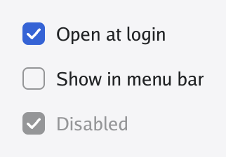
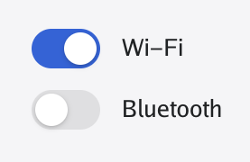
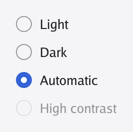
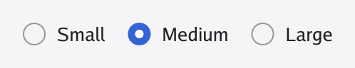
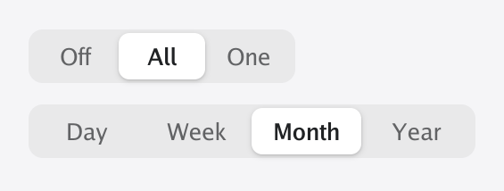
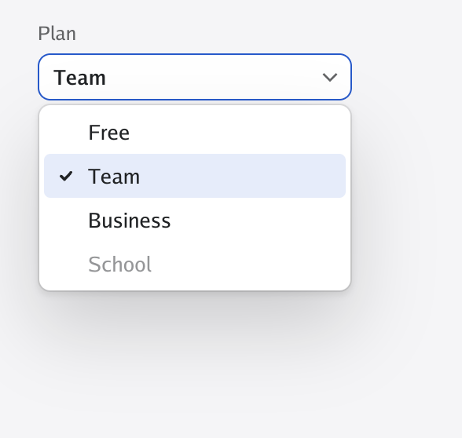
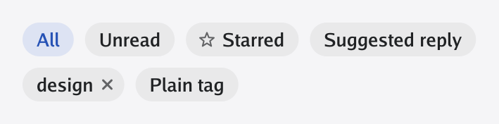
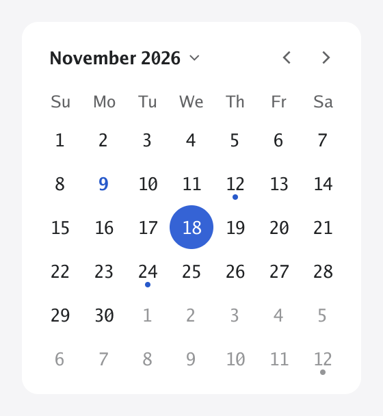
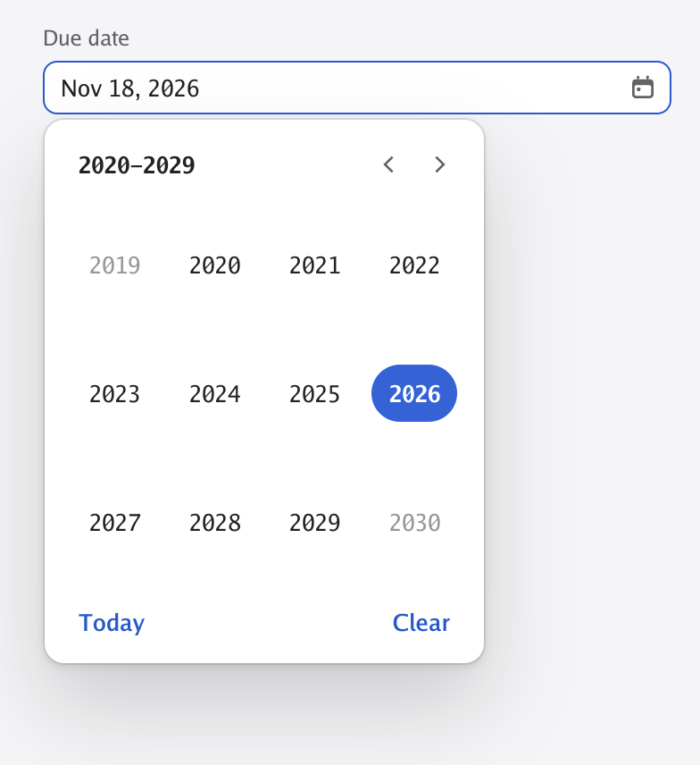
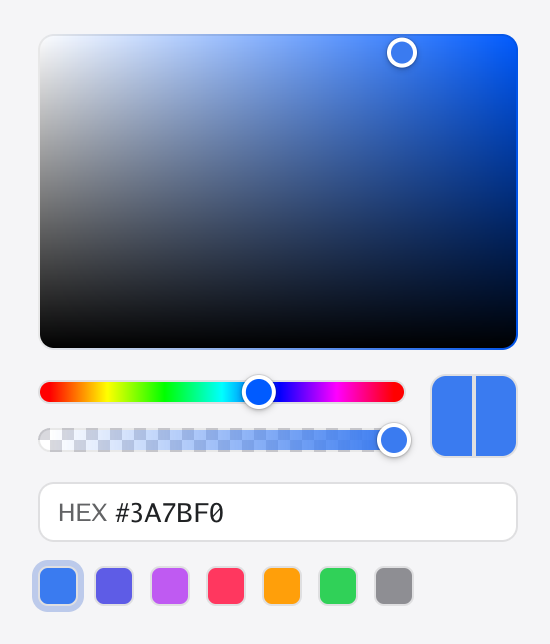

<!-- Code generated by internal/cmd/catalog; DO NOT EDIT. -->

# Selection

[Catalog contents](README.md) · [日本語](../ja/selection.md) · [Searchable site](https://bankai-tensei.github.io/gowaku/catalog/selection/)

Controls that pick from a set of choices: `control.SegmentedControl` for two to four, `field.DropdownMenu` for more.

> The lower-case functions in the examples (`themed`, `colored`, `tile`, and shapes such as `squareIcon`) are small helpers in [internal/catalog/helpers.go](../../../internal/catalog/helpers.go); `themed` is a `basic.Builder` that reads `basic.ThemeOf(ctx)`. `core.Widget` and `core.BuildContext` in the examples are the same types as `gowaku.Widget` and `gowaku.BuildContext`.

[control.Checkbox](#controlcheckbox) · [control.Switch](#controlswitch) · [control.RadioGroup](#controlradiogroup) · [control.Radio](#controlradio) · [control.SegmentedControl](#controlsegmentedcontrol) · [field.DropdownMenu](#fielddropdownmenu) · [control.Chip](#controlchip) · [field.Calendar](#fieldcalendar) · [field.DatePicker](#fielddatepicker) · [field.ColorPicker](#fieldcolorpicker)

## control.Checkbox

A box that turns an option on and off. The label is part of the target.

Package: [`github.com/bankai-tensei/gowaku/widgets/control`](https://pkg.go.dev/github.com/bankai-tensei/gowaku/widgets/control)

<picture>
  <source media="(prefers-color-scheme: dark)" srcset="../img/control-checkbox-dark.png">
  
</picture>

```go
set := func(bool) {}
return basic.Column{Size: layout.MainMin, Cross: layout.CrossStart, Spacing: theme.Space12, Children: []core.Widget{
	control.Checkbox{Value: true, Label: "Open at login", OnChange: set},
	control.Checkbox{Label: "Show in menu bar", OnChange: set},
	control.Checkbox{Value: true, Label: "Disabled"},
}}
```

API: [`control.Checkbox`](https://pkg.go.dev/github.com/bankai-tensei/gowaku/widgets/control#Checkbox)

## control.Switch

Turns a setting on and off at once, with a knob that moves on a spring.

Package: [`github.com/bankai-tensei/gowaku/widgets/control`](https://pkg.go.dev/github.com/bankai-tensei/gowaku/widgets/control)

<picture>
  <source media="(prefers-color-scheme: dark)" srcset="../img/control-switch-dark.png">
  
</picture>

```go
basic.Column{Size: layout.MainMin, Cross: layout.CrossStart, Spacing: theme.Space12, Children: []core.Widget{
	basic.Row{Size: layout.MainMin, Spacing: theme.Space12, Children: []core.Widget{
		control.Switch{Value: true, Label: "Wi-Fi", OnChange: func(bool) {}},
		basic.Text{Content: "Wi-Fi"},
	}},
	basic.Row{Size: layout.MainMin, Spacing: theme.Space12, Children: []core.Widget{
		control.Switch{Label: "Bluetooth", OnChange: func(bool) {}},
		basic.Text{Content: "Bluetooth"},
	}},
}}
```

API: [`control.Switch`](https://pkg.go.dev/github.com/bankai-tensei/gowaku/widgets/control#Switch)

## control.RadioGroup

A set of radio buttons that picks one choice. It is one stop for Tab, and the arrows move between the choices.

Package: [`github.com/bankai-tensei/gowaku/widgets/control`](https://pkg.go.dev/github.com/bankai-tensei/gowaku/widgets/control)

<picture>
  <source media="(prefers-color-scheme: dark)" srcset="../img/control-radiogroup-dark.png">
  
</picture>

```go
control.RadioGroup[string]{
	Label: "Appearance", Value: "auto", OnChange: func(string) {},
	Options: []control.RadioOption[string]{
		{Value: "light", Label: "Light"},
		{Value: "dark", Label: "Dark"},
		{Value: "auto", Label: "Automatic"},
		{Value: "contrast", Label: "High contrast", Disabled: true},
	},
}
```

API: [`control.RadioGroup`](https://pkg.go.dev/github.com/bankai-tensei/gowaku/widgets/control#RadioGroup) · [`control.RadioOption`](https://pkg.go.dev/github.com/bankai-tensei/gowaku/widgets/control#RadioOption)

## control.Radio

A single radio button, for layouts a `RadioGroup` cannot give. Name the set with a `Semantics`.

Package: [`github.com/bankai-tensei/gowaku/widgets/control`](https://pkg.go.dev/github.com/bankai-tensei/gowaku/widgets/control)

<picture>
  <source media="(prefers-color-scheme: dark)" srcset="../img/control-radio-dark.png">
  
</picture>

```go
interact.Semantics{Role: semantics.RoleRadioGroup, Label: "Size", Child: basic.Row{
	Size: layout.MainMin, Spacing: theme.Space16, Children: []core.Widget{
		control.Radio{Label: "Small", OnSelect: func() {}},
		control.Radio{Label: "Medium", Selected: true, OnSelect: func() {}},
		control.Radio{Label: "Large", OnSelect: func() {}},
	},
}}
```

API: [`control.Radio`](https://pkg.go.dev/github.com/bankai-tensei/gowaku/widgets/control#Radio)

## control.SegmentedControl

Picks one of two to four choices, with a plate that slides on a spring.

Package: [`github.com/bankai-tensei/gowaku/widgets/control`](https://pkg.go.dev/github.com/bankai-tensei/gowaku/widgets/control)

<picture>
  <source media="(prefers-color-scheme: dark)" srcset="../img/control-segmentedcontrol-dark.png">
  
</picture>

```go
basic.Column{Size: layout.MainMin, Cross: layout.CrossStart, Spacing: theme.Space12, Children: []core.Widget{
	control.SegmentedControl{Label: "Repeat", Options: []string{"Off", "All", "One"}, Selected: 1, OnChange: func(int) {}},
	control.SegmentedControl{Label: "View", Options: []string{"Day", "Week", "Month", "Year"}, Selected: 2, OnChange: func(int) {}},
}}
```

API: [`control.SegmentedControl`](https://pkg.go.dev/github.com/bankai-tensei/gowaku/widgets/control#SegmentedControl)

## field.DropdownMenu

A field that opens a list below itself to pick one choice. Typing a letter jumps to the choices that start with it.

Package: [`github.com/bankai-tensei/gowaku/widgets/field`](https://pkg.go.dev/github.com/bankai-tensei/gowaku/widgets/field)

<picture>
  <source media="(prefers-color-scheme: dark)" srcset="../img/field-dropdownmenu-dark.png">
  
</picture>

```go
basic.SizedBox{Width: 200, Child: field.DropdownMenu[string]{
	Label: "Plan", Value: "team", OnChange: func(string) {},
	Options: []field.DropdownOption[string]{
		{Value: "free", Label: "Free"},
		{Value: "team", Label: "Team"},
		{Value: "business", Label: "Business"},
		{Value: "school", Label: "School", Disabled: true},
	},
}}
```

API: [`field.DropdownMenu`](https://pkg.go.dev/github.com/bankai-tensei/gowaku/widgets/field#DropdownMenu) · [`field.DropdownOption`](https://pkg.go.dev/github.com/bankai-tensei/gowaku/widgets/field#DropdownOption)

## control.Chip

A compact pill: a toggling filter with `OnChange`, a button with `OnPress`, or a plain tag with neither.

Package: [`github.com/bankai-tensei/gowaku/widgets/control`](https://pkg.go.dev/github.com/bankai-tensei/gowaku/widgets/control)

<picture>
  <source media="(prefers-color-scheme: dark)" srcset="../img/control-chip-dark.png">
  
</picture>

```go
basic.SizedBox{Width: 360, Child: basic.Wrap{Spacing: theme.Space8, RunSpacing: theme.Space8, Children: []core.Widget{
	control.Chip{Label: "All", Selected: true, OnChange: func(bool) {}},
	control.Chip{Label: "Unread", OnChange: func(bool) {}},
	control.Chip{Label: "Starred", Icon: icons.Star(), OnChange: func(bool) {}},
	control.Chip{Label: "Suggested reply", OnPress: func() {}},
	control.Chip{Label: "design", OnRemove: func() {}},
	control.Chip{Label: "Plain tag"},
}}}
```

API: [`control.Chip`](https://pkg.go.dev/github.com/bankai-tensei/gowaku/widgets/control#Chip)

## field.Calendar

Picks a day from a month. The first day of the week and the names follow the locale. `Marks` puts dots under days. The title opens the months of the year, and the year the years of a decade, so a day far away, such as a birth date, takes a few presses. While `Value` is zero it opens on `InitialMonth`.

Package: [`github.com/bankai-tensei/gowaku/widgets/field`](https://pkg.go.dev/github.com/bankai-tensei/gowaku/widgets/field)

<picture>
  <source media="(prefers-color-scheme: dark)" srcset="../img/field-calendar-dark.png">
  
</picture>

```go
themed(func(th *theme.Theme) core.Widget {
	return basic.Container{Color: th.Color.Card, Radius: th.Radius.Group, Padding: geom.All(theme.Space12), Child: field.Calendar{
		Value: day(18), Today: day(9), OnChange: func(time.Time) {},
		Marks: func(d time.Time) []geom.Color {
			if d.Day() == 12 || d.Day() == 24 {
				return []geom.Color{th.Color.AccentInk}
			}
			return nil
		},
	}}
})
```

API: [`field.Calendar`](https://pkg.go.dev/github.com/bankai-tensei/gowaku/widgets/field#Calendar)

## field.DatePicker

A field that shows a date and opens a `Calendar` below itself, whose title switches to the months and the years (the picture shows the years). For a birth date, give an `InitialMonth` some thirty years back and a `Max` of today. In a `FormItem` its border turns red with an error.

Package: [`github.com/bankai-tensei/gowaku/widgets/field`](https://pkg.go.dev/github.com/bankai-tensei/gowaku/widgets/field)

<picture>
  <source media="(prefers-color-scheme: dark)" srcset="../img/field-datepicker-dark.png">
  
</picture>

```go
day := func(d int) time.Time { return time.Date(2026, time.November, d, 0, 0, 0, 0, time.UTC) }
return field.DatePicker{
	Label: "Due date", Value: day(18), Today: day(9),
	ShowToday: true, ShowClear: true, OnChange: func(time.Time) {},
}
```

API: [`field.DatePicker`](https://pkg.go.dev/github.com/bankai-tensei/gowaku/widgets/field#DatePicker)

## field.ColorPicker

Chooses a color with a plane of saturation and brightness, strips of hue and opacity, and a hex field. It keeps HSV, so the hue survives black and gray. A `collection.PropertyColor` with `OnChange` opens one.

Package: [`github.com/bankai-tensei/gowaku/widgets/field`](https://pkg.go.dev/github.com/bankai-tensei/gowaku/widgets/field)

<picture>
  <source media="(prefers-color-scheme: dark)" srcset="../img/field-colorpicker-dark.png">
  
</picture>

```go
field.ColorPicker{
	Value: geom.Hex(0x3a7bf0), Label: "Accent color", OnChange: func(geom.Color) {},
	Swatches: []geom.Color{
		geom.Hex(0x3a7bf0), geom.Hex(0x5e5ce6), geom.Hex(0xbf5af2), geom.Hex(0xff375f),
		geom.Hex(0xff9f0a), geom.Hex(0x30d158), geom.Hex(0x8e8e93),
	},
}
```

API: [`field.ColorPicker`](https://pkg.go.dev/github.com/bankai-tensei/gowaku/widgets/field#ColorPicker)
