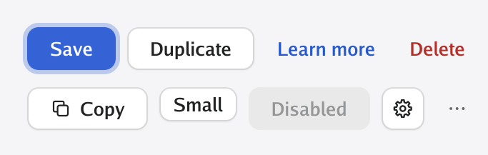
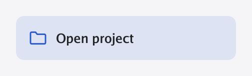
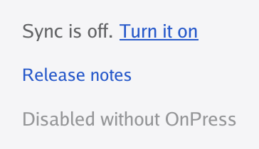

<!-- Code generated by internal/cmd/catalog; DO NOT EDIT. -->

# ボタンと操作

[カタログの目次](README.md) · [English](../en/actions.md) · [検索できるサイト](https://bankai-tensei.github.io/gowaku/ja/catalog/actions/)

押して何かを実行するウィジェット。ボタンは `control.Button` の 1 種類だけで、`Style` で 4 種類の見た目を選ぶ。

> 例に出てくる小文字の関数（`themed`、`colored`、`tile`、`squareIcon` などの図形）は、[internal/catalog/helpers.go](../../../internal/catalog/helpers.go) にある小さな補助関数である。`themed` は `basic.ThemeOf(ctx)` を読み取る `basic.Builder`。例の `core.Widget` と `core.BuildContext` は、`gowaku.Widget` と `gowaku.BuildContext` と同じ型である。

[control.Button](#controlbutton) · [interact.Pressable](#interactpressable) · [control.Link](#controllink)

## control.Button

押すと `OnPress` を実行するボタン。`Style` で通常・主要・控えめ・破壊的の 4 種類の見た目を、`Size` で高さを選ぶ。`OnPress` を指定しないと無効になる。

パッケージ: [`github.com/bankai-tensei/gowaku/widgets/control`](https://pkg.go.dev/github.com/bankai-tensei/gowaku/widgets/control)

<picture>
  <source media="(prefers-color-scheme: dark)" srcset="../img/control-button-dark.png">
  
</picture>

```go
save := func() {}
return basic.Column{Size: layout.MainMin, Cross: layout.CrossStart, Spacing: theme.Space12, Children: []core.Widget{
	basic.Row{Size: layout.MainMin, Spacing: theme.Space8, Children: []core.Widget{
		control.Button{Label: "Save", Style: control.ButtonPrimary, OnPress: save},
		control.Button{Label: "Duplicate", OnPress: save},
		control.Button{Label: "Learn more", Style: control.ButtonQuiet, OnPress: save},
		control.Button{Label: "Delete", Style: control.ButtonDanger, OnPress: save},
	}},
	basic.Row{Size: layout.MainMin, Spacing: theme.Space8, Children: []core.Widget{
		control.Button{Label: "Copy", Icon: icons.Copy(), OnPress: save},
		control.Button{Label: "Small", Size: control.ButtonSmall, OnPress: save},
		control.Button{Label: "Disabled"},
		control.Button{Label: "Settings", Icon: icons.Settings(), HideLabel: true, OnPress: save},
		control.Button{Label: "More", Icon: icons.More(), HideLabel: true, Style: control.ButtonQuiet, OnPress: save},
	}},
}}
```

API: [`control.Button`](https://pkg.go.dev/github.com/bankai-tensei/gowaku/widgets/control#Button) · [`control.ButtonStyle`](https://pkg.go.dev/github.com/bankai-tensei/gowaku/widgets/control#ButtonStyle) · [`control.ButtonSize`](https://pkg.go.dev/github.com/bankai-tensei/gowaku/widgets/control#ButtonSize)

## interact.Pressable

独自の見た目で押せる領域を作るための土台。`Build` は hover・押下・フォーカスの状態を表す `PressState` を受け取り、中身を返す。

パッケージ: [`github.com/bankai-tensei/gowaku/widgets/interact`](https://pkg.go.dev/github.com/bankai-tensei/gowaku/widgets/interact)

<picture>
  <source media="(prefers-color-scheme: dark)" srcset="../img/interact-pressable-dark.png">
  
</picture>

```go
interact.Pressable{Label: "Open project", OnPress: func() {}, Build: func(s interact.PressState) core.Widget {
	return themed(func(th *theme.Theme) core.Widget {
		ground := th.Color.Card
		if s.Hovered {
			ground = th.Color.AccentTint
		}
		return interact.FocusRing{Visible: s.FocusVisible, Radius: th.Radius.Control, Child: basic.Container{
			Width: 220, Padding: geom.All(theme.Space12), Radius: th.Radius.Control, Color: ground,
			Child: basic.Row{Spacing: theme.Space8, Children: []core.Widget{
				basic.Icon{Path: icons.Folder(), Size: 20, Color: th.Color.AccentInk},
				basic.Text{Content: "Open project", Style: colored(th.Text.Control, th.Color.Ink)},
			}},
		}}
	})
}}
```

API: [`interact.Pressable`](https://pkg.go.dev/github.com/bankai-tensei/gowaku/widgets/interact#Pressable) · [`interact.PressState`](https://pkg.go.dev/github.com/bankai-tensei/gowaku/widgets/interact#PressState)

## control.Link

本文に添えて置く、押せる短いテキスト。アクセントの色で表示され、ポインタを重ねると下線が付く。Enter キーでは押せるが、Space キーでは押せない。`OnPress` を指定しないと無効になる。

パッケージ: [`github.com/bankai-tensei/gowaku/widgets/control`](https://pkg.go.dev/github.com/bankai-tensei/gowaku/widgets/control)

<picture>
  <source media="(prefers-color-scheme: dark)" srcset="../img/control-link-dark.png">
  
</picture>

```go
basic.Row{Size: layout.MainMin, Spacing: theme.Space4, Children: []core.Widget{
	basic.Text{Content: "Sync is off.", Style: note},
	control.Link{Label: "Turn it on", OnPress: func() {}},
}},
control.Link{Label: "Release notes", Style: th.Text.Caption, OnPress: func() {}},
control.Link{Label: "Disabled without OnPress"},
```

API: [`control.Link`](https://pkg.go.dev/github.com/bankai-tensei/gowaku/widgets/control#Link)
