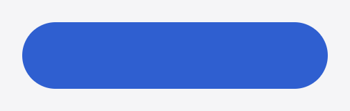
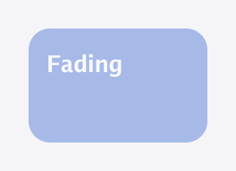
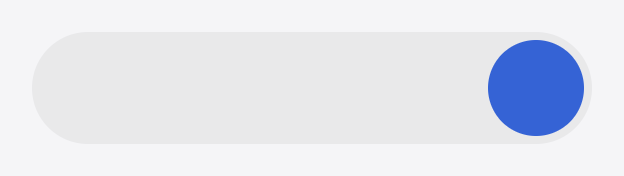
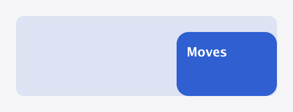
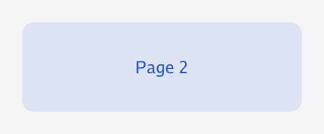
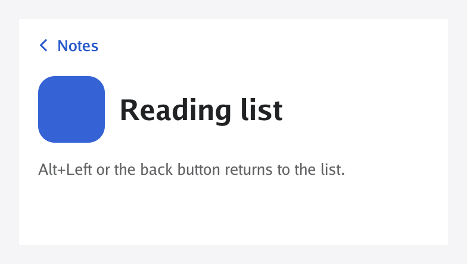

<!-- Code generated by internal/cmd/catalog; DO NOT EDIT. -->

# アニメーション

[カタログの目次](README.md) · [English](../en/animation.md) · [検索できるサイト](https://bankai-tensei.github.io/gowaku/ja/catalog/animation/)

値が変わると、補間しながら変化するウィジェット。OS が動きを減らすよう求めているときは、アニメーションせずに切り替わる。

> 例に出てくる小文字の関数（`themed`、`colored`、`tile`、`squareIcon` などの図形）は、[internal/catalog/helpers.go](../../../internal/catalog/helpers.go) にある小さな補助関数である。`themed` は `basic.ThemeOf(ctx)` を読み取る `basic.Builder`。例の `core.Widget` と `core.BuildContext` は、`gowaku.Widget` と `gowaku.BuildContext` と同じ型である。

[basic.AnimatedContainer](#basicanimatedcontainer) · [basic.AnimatedOpacity](#basicanimatedopacity) · [basic.AnimatedAlign](#basicanimatedalign) · [basic.AnimatedPositioned](#basicanimatedpositioned) · [basic.AnimatedSwitcher](#basicanimatedswitcher) · [nav.Hero](#navhero)

## basic.AnimatedContainer

値が変わると、色、大きさ、余白、角丸、枠線、影を補間しながら変化する `Container`。

パッケージ: [`github.com/bankai-tensei/gowaku/widgets/basic`](https://pkg.go.dev/github.com/bankai-tensei/gowaku/widgets/basic)

<picture>
  <source media="(prefers-color-scheme: dark)" srcset="../img/basic-animatedcontainer-dark.png">
  
</picture>

```go
expanded := true // a field of the State; SetState changes it
w, c := float32(120), geom.Hex(0x8a8a8e)
if expanded {
	w, c = 220, geom.Hex(0x2f5fd0)
}
return basic.AnimatedContainer{Duration: 250 * time.Millisecond, Width: w, Height: 48, Radius: 24, Color: c}
```

API: [`basic.AnimatedContainer`](https://pkg.go.dev/github.com/bankai-tensei/gowaku/widgets/basic#AnimatedContainer)

## basic.AnimatedOpacity

新しい透明度へフェードする `Opacity`。

パッケージ: [`github.com/bankai-tensei/gowaku/widgets/basic`](https://pkg.go.dev/github.com/bankai-tensei/gowaku/widgets/basic)

<picture>
  <source media="(prefers-color-scheme: dark)" srcset="../img/basic-animatedopacity-dark.png">
  
</picture>

```go
visible := false // a field of the State
var o float32 = 1
if !visible {
	o = 0.4
}
return basic.AnimatedOpacity{Opacity: o, Child: swatch("Fading", geom.Hex(0x2f5fd0))}
```

API: [`basic.AnimatedOpacity`](https://pkg.go.dev/github.com/bankai-tensei/gowaku/widgets/basic#AnimatedOpacity)

## basic.AnimatedAlign

新しい位置へ移動する `Align`。

パッケージ: [`github.com/bankai-tensei/gowaku/widgets/basic`](https://pkg.go.dev/github.com/bankai-tensei/gowaku/widgets/basic)

<picture>
  <source media="(prefers-color-scheme: dark)" srcset="../img/basic-animatedalign-dark.png">
  
</picture>

```go
themed(func(th *theme.Theme) core.Widget {
	return basic.Container{Width: 280, Height: 56, Radius: 28, Color: th.Color.Fill, Padding: geom.All(4),
		Child: basic.AnimatedAlign{Alignment: a, Child: basic.Container{Width: 48, Height: 48, Radius: 24, Color: th.Color.Accent}}}
})
```

API: [`basic.AnimatedAlign`](https://pkg.go.dev/github.com/bankai-tensei/gowaku/widgets/basic#AnimatedAlign)

## basic.AnimatedPositioned

`Stack` の中で新しい位置へ移動する `Positioned`。

パッケージ: [`github.com/bankai-tensei/gowaku/widgets/basic`](https://pkg.go.dev/github.com/bankai-tensei/gowaku/widgets/basic)

<picture>
  <source media="(prefers-color-scheme: dark)" srcset="../img/basic-animatedpositioned-dark.png">
  
</picture>

```go
moved := true // a field of the State
var left float32 = 8
if moved {
	left = 160
}
return basic.SizedBox{Width: 260, Height: 80, Child: basic.Stack{Children: []core.Widget{
	tile("", 260, 80),
	basic.AnimatedPositioned{Left: left, Top: 16, Child: swatch("Moves", geom.Hex(0x2f5fd0))},
}}}
```

API: [`basic.AnimatedPositioned`](https://pkg.go.dev/github.com/bankai-tensei/gowaku/widgets/basic#AnimatedPositioned)

## basic.AnimatedSwitcher

子が替わると、クロスフェードやスライドで切り替える。同じ型の子は `core.Keyed` で区別する。

パッケージ: [`github.com/bankai-tensei/gowaku/widgets/basic`](https://pkg.go.dev/github.com/bankai-tensei/gowaku/widgets/basic)

<picture>
  <source media="(prefers-color-scheme: dark)" srcset="../img/basic-animatedswitcher-dark.png">
  
</picture>

```go
page := 1 // a field of the State
return basic.AnimatedSwitcher{
	Duration:   250 * time.Millisecond,
	Transition: basic.SlideTransition(0.04, 0),
	Child:      core.Keyed(page, tile("Page "+strconv.Itoa(page+1), 200, 64)),
}
```

API: [`basic.AnimatedSwitcher`](https://pkg.go.dev/github.com/bankai-tensei/gowaku/widgets/basic#AnimatedSwitcher) · [`basic.SwitcherTransition`](https://pkg.go.dev/github.com/bankai-tensei/gowaku/widgets/basic#SwitcherTransition)

## nav.Hero

`Navigator` がページを切り替えるとき、同じ `Tag` を付けた子が、元の位置から新しい位置へ飛ぶように移動する。画像は遷移後のページを写したもの。

パッケージ: [`github.com/bankai-tensei/gowaku/widgets/nav`](https://pkg.go.dev/github.com/bankai-tensei/gowaku/widgets/nav)

<picture>
  <source media="(prefers-color-scheme: dark)" srcset="../img/nav-hero-dark.png">
  
</picture>

```go
// In the row of the list:
row := basic.Row{Spacing: theme.Space12, Children: []core.Widget{nav.Hero{Tag: 1, Child: icon}, basic.Text{Content: "Trip to Kyoto"}}}
// On the page the row opens, with the same Tag:
header := basic.Row{Spacing: theme.Space12, Children: []core.Widget{nav.Hero{Tag: 1, Child: big}, basic.Text{Content: "Trip to Kyoto"}}}
```

API: [`nav.Hero`](https://pkg.go.dev/github.com/bankai-tensei/gowaku/widgets/nav#Hero)
