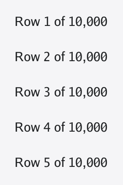
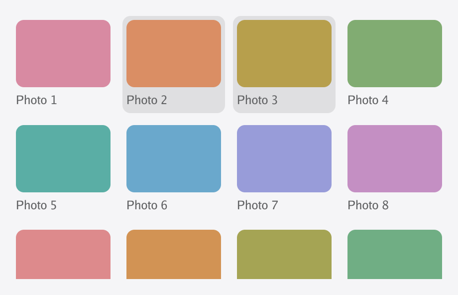
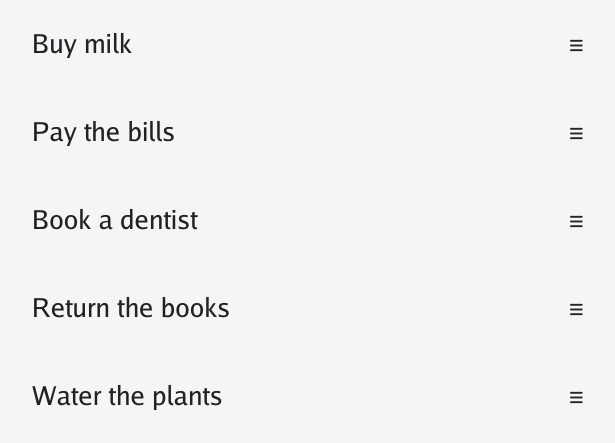
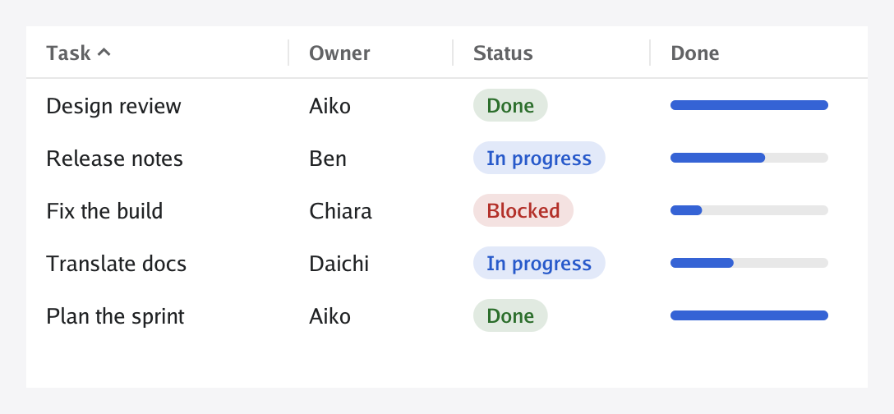
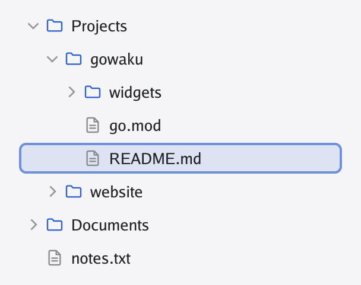
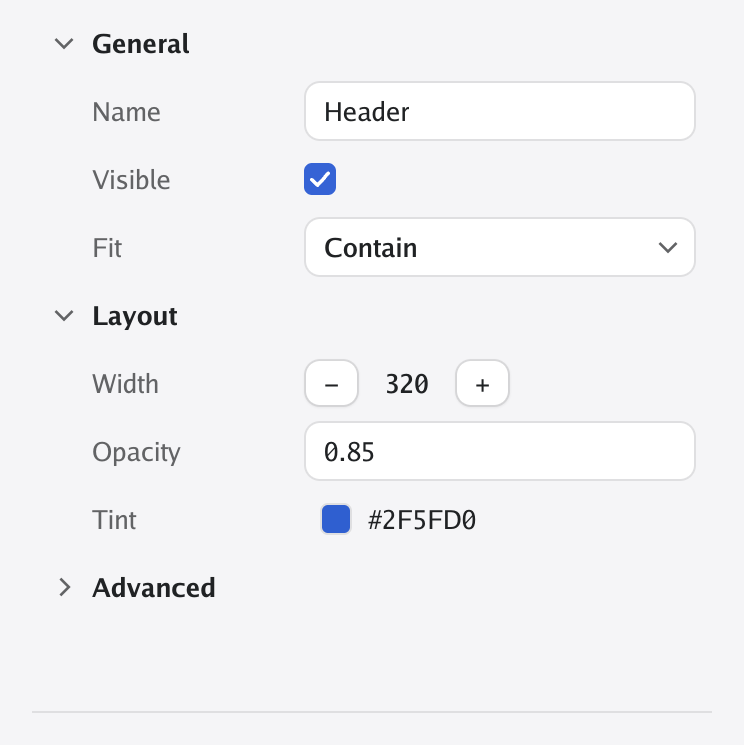
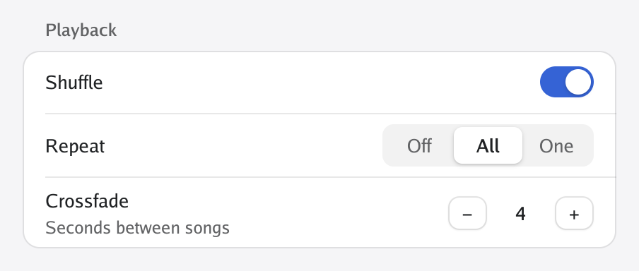

<!-- Code generated by internal/cmd/catalog; DO NOT EDIT. -->

# データ

[カタログの目次](README.md) · [English](../en/data.md) · [検索できるサイト](https://bankai-tensei.github.io/gowaku/ja/catalog/data/)

多数の行を表示し、編集するウィジェット。どれも表示範囲付近の行だけを構築する。

> 例に出てくる小文字の関数（`themed`、`colored`、`tile`、`squareIcon` などの図形）は、[internal/catalog/helpers.go](../../../internal/catalog/helpers.go) にある小さな補助関数である。`themed` は `basic.ThemeOf(ctx)` を読み取る `basic.Builder`。例の `core.Widget` と `core.BuildContext` は、`gowaku.Widget` と `gowaku.BuildContext` と同じ型である。

[collection.List](#collectionlist) · [collection.GridView](#collectiongridview) · [collection.ReorderableList](#collectionreorderablelist) · [collection.Table](#collectiontable) · [collection.Tree](#collectiontree) · [collection.PropertyGrid](#collectionpropertygrid) · [collection.Group](#collectiongroup)

## collection.List

任意の件数を扱える縦方向のリスト。表示範囲付近の行だけを構築する。行ごとに高さが異なってもよい。

パッケージ: [`github.com/bankai-tensei/gowaku/widgets/collection`](https://pkg.go.dev/github.com/bankai-tensei/gowaku/widgets/collection)

<picture>
  <source media="(prefers-color-scheme: dark)" srcset="../img/collection-list-dark.png">
  
</picture>

```go
basic.SizedBox{Width: 320, Height: 180, Child: collection.List{
	ItemCount: 10000, ItemExtent: 36,
	ItemBuilder: func(i int) core.Widget {
		return basic.Padding{Insets: geom.Symmetric(theme.Space12, theme.Space8), Child: basic.Text{
			Content: "Row " + strconv.Itoa(i+1) + " of 10,000",
		}}
	},
}}
```

API: [`collection.List`](https://pkg.go.dev/github.com/bankai-tensei/gowaku/widgets/collection#List)

## collection.GridView

任意の個数のタイルを並べるグリッド。表示範囲付近の行だけを構築する。列数は幅から決まり、選択とフォーカスは `TableController` が管理し、`ItemKey` を与えると項目の並びが変わっても同じ項目に残る。矢印キーでタイル間を移動し、Enter で開く。

パッケージ: [`github.com/bankai-tensei/gowaku/widgets/collection`](https://pkg.go.dev/github.com/bankai-tensei/gowaku/widgets/collection)

<picture>
  <source media="(prefers-color-scheme: dark)" srcset="../img/collection-gridview-dark.png">
  
</picture>

```go
var photos collection.TableController
photos.SetSelection(collection.RowRange{Start: 1, End: 3})
return basic.SizedBox{Width: 460, Height: 280, Child: collection.GridView{
	ItemCount: 10000, MinColumnWidth: 96, AspectRatio: 4.0 / 3, ExtraHeight: 20,
	Spacing: theme.Space8, RunSpacing: theme.Space8, Padding: geom.All(theme.Space8),
	Label: "Photos", Controller: &photos,
	LabelOf: func(i int) string { return "Photo " + strconv.Itoa(i+1) },
	ItemBuilder: func(i int) core.Widget {
		tone := theme.TonalPalette{Hue: float64(i*47%360) + 0.5, Chroma: 36}.Tone(66)
		return basic.Column{Cross: layout.CrossStretch, Spacing: theme.Space4, Children: []core.Widget{
			basic.Expanded{Child: basic.Container{Color: tone, Radius: th.Radius.Control}},
			basic.Text{Content: "Photo " + strconv.Itoa(i+1), Style: small},
		}}
	},
}}
```

API: [`collection.GridView`](https://pkg.go.dev/github.com/bankai-tensei/gowaku/widgets/collection#GridView)

## collection.ReorderableList

ドラッグか Ctrl+Shift+矢印キーで項目を並べ替えられる `List`。データ自体は保持せず、`OnReorder` で移動を依頼する。スクリーンリーダーには移動後の位置を伝える。

パッケージ: [`github.com/bankai-tensei/gowaku/widgets/collection`](https://pkg.go.dev/github.com/bankai-tensei/gowaku/widgets/collection)

<picture>
  <source media="(prefers-color-scheme: dark)" srcset="../img/collection-reorderablelist-dark.png">
  
</picture>

```go
basic.SizedBox{Width: 300, Height: 220, Child: collection.ReorderableList{
	ItemCount: len(todos), ItemExtent: 44, Label: "To do",
	LabelOf: func(i int) string { return todos[i] },
	// Move the item in your data, then build again.
	OnReorder: func(_, _ int) {},
	ItemBuilder: func(i int) core.Widget {
		return basic.Padding{Insets: geom.Symmetric(theme.Space12, 0), Child: basic.Row{Cross: layout.CrossCenter, Children: []core.Widget{
			basic.Expanded{Child: basic.Text{Content: todos[i]}},
			basic.Text{Content: "≡"},
		}}}
	},
}}
```

API: [`collection.ReorderableList`](https://pkg.go.dev/github.com/bankai-tensei/gowaku/widgets/collection#ReorderableList)

## collection.Table

並べ替え、絞り込み、範囲選択、セルの編集、列の固定に対応した表。セルには文字のほか、バッジ、点、バー、チェックボックスを表示できる。`RowKey` を与えると、並べ替えや行の削除の後も選択が同じ行に残る。並べ替えた列の見出しは、スクリーンリーダーに昇順か降順かを伝える。ファイルの行のように別の場所にある行は、スライスにせず `RowCount` と `Row` で渡せる。

パッケージ: [`github.com/bankai-tensei/gowaku/widgets/collection`](https://pkg.go.dev/github.com/bankai-tensei/gowaku/widgets/collection)

<picture>
  <source media="(prefers-color-scheme: dark)" srcset="../img/collection-table-dark.png">
  
</picture>

```go
rows := []task{
	{"Design review", "Aiko", "Done", 1},
	{"Release notes", "Ben", "In progress", 0.6},
	{"Fix the build", "Chiara", "Blocked", 0.2},
	{"Translate docs", "Daichi", "In progress", 0.4},
	{"Plan the sprint", "Aiko", "Done", 1},
}
tone := func(t task) collection.CellTone {
	switch t.status {
	case "Done":
		return collection.CellToneSuccess
	case "Blocked":
		return collection.CellToneDanger
	}
	return collection.CellToneAccent
}
return basic.SizedBox{Width: 520, Height: 220, Child: collection.Table[task]{
	Label: "Tasks", Rows: rows,
	Sort: collection.TableSort{Column: 0, Order: collection.SortAscending}, OnSort: func(collection.TableSort) {},
	Columns: []collection.TableColumn[task]{
		{Title: "Task", Width: 160, Text: func(t task) string { return t.name }, Sortable: true},
		{Title: "Owner", Width: 100, Text: func(t task) string { return t.owner }, Sortable: true},
		{Title: "Status", Width: 120, Text: func(t task) string { return t.status }, Kind: collection.CellBadge, Tone: tone},
		{Title: "Done", Width: 120, Kind: collection.CellProgress, Value: func(t task) float32 { return t.done }},
	},
}}
```

API: [`collection.Table`](https://pkg.go.dev/github.com/bankai-tensei/gowaku/widgets/collection#Table) · [`collection.TableColumn`](https://pkg.go.dev/github.com/bankai-tensei/gowaku/widgets/collection#TableColumn) · [`collection.TableController`](https://pkg.go.dev/github.com/bankai-tensei/gowaku/widgets/collection#TableController) · [`collection.TableSort`](https://pkg.go.dev/github.com/bankai-tensei/gowaku/widgets/collection#TableSort) · [`collection.TableFilter`](https://pkg.go.dev/github.com/bankai-tensei/gowaku/widgets/collection#TableFilter) · [`collection.TableEdit`](https://pkg.go.dev/github.com/bankai-tensei/gowaku/widgets/collection#TableEdit) · [`collection.TableEditor`](https://pkg.go.dev/github.com/bankai-tensei/gowaku/widgets/collection#TableEditor) · [`collection.CellKind`](https://pkg.go.dev/github.com/bankai-tensei/gowaku/widgets/collection#CellKind) · [`collection.CellTone`](https://pkg.go.dev/github.com/bankai-tensei/gowaku/widgets/collection#CellTone) · [`collection.RowRange`](https://pkg.go.dev/github.com/bankai-tensei/gowaku/widgets/collection#RowRange) · [`collection.SortOrder`](https://pkg.go.dev/github.com/bankai-tensei/gowaku/widgets/collection#SortOrder) · [`collection.TableSelectMode`](https://pkg.go.dev/github.com/bankai-tensei/gowaku/widgets/collection#TableSelectMode)

## collection.Tree

ノードを開閉できるツリー。複数選択、遅延読み込み、名前の変更、ドラッグによる移動に対応する。

パッケージ: [`github.com/bankai-tensei/gowaku/widgets/collection`](https://pkg.go.dev/github.com/bankai-tensei/gowaku/widgets/collection)

<picture>
  <source media="(prefers-color-scheme: dark)" srcset="../img/collection-tree-dark.png">
  
</picture>

```go
isFolder := func(k string) bool { return len(folders[k]) > 0 || k == "Documents" }
return basic.SizedBox{Width: 280, Height: 260, Child: collection.Tree[string]{
	Label: "Files", Roots: folders[""], Controller: &ctrl,
	ChildrenOf:  func(k string) []string { return folders[k] },
	HasChildren: isFolder,
	IconOf: func(k string) core.Widget {
		if isFolder(k) {
			return basic.Icon{Path: icons.Folder(), Size: 16, Color: geom.Hex(0x2f5fd0)}
		}
		return basic.Icon{Path: icons.Document(), Size: 16, Color: geom.Hex(0x8a8a8e)}
	},
}}
```

API: [`collection.Tree`](https://pkg.go.dev/github.com/bankai-tensei/gowaku/widgets/collection#Tree) · [`collection.TreeController`](https://pkg.go.dev/github.com/bankai-tensei/gowaku/widgets/collection#TreeController) · [`collection.TreeMove`](https://pkg.go.dev/github.com/bankai-tensei/gowaku/widgets/collection#TreeMove) · [`collection.TreeDrop`](https://pkg.go.dev/github.com/bankai-tensei/gowaku/widgets/collection#TreeDrop)

## collection.PropertyGrid

名前と値の 2 列で属性を編集するインスペクタ。カテゴリごとに折りたためる。

パッケージ: [`github.com/bankai-tensei/gowaku/widgets/collection`](https://pkg.go.dev/github.com/bankai-tensei/gowaku/widgets/collection)

<picture>
  <source media="(prefers-color-scheme: dark)" srcset="../img/collection-propertygrid-dark.png">
  
</picture>

```go
type fit int
return basic.SizedBox{Width: 340, Child: collection.PropertyGrid{Label: "Inspector", Categories: []collection.PropertyCategory{
	{Name: "General", Properties: []collection.Property{
		{Name: "Name", Description: "The name of the layer.", Editor: collection.PropertyText{Value: "Header", OnChange: func(string) {}}},
		{Name: "Visible", Editor: collection.PropertyBool{Value: true, OnChange: func(bool) {}}},
		{Name: "Fit", Editor: collection.PropertyChoice[fit]{Value: 1, OnChange: func(fit) {}, Options: []field.DropdownOption[fit]{
			{Value: 0, Label: "Fill"}, {Value: 1, Label: "Contain"},
		}}},
	}},
	{Name: "Layout", Properties: []collection.Property{
		{Name: "Width", Editor: collection.PropertyInt{Value: 320, Max: 4096, OnChange: func(int) {}}},
		{Name: "Opacity", Editor: collection.PropertyNumber{Value: 0.85, Max: 1, OnChange: func(float64) {}}},
		{Name: "Tint", Editor: collection.PropertyColor{Value: geom.Hex(0x2f5fd0), OnPress: func() {}}},
	}},
	{Name: "Advanced", Collapsed: true, Properties: []collection.Property{
		{Name: "Cache", Editor: collection.PropertyBool{OnChange: func(bool) {}}},
	}},
}}}
```

API: [`collection.PropertyGrid`](https://pkg.go.dev/github.com/bankai-tensei/gowaku/widgets/collection#PropertyGrid) · [`collection.Property`](https://pkg.go.dev/github.com/bankai-tensei/gowaku/widgets/collection#Property) · [`collection.PropertyCategory`](https://pkg.go.dev/github.com/bankai-tensei/gowaku/widgets/collection#PropertyCategory) · [`collection.PropertyEditor`](https://pkg.go.dev/github.com/bankai-tensei/gowaku/widgets/collection#PropertyEditor) · [`collection.PropertyText`](https://pkg.go.dev/github.com/bankai-tensei/gowaku/widgets/collection#PropertyText) · [`collection.PropertyBool`](https://pkg.go.dev/github.com/bankai-tensei/gowaku/widgets/collection#PropertyBool) · [`collection.PropertyChoice`](https://pkg.go.dev/github.com/bankai-tensei/gowaku/widgets/collection#PropertyChoice) · [`collection.PropertyInt`](https://pkg.go.dev/github.com/bankai-tensei/gowaku/widgets/collection#PropertyInt) · [`collection.PropertyNumber`](https://pkg.go.dev/github.com/bankai-tensei/gowaku/widgets/collection#PropertyNumber) · [`collection.PropertyColor`](https://pkg.go.dev/github.com/bankai-tensei/gowaku/widgets/collection#PropertyColor) · [`collection.PropertyCustom`](https://pkg.go.dev/github.com/bankai-tensei/gowaku/widgets/collection#PropertyCustom)

## collection.Group

角丸のカードに行を並べるウィジェット。設定画面やフォームは、これをいくつか並べて作る。行の区切り線は、左端まで届かずに止まる。

パッケージ: [`github.com/bankai-tensei/gowaku/widgets/collection`](https://pkg.go.dev/github.com/bankai-tensei/gowaku/widgets/collection)

<picture>
  <source media="(prefers-color-scheme: dark)" srcset="../img/collection-group-dark.png">
  
</picture>

```go
basic.SizedBox{Width: 420, Child: collection.Group{Title: "Playback", Children: []core.Widget{
	collection.GroupRow{Label: "Shuffle", Child: control.Switch{Value: true, OnChange: func(bool) {}}},
	collection.GroupRow{Label: "Repeat", Child: control.SegmentedControl{
		Options: []string{"Off", "All", "One"}, Selected: 1, OnChange: func(int) {},
	}},
	collection.GroupRow{Label: "Crossfade", Detail: "Seconds between songs", Child: control.NumberStepper{
		Value: 4, Max: 12, OnChange: func(int) {},
	}},
}}}
```

API: [`collection.Group`](https://pkg.go.dev/github.com/bankai-tensei/gowaku/widgets/collection#Group) · [`collection.GroupRow`](https://pkg.go.dev/github.com/bankai-tensei/gowaku/widgets/collection#GroupRow)
