<!-- Code generated by internal/cmd/catalog; DO NOT EDIT. -->

# 効果と描画

[カタログの目次](README.md) · [English](../en/effects.md) · [検索できるサイト](https://bankai-tensei.github.io/gowaku/ja/catalog/effects/)

子の見た目を変えるウィジェットと、自分で描画するウィジェット。どちらもレイアウトには影響しない。

> 例に出てくる小文字の関数（`themed`、`colored`、`tile`、`squareIcon` などの図形）は、[internal/catalog/helpers.go](../../../internal/catalog/helpers.go) にある小さな補助関数である。`themed` は `basic.ThemeOf(ctx)` を読み取る `basic.Builder`。例の `core.Widget` と `core.BuildContext` は、`gowaku.Widget` と `gowaku.BuildContext` と同じ型である。

[basic.Opacity](#basicopacity) · [basic.Blend](#basicblend) · [basic.BackdropFilter](#basicbackdropfilter) · [basic.ImageFiltered](#basicimagefiltered) · [basic.ShaderMask](#basicshadermask) · [basic.Transform](#basictransform) · [basic.Translate](#basictranslate) · [basic.ClipRRect](#basiccliprrect) · [basic.Scale](#basicscale) · [control.CustomPaint](#controlcustompaint) · [basic.RepaintBoundary](#basicrepaintboundary) · [interact.FocusRing](#interactfocusring)

## basic.Opacity

子を一様な透明度で描く。0 のときは、ポインタ、フォーカス、支援技術の対象からも外れる。

パッケージ: [`github.com/bankai-tensei/gowaku/widgets/basic`](https://pkg.go.dev/github.com/bankai-tensei/gowaku/widgets/basic)

<picture>
  <source media="(prefers-color-scheme: dark)" srcset="../img/basic-opacity-dark.png">
  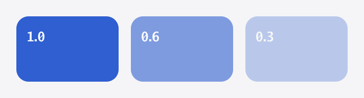
</picture>

```go
accent := geom.Hex(0x2f5fd0)
return basic.Row{Size: layout.MainMin, Spacing: theme.Space12, Children: []core.Widget{
	swatch("1.0", accent),
	basic.Opacity{Opacity: 0.6, Child: swatch("0.6", accent)},
	basic.Opacity{Opacity: 0.3, Child: swatch("0.3", accent)},
}}
```

API: [`basic.Opacity`](https://pkg.go.dev/github.com/bankai-tensei/gowaku/widgets/basic#Opacity)

## basic.Blend

子を 1 枚の画像として、下に描かれたものと合成する。CSS の mix-blend-mode と同じ働きをする。

パッケージ: [`github.com/bankai-tensei/gowaku/widgets/basic`](https://pkg.go.dev/github.com/bankai-tensei/gowaku/widgets/basic)

<picture>
  <source media="(prefers-color-scheme: dark)" srcset="../img/basic-blend-dark.png">
  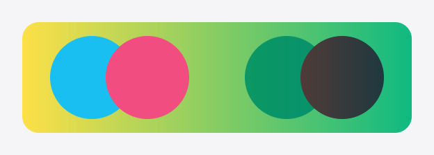
</picture>

```go
backdrop := basic.Container{Width: 280, Height: 80, Radius: 12, Gradient: &paint.Gradient{
	End: geom.Offset{X: 280}, StartColor: geom.Hex(0xfde047), EndColor: geom.Hex(0x10b981),
}}
return basic.Stack{Children: []core.Widget{
	backdrop,
	basic.Positioned{Left: 10, Child: rings()},
	basic.Positioned{Left: 150, Child: basic.Blend{Mode: paint.BlendMultiply, Child: rings()}},
}}
```

API: [`basic.Blend`](https://pkg.go.dev/github.com/bankai-tensei/gowaku/widgets/basic#Blend)

## basic.BackdropFilter

自分の下に描かれたものをぼかしてから、子を描く。すりガラスのような面に使う。

パッケージ: [`github.com/bankai-tensei/gowaku/widgets/basic`](https://pkg.go.dev/github.com/bankai-tensei/gowaku/widgets/basic)

<picture>
  <source media="(prefers-color-scheme: dark)" srcset="../img/basic-backdropfilter-dark.png">
  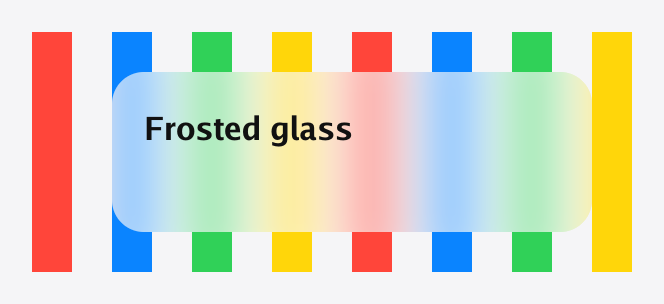
</picture>

```go
basic.Stack{Children: []core.Widget{
	busy(320, 120),
	basic.Positioned{Left: 40, Top: 20, Child: basic.BackdropFilter{Sigma: 12, Radius: 16, Child: basic.Container{
		Width: 240, Height: 80, Radius: 16, Color: geom.RGBA(1, 1, 1, 0.4), Padding: geom.All(16),
		Child: basic.Text{Content: "Frosted glass", Style: text.Style{Size: 16, Weight: 600, Color: geom.Hex(0x111111)}},
	}}},
}}
```

API: [`basic.BackdropFilter`](https://pkg.go.dev/github.com/bankai-tensei/gowaku/widgets/basic#BackdropFilter)

## basic.ImageFiltered

子をぼかして描く。CSS の filter: blur() と同じ働きをする。

パッケージ: [`github.com/bankai-tensei/gowaku/widgets/basic`](https://pkg.go.dev/github.com/bankai-tensei/gowaku/widgets/basic)

<picture>
  <source media="(prefers-color-scheme: dark)" srcset="../img/basic-imagefiltered-dark.png">
  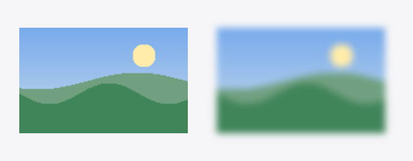
</picture>

```go
basic.Row{Size: layout.MainMin, Spacing: theme.Space24, Children: []core.Widget{
	basic.Image{Source: photo(), Width: 140},
	basic.ImageFiltered{Sigma: 3, Child: basic.Image{Source: photo(), Width: 140}},
}}
```

API: [`basic.ImageFiltered`](https://pkg.go.dev/github.com/bankai-tensei/gowaku/widgets/basic#ImageFiltered)

## basic.ShaderMask

子を独自のシェーダーに通して描く。きらめき、波紋、色調の変更などに使う。

パッケージ: [`github.com/bankai-tensei/gowaku/widgets/basic`](https://pkg.go.dev/github.com/bankai-tensei/gowaku/widgets/basic)

<picture>
  <source media="(prefers-color-scheme: dark)" srcset="../img/basic-shadermask-dark.png">
  
</picture>

```go
// shaders.Shimmer is a shader of examples/shader, made by cmd/gowaku-shader.
shimmer := paint.ShaderParams{0.5, 0.2, 0.35, 0, 1, 1, 1, 0.85}
return basic.ShaderMask{Shader: shaders.Shimmer, Params: shimmer, Time: 1250 * time.Millisecond, Animate: true,
	Child: basic.Text{Content: "gowaku", Style: text.Style{Size: 56, Weight: 700, Color: geom.Hex(0x2f5fd0)}},
}
```

API: [`basic.ShaderMask`](https://pkg.go.dev/github.com/bankai-tensei/gowaku/widgets/basic#ShaderMask)

## basic.Transform

子をアフィン変換で回転、傾斜、伸縮させる。ポインタと支援技術も、変換後の形に従う。

パッケージ: [`github.com/bankai-tensei/gowaku/widgets/basic`](https://pkg.go.dev/github.com/bankai-tensei/gowaku/widgets/basic)

<picture>
  <source media="(prefers-color-scheme: dark)" srcset="../img/basic-transform-dark.png">
  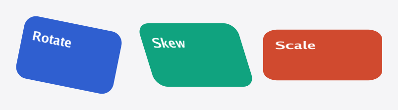
</picture>

```go
basic.Row{Size: layout.MainMin, Spacing: theme.Space28, Children: []core.Widget{
	basic.Rotate(0.2, swatch("Rotate", geom.Hex(0x2f5fd0))),
	basic.Skew(0.3, 0, swatch("Skew", geom.Hex(0x10a37f))),
	basic.Transform{Transform: geom.Scaling(1.2, 0.8), Origin: layout.AlignCenter, Child: swatch("Scale", geom.Hex(0xd04a2f))},
}}
```

API: [`basic.Transform`](https://pkg.go.dev/github.com/bankai-tensei/gowaku/widgets/basic#Transform)

## basic.Translate

子を、自分の大きさに対する割合だけずらして描く。遷移に使う軽量な移動。

パッケージ: [`github.com/bankai-tensei/gowaku/widgets/basic`](https://pkg.go.dev/github.com/bankai-tensei/gowaku/widgets/basic)

<picture>
  <source media="(prefers-color-scheme: dark)" srcset="../img/basic-translate-dark.png">
  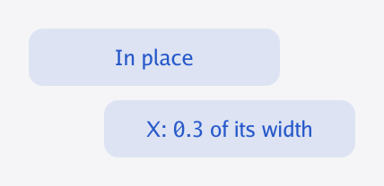
</picture>

```go
basic.Column{Size: layout.MainMin, Cross: layout.CrossStart, Spacing: theme.Space8, Children: []core.Widget{
	tile("In place", 140, 32),
	basic.Translate{X: 0.3, Child: tile("X: 0.3 of its width", 140, 32)},
}}
```

API: [`basic.Translate`](https://pkg.go.dev/github.com/bankai-tensei/gowaku/widgets/basic#Translate)

## basic.ClipRRect

子の描画を自分の箱の中に切り取る。`ClipRRect` は角を丸め、半径が 0 ならテーマのカードの角になる。ポインタも切り取った形の中でしか子に届かない。

パッケージ: [`github.com/bankai-tensei/gowaku/widgets/basic`](https://pkg.go.dev/github.com/bankai-tensei/gowaku/widgets/basic)

<picture>
  <source media="(prefers-color-scheme: dark)" srcset="../img/basic-cliprrect-dark.png">
  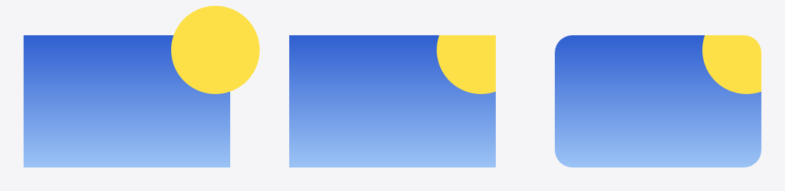
</picture>

```go
basic.Row{Size: layout.MainMin, Spacing: 40, Children: []core.Widget{
	picture,
	basic.ClipRect{Child: picture},
	basic.ClipRRect{Child: picture},
}}
```

API: [`basic.ClipRRect`](https://pkg.go.dev/github.com/bankai-tensei/gowaku/widgets/basic#ClipRRect) · [`basic.ClipRect`](https://pkg.go.dev/github.com/bankai-tensei/gowaku/widgets/basic#ClipRect)

## basic.Scale

`Origin` を中心に、子を拡大縮小して描く。遷移に使う軽量な拡大。

パッケージ: [`github.com/bankai-tensei/gowaku/widgets/basic`](https://pkg.go.dev/github.com/bankai-tensei/gowaku/widgets/basic)

<picture>
  <source media="(prefers-color-scheme: dark)" srcset="../img/basic-scale-dark.png">
  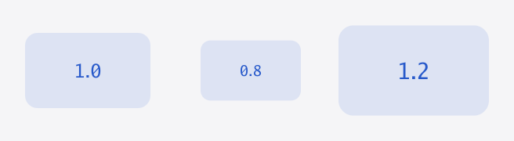
</picture>

```go
basic.Row{Size: layout.MainMin, Spacing: theme.Space24, Children: []core.Widget{
	tile("1.0", 80, 48),
	basic.Scale{Scale: 0.8, Origin: layout.AlignCenter, Child: tile("0.8", 80, 48)},
	basic.Scale{Scale: 1.2, Origin: layout.AlignCenter, Child: tile("1.2", 80, 48)},
}}
```

API: [`basic.Scale`](https://pkg.go.dev/github.com/bankai-tensei/gowaku/widgets/basic#Scale)

## control.CustomPaint

`layout.Painter` で自由に描画する。グラフやメーターなどに使う。

パッケージ: [`github.com/bankai-tensei/gowaku/widgets/control`](https://pkg.go.dev/github.com/bankai-tensei/gowaku/widgets/control)

<picture>
  <source media="(prefers-color-scheme: dark)" srcset="../img/control-custompaint-dark.png">
  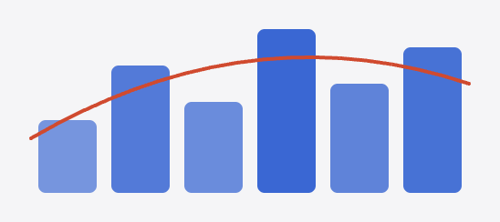
</picture>

```go
control.CustomPaint{Width: 240, Height: 100, Painter: layout.PainterFunc(func(cv *paint.Canvas, sz geom.Size) {
	bars := []float32{0.4, 0.7, 0.5, 0.9, 0.6, 0.8}
	w := sz.W / float32(len(bars))
	for i, v := range bars {
		r := geom.Rect{X: float32(i)*w + 4, Y: sz.H * (1 - v), W: w - 8, H: sz.H * v}
		cv.DrawRRect(geom.RRectAll(r, 4), paint.Paint{Color: geom.Hex(0x2f5fd0).WithAlpha(0.4 + v*0.6)})
	}
	var line paint.Path
	line.MoveTo(0, sz.H*0.7)
	line.QuadTo(sz.W/2, 0, sz.W, sz.H*0.4)
	cv.DrawPath(&line, paint.Paint{Stroke: &paint.Stroke{Width: 2, Color: geom.Hex(0xd04a2f)}})
})}
```

API: [`control.CustomPaint`](https://pkg.go.dev/github.com/bankai-tensei/gowaku/widgets/control#CustomPaint)

## basic.RepaintBoundary

子の描画を周囲から切り離し、片方が変化しても、もう片方を描き直さないようにする。

パッケージ: [`github.com/bankai-tensei/gowaku/widgets/basic`](https://pkg.go.dev/github.com/bankai-tensei/gowaku/widgets/basic)

<picture>
  <source media="(prefers-color-scheme: dark)" srcset="../img/basic-repaintboundary-dark.png">
  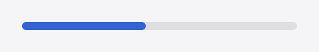
</picture>

```go
// A meter that changes on every frame keeps its repaints to itself.
return basic.RepaintBoundary{Child: basic.SizedBox{Width: 200, Child: control.ProgressBar{Value: 0.45, Label: "Level"}}}
```

API: [`basic.RepaintBoundary`](https://pkg.go.dev/github.com/bankai-tensei/gowaku/widgets/basic#RepaintBoundary)

## interact.FocusRing

標準のコントロールと同じ、淡い 3px のフォーカスリングを描く。独自のコントロールに使う。

パッケージ: [`github.com/bankai-tensei/gowaku/widgets/interact`](https://pkg.go.dev/github.com/bankai-tensei/gowaku/widgets/interact)

<picture>
  <source media="(prefers-color-scheme: dark)" srcset="../img/interact-focusring-dark.png">
  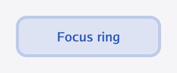
</picture>

```go
themed(func(th *theme.Theme) core.Widget {
	return interact.FocusRing{Visible: true, Radius: th.Radius.Control, Child: basic.Container{
		Width: 140, Height: 36, Radius: th.Radius.Control, Color: th.Color.AccentTint,
		Child: basic.Center{Child: basic.Text{Content: "Focus ring", Style: colored(th.Text.Control, th.Color.AccentInk)}},
	}}
})
```

API: [`interact.FocusRing`](https://pkg.go.dev/github.com/bankai-tensei/gowaku/widgets/interact#FocusRing)
