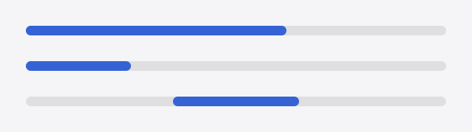
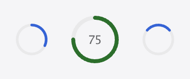
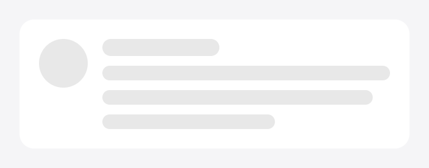
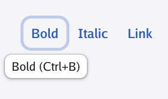
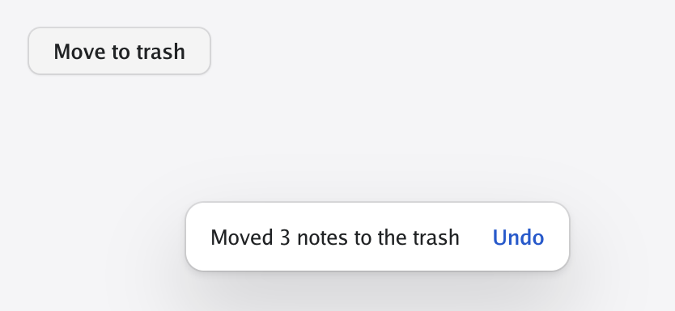
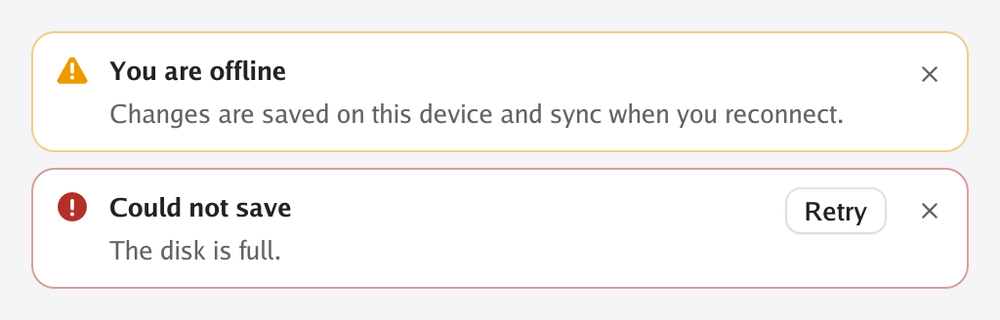
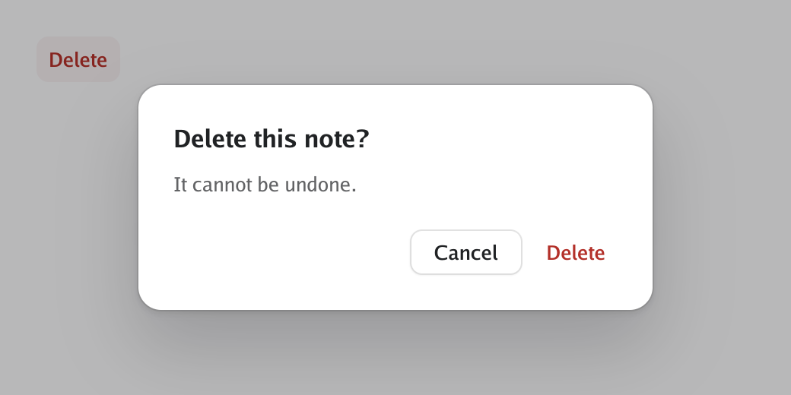
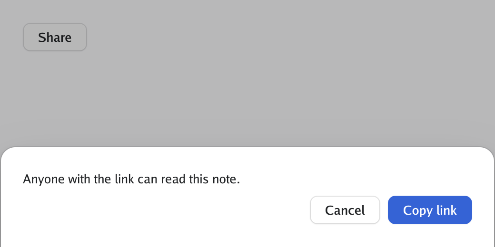

<!-- Code generated by internal/cmd/catalog; DO NOT EDIT. -->

# フィードバックとオーバーレイ

[カタログの目次](README.md) · [English](../en/feedback.md) · [検索できるサイト](https://bankai-tensei.github.io/gowaku/ja/catalog/feedback/)

進み具合や結果を伝えるウィジェットと、画面の上に重ねて表示するウィジェット。重ねて表示するものは `overlay.Show...` 関数で表示する。

> 例に出てくる小文字の関数（`themed`、`colored`、`tile`、`squareIcon` などの図形）は、[internal/catalog/helpers.go](../../../internal/catalog/helpers.go) にある小さな補助関数である。`themed` は `basic.ThemeOf(ctx)` を読み取る `basic.Builder`。例の `core.Widget` と `core.BuildContext` は、`gowaku.Widget` と `gowaku.BuildContext` と同じ型である。

[control.ProgressBar](#controlprogressbar) · [control.ProgressRing](#controlprogressring) · [control.Skeleton](#controlskeleton) · [overlay.Tooltip](#overlaytooltip) · [overlay.Toast](#overlaytoast) · [control.InfoBar](#controlinfobar) · [overlay.Dialog](#overlaydialog) · [overlay.Sheet](#overlaysheet)

## control.ProgressBar

処理の進み具合を、左から伸びるバーで示すウィジェット。値が変わると、新しい位置まで滑らかに移動する。`Indeterminate` にすると、長さの分からない処理を、バーを繰り返し横切る帯で示し、スクリーンリーダーには値の無い処理中の表示として伝える。帯は見えている間だけ動き、動きを減らす設定が有効なときは中央で止まる。

パッケージ: [`github.com/bankai-tensei/gowaku/widgets/control`](https://pkg.go.dev/github.com/bankai-tensei/gowaku/widgets/control)

<picture>
  <source media="(prefers-color-scheme: dark)" srcset="../img/control-progressbar-dark.png">
  
</picture>

```go
basic.SizedBox{Width: 260, Child: basic.Column{Size: layout.MainMin, Cross: layout.CrossStretch, Spacing: theme.Space16, Children: []core.Widget{
	control.ProgressBar{Value: 0.62, Label: "Library sync"},
	control.ProgressBar{Value: 0.25, Label: "Upload"},
	control.ProgressBar{Indeterminate: true, Label: "Connecting"},
}}}
```

API: [`control.ProgressBar`](https://pkg.go.dev/github.com/bankai-tensei/gowaku/widgets/control#ProgressBar)

## control.ProgressRing

処理の進み具合を、12 時の位置から時計回りに満ちていくリングで示すウィジェット。中央に子を置ける。`Indeterminate` にすると、長さの分からない処理のためのスピナーになり、弧がリングの上を回る。スクリーンリーダーには値の無い処理中の表示として伝え、ラベルが無ければウィンドウの言語で「読み込み中」と読む。弧は見えている間だけ回り、動きを減らす設定が有効なときは 12 時の位置で止まる。

パッケージ: [`github.com/bankai-tensei/gowaku/widgets/control`](https://pkg.go.dev/github.com/bankai-tensei/gowaku/widgets/control)

<picture>
  <source media="(prefers-color-scheme: dark)" srcset="../img/control-progressring-dark.png">
  
</picture>

```go
themed(func(th *theme.Theme) core.Widget {
	return basic.Row{Size: layout.MainMin, Spacing: theme.Space24, Cross: layout.CrossCenter, Children: []core.Widget{
		control.ProgressRing{Value: 0.32, Label: "Album art"},
		control.ProgressRing{Value: 0.75, Size: 48, Color: th.Color.Success, Label: "Lyrics", Child: basic.Text{
			Content: "75", Style: colored(th.Text.Caption, th.Color.Ink2),
		}},
		control.ProgressRing{Indeterminate: true, Label: "Syncing"},
	}}
})
```

API: [`control.ProgressRing`](https://pkg.go.dev/github.com/bankai-tensei/gowaku/widgets/control#ProgressRing)

## control.Skeleton

読み込み中の内容の代わりに表示するプレースホルダー。光の帯はウィンドウ全体で 1 本だけ流れ、スケルトンが見えている間だけ動く。動きを減らす設定が有効なときは止まる。`SkeletonGroup` は、読み込み中であることを支援技術に伝える。

パッケージ: [`github.com/bankai-tensei/gowaku/widgets/control`](https://pkg.go.dev/github.com/bankai-tensei/gowaku/widgets/control)

<picture>
  <source media="(prefers-color-scheme: dark)" srcset="../img/control-skeleton-dark.png">
  
</picture>

```go
themed(func(th *theme.Theme) core.Widget {
	return basic.Container{Width: 320, Color: th.Color.Card, Radius: th.Radius.Group, Padding: geom.All(theme.Space16), Child: control.SkeletonGroup{
		Label: "Loading messages",
		Child: basic.Row{Cross: layout.CrossStart, Spacing: theme.Space12, Children: []core.Widget{
			control.Skeleton{Shape: control.SkeletonCircle, Width: 40},
			basic.Expanded{Child: basic.Column{Size: layout.MainMin, Cross: layout.CrossStart, Spacing: theme.Space8, Children: []core.Widget{
				control.Skeleton{Width: 96, Height: 14},
				control.SkeletonText{Lines: 3},
			}}},
		}},
	}}
})
```

API: [`control.Skeleton`](https://pkg.go.dev/github.com/bankai-tensei/gowaku/widgets/control#Skeleton) · [`control.SkeletonShape`](https://pkg.go.dev/github.com/bankai-tensei/gowaku/widgets/control#SkeletonShape) · [`control.SkeletonText`](https://pkg.go.dev/github.com/bankai-tensei/gowaku/widgets/control#SkeletonText) · [`control.SkeletonGroup`](https://pkg.go.dev/github.com/bankai-tensei/gowaku/widgets/control#SkeletonGroup)

## overlay.Tooltip

子にポインタを重ねるか、キーボードでフォーカスを移すと表示される短い説明。支援技術には子の説明として伝わる。

パッケージ: [`github.com/bankai-tensei/gowaku/widgets/overlay`](https://pkg.go.dev/github.com/bankai-tensei/gowaku/widgets/overlay)

<picture>
  <source media="(prefers-color-scheme: dark)" srcset="../img/overlay-tooltip-dark.png">
  
</picture>

```go
tool := func(label, tip string) core.Widget {
	return overlay.Tooltip{Message: tip, Child: control.Button{Label: label, Style: control.ButtonQuiet, OnPress: func() {}}}
}
return basic.Row{Size: layout.MainMin, Spacing: theme.Space4, Children: []core.Widget{
	tool("Bold", "Bold (Ctrl+B)"),
	tool("Italic", "Italic (Ctrl+I)"),
	tool("Link", "Insert a link (Ctrl+K)"),
}}
```

API: [`overlay.Tooltip`](https://pkg.go.dev/github.com/bankai-tensei/gowaku/widgets/overlay#Tooltip)

## overlay.Toast

ウィンドウの下部に数秒間表示される短い通知。「元に戻す」のような操作を 1 つ付けられる。`ShowToast` で表示する。

パッケージ: [`github.com/bankai-tensei/gowaku/widgets/overlay`](https://pkg.go.dev/github.com/bankai-tensei/gowaku/widgets/overlay)

<picture>
  <source media="(prefers-color-scheme: dark)" srcset="../img/overlay-toast-dark.png">
  
</picture>

```go
basic.Builder{Content: func(ctx core.BuildContext) core.Widget {
	return control.Button{Label: "Move to trash", OnPress: func() {
		overlay.ShowToast(ctx, overlay.Toast{Message: "Moved 3 notes to the trash", Action: "Undo", OnAction: func() {}})
	}}
}}
```

API: [`overlay.Toast`](https://pkg.go.dev/github.com/bankai-tensei/gowaku/widgets/overlay#Toast)

## control.InfoBar

ページ内に表示され続ける通知の帯。情報・成功・警告・エラーに応じたアイコンと色で表示し、閉じるボタンと操作を 1 つ付けられる。表示するかどうかは、親が `Open` で決める。

パッケージ: [`github.com/bankai-tensei/gowaku/widgets/control`](https://pkg.go.dev/github.com/bankai-tensei/gowaku/widgets/control)

<picture>
  <source media="(prefers-color-scheme: dark)" srcset="../img/control-infobar-dark.png">
  
</picture>

```go
control.InfoBar{
	Open: true, Severity: control.SeverityWarning,
	Title: "You are offline", Message: "Changes are saved on this device and sync when you reconnect.",
	OnClose: closed,
},
control.InfoBar{
	Open: true, Severity: control.SeverityError,
	Title: "Could not save", Message: "The disk is full.",
	Action: "Retry", OnAction: func() {}, OnClose: closed,
},
```

API: [`control.InfoBar`](https://pkg.go.dev/github.com/bankai-tensei/gowaku/widgets/control#InfoBar) · [`control.InfoSeverity`](https://pkg.go.dev/github.com/bankai-tensei/gowaku/widgets/control#InfoSeverity)

## overlay.Dialog

作業を中断して応答を求めるカード。`ShowDialog` で表示し、フォーカスはダイアログの中に閉じ込められる。`Glass` を指定すると背景をぼかす。

パッケージ: [`github.com/bankai-tensei/gowaku/widgets/overlay`](https://pkg.go.dev/github.com/bankai-tensei/gowaku/widgets/overlay)

<picture>
  <source media="(prefers-color-scheme: dark)" srcset="../img/overlay-dialog-dark.png">
  
</picture>

```go
basic.Builder{Content: func(ctx core.BuildContext) core.Widget {
	return control.Button{Label: "Delete", Style: control.ButtonDanger, OnPress: func() {
		overlay.ShowDialog(ctx, func(dismiss func()) core.Widget {
			return overlay.Dialog{
				Title:   "Delete this note?",
				Message: "It cannot be undone.",
				Actions: []core.Widget{
					control.Button{Label: "Cancel", OnPress: dismiss},
					control.Button{Label: "Delete", Style: control.ButtonDanger, OnPress: dismiss},
				},
			}
		})
	}}
}}
```

API: [`overlay.Dialog`](https://pkg.go.dev/github.com/bankai-tensei/gowaku/widgets/overlay#Dialog)

## overlay.Sheet

ウィンドウの下端か横からせり出すパネル。`ShowSheet` で表示する。

パッケージ: [`github.com/bankai-tensei/gowaku/widgets/overlay`](https://pkg.go.dev/github.com/bankai-tensei/gowaku/widgets/overlay)

<picture>
  <source media="(prefers-color-scheme: dark)" srcset="../img/overlay-sheet-dark.png">
  
</picture>

```go
basic.Builder{Content: func(ctx core.BuildContext) core.Widget {
	return control.Button{Label: "Share", OnPress: func() {
		overlay.ShowSheet(ctx, overlay.Sheet{Label: "Share note"}, func(dismiss func()) core.Widget {
			return basic.Column{Size: layout.MainMin, Spacing: theme.Space8, Children: []core.Widget{
				basic.Text{Content: "Anyone with the link can read this note."},
				basic.Row{Main: layout.MainEnd, Spacing: theme.Space8, Children: []core.Widget{
					control.Button{Label: "Cancel", OnPress: dismiss},
					control.Button{Label: "Copy link", Style: control.ButtonPrimary, OnPress: dismiss},
				}},
			}}
		})
	}}
}}
```

API: [`overlay.Sheet`](https://pkg.go.dev/github.com/bankai-tensei/gowaku/widgets/overlay#Sheet) · [`overlay.SheetEdge`](https://pkg.go.dev/github.com/bankai-tensei/gowaku/widgets/overlay#SheetEdge)
