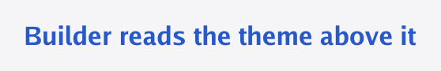
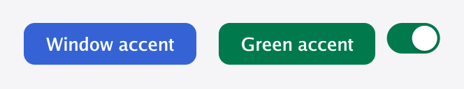
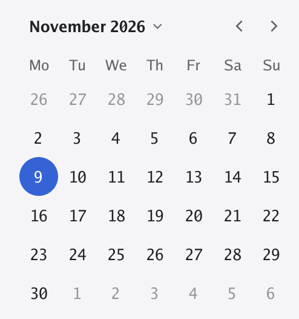

<!-- Code generated by internal/cmd/catalog; DO NOT EDIT. -->

# ウィジェットツリーの基盤

[カタログの目次](README.md) · [English](../en/infrastructure.md) · [検索できるサイト](https://bankai-tensei.github.io/gowaku/ja/catalog/infrastructure/)

配下のウィジェットに、テーマ、ウィンドウの情報、文言、重ねて表示する場所を提供するウィジェット。`gowaku.Run` がウィンドウのルートに置くため、自分で使うのは一部だけを変えたいときに限られる。

> 例に出てくる小文字の関数（`themed`、`colored`、`tile`、`squareIcon` などの図形）は、[internal/catalog/helpers.go](../../../internal/catalog/helpers.go) にある小さな補助関数である。`themed` は `basic.ThemeOf(ctx)` を読み取る `basic.Builder`。例の `core.Widget` と `core.BuildContext` は、`gowaku.Widget` と `gowaku.BuildContext` と同じ型である。

[basic.Builder](#basicbuilder) · [basic.Theme](#basictheme) · [basic.MediaQuery](#basicmediaquery) · [basic.Localizations](#basiclocalizations) · [overlay.Overlay](#overlayoverlay)

## basic.Builder

その位置の `BuildContext` で中身を構築する。上位にあるテーマなどを読み取るのに使う。

パッケージ: [`github.com/bankai-tensei/gowaku/widgets/basic`](https://pkg.go.dev/github.com/bankai-tensei/gowaku/widgets/basic)

<picture>
  <source media="(prefers-color-scheme: dark)" srcset="../img/basic-builder-dark.png">
  
</picture>

```go
basic.Builder{Content: func(ctx core.BuildContext) core.Widget {
	th := basic.ThemeOf(ctx)
	return basic.Text{Content: "Builder reads the theme above it", Style: colored(th.Text.Title, th.Color.AccentInk)}
}}
```

API: [`basic.Builder`](https://pkg.go.dev/github.com/bankai-tensei/gowaku/widgets/basic#Builder)

## basic.Theme

配下のウィジェットの見た目を決める。ウィンドウの一部だけアクセントの色を変えたいときに使う。

パッケージ: [`github.com/bankai-tensei/gowaku/widgets/basic`](https://pkg.go.dev/github.com/bankai-tensei/gowaku/widgets/basic)

<picture>
  <source media="(prefers-color-scheme: dark)" srcset="../img/basic-theme-dark.png">
  
</picture>

```go
basic.Builder{Content: func(ctx core.BuildContext) core.Widget {
	green := theme.FromAccent(geom.Hex(0x1f8a5b)).For(basic.MediaQueryOf(ctx).Brightness)
	return basic.Row{Size: layout.MainMin, Spacing: theme.Space16, Children: []core.Widget{
		control.Button{Label: "Window accent", Style: control.ButtonPrimary, OnPress: func() {}},
		basic.Theme{Data: green, Child: basic.Row{Size: layout.MainMin, Spacing: theme.Space8, Children: []core.Widget{
			control.Button{Label: "Green accent", Style: control.ButtonPrimary, OnPress: func() {}},
			control.Switch{Value: true, Label: "Green", OnChange: func(bool) {}},
		}}},
	}}
}}
```

API: [`basic.Theme`](https://pkg.go.dev/github.com/bankai-tensei/gowaku/widgets/basic#Theme)

## basic.MediaQuery

ウィンドウの明るさ、表示倍率、動きを減らす設定、ロケール、内容の領域の大きさを配下に伝える。大きさは `basic.WindowSizeOf` で読むと、ウィンドウの大きさが変わったときにそのウィジェットだけが再構築される。この例ではロケールを英国にして、週を月曜から始めている。

パッケージ: [`github.com/bankai-tensei/gowaku/widgets/basic`](https://pkg.go.dev/github.com/bankai-tensei/gowaku/widgets/basic)

<picture>
  <source media="(prefers-color-scheme: dark)" srcset="../img/basic-mediaquery-dark.png">
  
</picture>

```go
basic.Builder{Content: func(ctx core.BuildContext) core.Widget {
	data := basic.MediaQueryOf(ctx)
	data.Locale = language.BritishEnglish // weeks start on Monday
	return basic.MediaQuery{Data: data, Child: field.Calendar{
		Value: time.Date(2026, time.November, 9, 0, 0, 0, 0, time.UTC), OnChange: func(time.Time) {},
	}}
}}
```

API: [`basic.MediaQuery`](https://pkg.go.dev/github.com/bankai-tensei/gowaku/widgets/basic#MediaQuery) · [`basic.MediaQueryData`](https://pkg.go.dev/github.com/bankai-tensei/gowaku/widgets/basic#MediaQueryData)

## basic.Localizations

標準のウィジェットが使う文言の表を渡す。日本語と英語は同梱されており、ほかの言語は `Strings` を追加する。

パッケージ: [`github.com/bankai-tensei/gowaku/widgets/basic`](https://pkg.go.dev/github.com/bankai-tensei/gowaku/widgets/basic)

*自分では何も描画しないため、画像は無い。*

```go
german := &basic.Strings{Language: language.German, Today: "Heute", Clear: "Löschen"}
return basic.Localizations{Strings: []*basic.Strings{german}, Child: field.DatePicker{
	ShowToday: true, ShowClear: true, OnChange: func(time.Time) {},
}}
```

API: [`basic.Localizations`](https://pkg.go.dev/github.com/bankai-tensei/gowaku/widgets/basic#Localizations) · [`basic.Strings`](https://pkg.go.dev/github.com/bankai-tensei/gowaku/widgets/basic#Strings)

## overlay.Overlay

子の上に項目を重ねて表示する場所。ダイアログやメニューもここに表示される。

パッケージ: [`github.com/bankai-tensei/gowaku/widgets/overlay`](https://pkg.go.dev/github.com/bankai-tensei/gowaku/widgets/overlay)

*自分では何も描画しないため、画像は無い。*

```go
basic.Builder{Content: func(ctx core.BuildContext) core.Widget {
	return control.Button{Label: "Show a hint", OnPress: func() {
		var entry *overlay.Entry
		entry = overlay.Of(ctx).Insert(func() core.Widget {
			return basic.Positioned{Left: 16, Top: 16, Child: control.Button{Label: "Close the hint", OnPress: func() { entry.Remove() }}}
		})
	}}
}}
```

API: [`overlay.Overlay`](https://pkg.go.dev/github.com/bankai-tensei/gowaku/widgets/overlay#Overlay) · [`overlay.Entry`](https://pkg.go.dev/github.com/bankai-tensei/gowaku/widgets/overlay#Entry) · [`overlay.Host`](https://pkg.go.dev/github.com/bankai-tensei/gowaku/widgets/overlay#Host)
