<!-- Code generated by internal/cmd/catalog; DO NOT EDIT. -->

# 入力

[カタログの目次](README.md) · [English](../en/input.md) · [検索できるサイト](https://bankai-tensei.github.io/gowaku/ja/catalog/input/)

文字や数値を入力するウィジェット。ラベルは欄の上か、`collection.GroupRow` の左に置く。

> 例に出てくる小文字の関数（`themed`、`colored`、`tile`、`squareIcon` などの図形）は、[internal/catalog/helpers.go](../../../internal/catalog/helpers.go) にある小さな補助関数である。`themed` は `basic.ThemeOf(ctx)` を読み取る `basic.Builder`。例の `core.Widget` と `core.BuildContext` は、`gowaku.Widget` と `gowaku.BuildContext` と同じ型である。

[field.Input](#fieldinput) · [field.Search](#fieldsearch) · [field.Autocomplete](#fieldautocomplete) · [editor.Editor](#editoreditor) · [control.NumberStepper](#controlnumberstepper) · [control.Slider](#controlslider) · [control.RangeSlider](#controlrangeslider) · [field.NumberField](#fieldnumberfield) · [field.TokenField](#fieldtokenfield) · [field.Form](#fieldform) · [field.TimePicker](#fieldtimepicker)

## field.Input

1 行または複数行のテキスト入力欄。ラベルは欄の上に表示される。IME、ルビ、縦書き、元に戻す操作に対応する。複数行の欄は、高さの決まっていない所では文字に合わせて伸び、`Expanded` などで高さを与えると、ラベルの有無にかかわらずその高さを埋める。`SubmitOnEnter` を指定した複数行の欄は、チャットの入力欄のように Enter で送信し、Shift+Enter で改行する。`Autofocus` を指定すると、ダイアログの中でも最初に現れたときにキーボードを受け取る。長い文書には `editor.Editor` を使う。

パッケージ: [`github.com/bankai-tensei/gowaku/widgets/field`](https://pkg.go.dev/github.com/bankai-tensei/gowaku/widgets/field)

<picture>
  <source media="(prefers-color-scheme: dark)" srcset="../img/field-input-dark.png">
  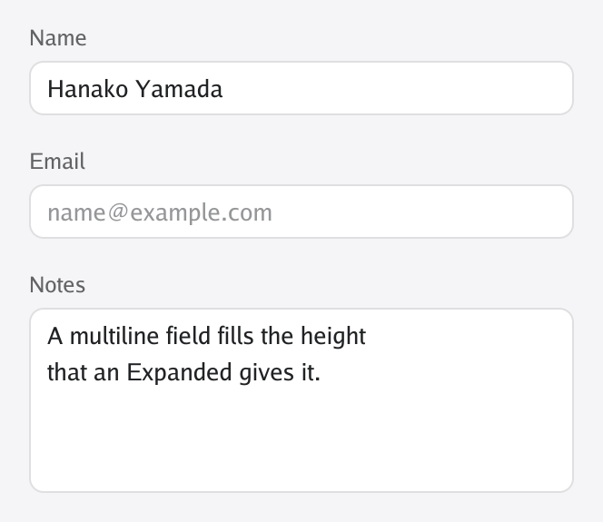
</picture>

```go
set := func(string) {}
return basic.SizedBox{Width: 300, Height: 260, Child: basic.Column{Cross: layout.CrossStretch, Spacing: theme.Space16, Children: []core.Widget{
	field.Input{Label: "Name", Value: "Hanako Yamada", OnChange: set},
	field.Input{Label: "Email", Placeholder: "name@example.com", OnChange: set},
	basic.Expanded{Child: field.Input{
		Label: "Notes", Multiline: true, Value: "A multiline field fills the height\nthat an Expanded gives it.", OnChange: set,
	}},
}}}
```

API: [`field.Input`](https://pkg.go.dev/github.com/bankai-tensei/gowaku/widgets/field#Input) · [`field.InputController`](https://pkg.go.dev/github.com/bankai-tensei/gowaku/widgets/field#InputController)

## field.Search

検索用のテキスト入力欄。虫眼鏡のアイコンと消去ボタンが付き、Escape キーで内容を消去する。

パッケージ: [`github.com/bankai-tensei/gowaku/widgets/field`](https://pkg.go.dev/github.com/bankai-tensei/gowaku/widgets/field)

<picture>
  <source media="(prefers-color-scheme: dark)" srcset="../img/field-search-dark.png">
  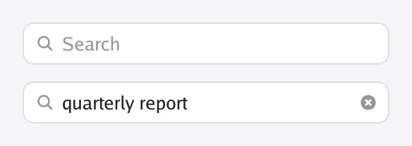
</picture>

```go
basic.SizedBox{Width: 260, Child: basic.Column{Size: layout.MainMin, Cross: layout.CrossStretch, Spacing: theme.Space12, Children: []core.Widget{
	field.Search{OnChange: func(string) {}},
	field.Search{Value: "quarterly report", OnChange: func(string) {}},
}}}
```

API: [`field.Search`](https://pkg.go.dev/github.com/bankai-tensei/gowaku/widgets/field#Search)

## field.Autocomplete

入力に応じて候補を欄の下に表示するテキスト入力欄。矢印キーで候補を選び、Enter か Tab で確定する。

パッケージ: [`github.com/bankai-tensei/gowaku/widgets/field`](https://pkg.go.dev/github.com/bankai-tensei/gowaku/widgets/field)

<picture>
  <source media="(prefers-color-scheme: dark)" srcset="../img/field-autocomplete-dark.png">
  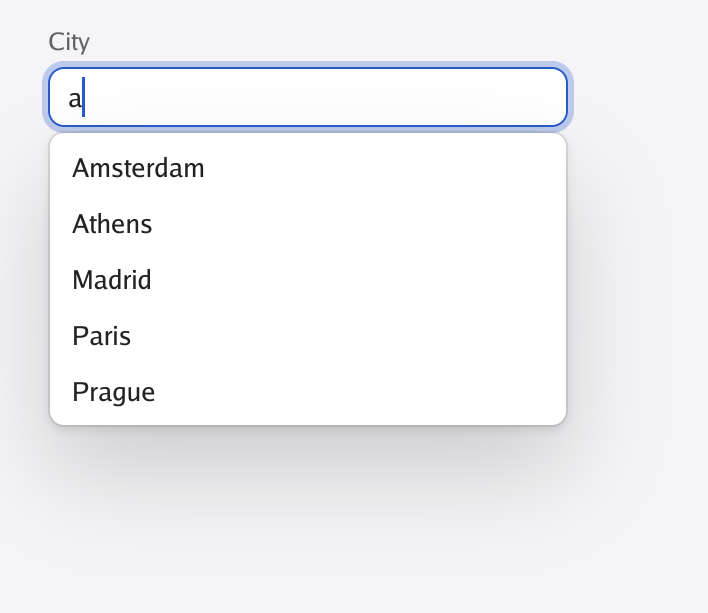
</picture>

```go
cities := []string{"Amsterdam", "Athens", "Berlin", "Lisbon", "Madrid", "Paris", "Prague", "Rome"}
return basic.SizedBox{Width: 260, Child: field.Autocomplete[string]{
	Label: "City", Placeholder: "Type a city", Options: cities, OnSelect: func(string) {},
}}
```

API: [`field.Autocomplete`](https://pkg.go.dev/github.com/bankai-tensei/gowaku/widgets/field#Autocomplete)

## editor.Editor

コードや長文を編集するためのエディタ。行番号、色付けなどの装飾、検索と置換に対応し、表示中の行だけをレイアウトする。検索バーを開いている間は、バーの分の余白を先頭の行の上に取り、一致した箇所をバーの下に表示する。`Controller.SetSource` に渡した行のソース（ファイルなど）は、表示する行だけを読み、編集した行だけをメモリに持つので、数 GB でもすぐに開ける。

パッケージ: [`github.com/bankai-tensei/gowaku/widgets/editor`](https://pkg.go.dev/github.com/bankai-tensei/gowaku/widgets/editor)

<picture>
  <source media="(prefers-color-scheme: dark)" srcset="../img/editor-editor-dark.png">
  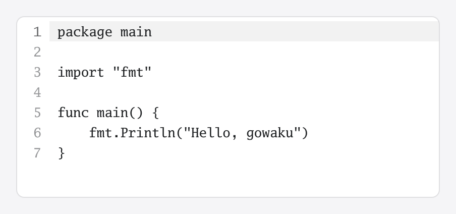
</picture>

```go
var doc editor.Controller
doc.SetText("package main\n\nimport \"fmt\"\n\nfunc main() {\n\tfmt.Println(\"Hello, gowaku\")\n}")
return basic.SizedBox{Width: 420, Height: 180, Child: editor.Editor{
	Controller: &doc, Label: "Source", LineNumbers: true, Border: true, HighlightCurrentLine: true,
}}
```

API: [`editor.Editor`](https://pkg.go.dev/github.com/bankai-tensei/gowaku/widgets/editor#Editor) · [`editor.Controller`](https://pkg.go.dev/github.com/bankai-tensei/gowaku/widgets/editor#Controller) · [`editor.Decoration`](https://pkg.go.dev/github.com/bankai-tensei/gowaku/widgets/editor#Decoration) · [`editor.TextPosition`](https://pkg.go.dev/github.com/bankai-tensei/gowaku/widgets/editor#TextPosition) · [`editor.TextRange`](https://pkg.go.dev/github.com/bankai-tensei/gowaku/widgets/editor#TextRange) · [`editor.FindOptions`](https://pkg.go.dev/github.com/bankai-tensei/gowaku/widgets/editor#FindOptions)

## control.NumberStepper

マイナスとプラスのボタンで整数を増減するウィジェット。`Format` で単位を付けて表示できる。ウィザードの手順を示すものは `nav.Steps` である。

パッケージ: [`github.com/bankai-tensei/gowaku/widgets/control`](https://pkg.go.dev/github.com/bankai-tensei/gowaku/widgets/control)

<picture>
  <source media="(prefers-color-scheme: dark)" srcset="../img/control-numberstepper-dark.png">
  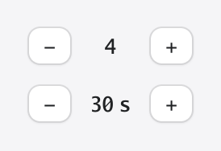
</picture>

```go
seconds := func(v int) string { return strconv.Itoa(v) + " s" }
return basic.Column{Size: layout.MainMin, Cross: layout.CrossStart, Spacing: theme.Space12, Children: []core.Widget{
	control.NumberStepper{Value: 4, Max: 12, Label: "Copies", OnChange: func(int) {}},
	control.NumberStepper{Value: 30, Max: 60, Step: 5, Format: seconds, Label: "Delay", OnChange: func(int) {}},
}}
```

API: [`control.NumberStepper`](https://pkg.go.dev/github.com/bankai-tensei/gowaku/widgets/control#NumberStepper)

## control.Slider

範囲の中から値を選ぶスライダー。`Snap` を指定すると、値が `Step` の刻みに吸着する。矢印キーでも操作できる。

パッケージ: [`github.com/bankai-tensei/gowaku/widgets/control`](https://pkg.go.dev/github.com/bankai-tensei/gowaku/widgets/control)

<picture>
  <source media="(prefers-color-scheme: dark)" srcset="../img/control-slider-dark.png">
  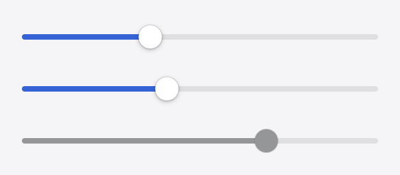
</picture>

```go
basic.SizedBox{Width: 260, Child: basic.Column{Size: layout.MainMin, Cross: layout.CrossStretch, Spacing: theme.Space16, Children: []core.Widget{
	control.Slider{Value: 0.35, Label: "Volume", OnChange: func(float32) {}},
	control.Slider{Value: 40, Min: 0, Max: 100, Step: 10, Snap: true, Label: "Zoom", OnChange: func(float32) {}},
	control.Slider{Value: 0.7, Label: "Disabled"},
}}}
```

API: [`control.Slider`](https://pkg.go.dev/github.com/bankai-tensei/gowaku/widgets/control#Slider)

## control.RangeSlider

2 つのつまみで範囲を選ぶ `Slider`。つまみの間の帯をドラッグすると、幅を保ったまま範囲全体が動く。つまみ同士は `MinGap` より近づかず、それぞれが Tab キーでの移動先になる。

パッケージ: [`github.com/bankai-tensei/gowaku/widgets/control`](https://pkg.go.dev/github.com/bankai-tensei/gowaku/widgets/control)

<picture>
  <source media="(prefers-color-scheme: dark)" srcset="../img/control-rangeslider-dark.png">
  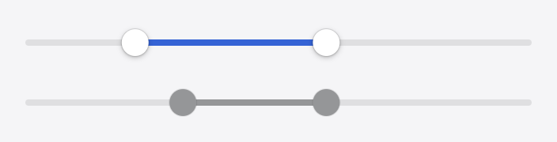
</picture>

```go
control.RangeSlider{
	Label: "Price", Low: 20000, High: 60000, Min: 0, Max: 100000,
	Step: 1000, Snap: true, MinGap: 5000, OnChange: set,
},
control.RangeSlider{Label: "Disabled", Low: 0.3, High: 0.6},
```

API: [`control.RangeSlider`](https://pkg.go.dev/github.com/bankai-tensei/gowaku/widgets/control#RangeSlider)

## field.NumberField

数値の入力欄。直接入力するほか、上下の矢印キー、フォーカス中のマウスホイール、右端のつまみのドラッグで値を増減できる。全角数字も受け付け、桁区切りと小数点の記号はロケールに従う。Enter キーで入力した文字を値として確定する。`FormItem` の中では、続けて周りの `Form` を新しい値で送信する。`FormItem` の外では確定するだけで、何も送信しない。

パッケージ: [`github.com/bankai-tensei/gowaku/widgets/field`](https://pkg.go.dev/github.com/bankai-tensei/gowaku/widgets/field)

<picture>
  <source media="(prefers-color-scheme: dark)" srcset="../img/field-numberfield-dark.png">
  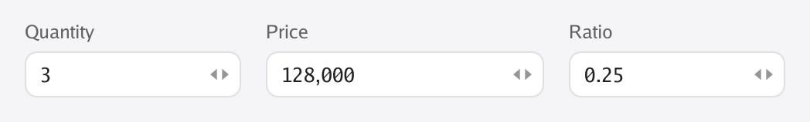
</picture>

```go
basic.SizedBox{Width: 140, Child: field.NumberField{Label: "Quantity", Value: 3, Min: 0, Max: 99, OnChange: set}},
basic.SizedBox{Width: 180, Child: field.NumberField{Label: "Price", Value: 128000, Step: 100, Grouping: true, OnChange: set}},
basic.SizedBox{Width: 140, Child: field.NumberField{Label: "Ratio", Value: 0.25, Min: 0, Max: 1, Step: 0.05, OnChange: set}},
```

API: [`field.NumberField`](https://pkg.go.dev/github.com/bankai-tensei/gowaku/widgets/field#NumberField)

## field.TokenField

タグや宛先のような短い文字列の並びを編集する入力欄。Enter か区切り文字で入力を確定すると、チップとして表示される。IME で変換中の Enter ではトークンを作らない。先頭で Backspace を 2 回押すと、直前のトークンを削除する。

パッケージ: [`github.com/bankai-tensei/gowaku/widgets/field`](https://pkg.go.dev/github.com/bankai-tensei/gowaku/widgets/field)

<picture>
  <source media="(prefers-color-scheme: dark)" srcset="../img/field-tokenfield-dark.png">
  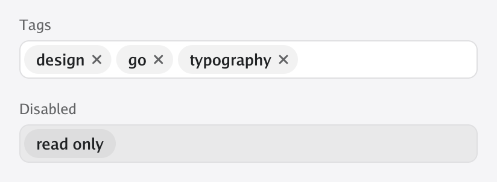
</picture>

```go
field.TokenField{Label: "Tags", Tokens: []string{"design", "go", "typography"}, Placeholder: "Add a tag", OnChange: set},
field.TokenField{Label: "Disabled", Tokens: []string{"read only"}},
```

API: [`field.TokenField`](https://pkg.go.dev/github.com/bankai-tensei/gowaku/widgets/field#TokenField)

## field.Form

配下の `FormItem` をまとめて検証し、送信するフォーム。エラーは、送信時と欄からフォーカスが外れたときに、その欄の下に表示され、欄の枠が赤くなる。`Required` のエラーは中の部品に合わせて変わり、入力欄では「入力してください」、`DropdownMenu` や `DatePicker` などの選択では「選択してください」、`Checkbox` では「チェックしてください」になる。`RequiredMessage` で差し替えられる。`FormItem` の中の 1 行の入力欄で Enter キーを押すと、フォームを送信する。

パッケージ: [`github.com/bankai-tensei/gowaku/widgets/field`](https://pkg.go.dev/github.com/bankai-tensei/gowaku/widgets/field)

<picture>
  <source media="(prefers-color-scheme: dark)" srcset="../img/field-form-dark.png">
  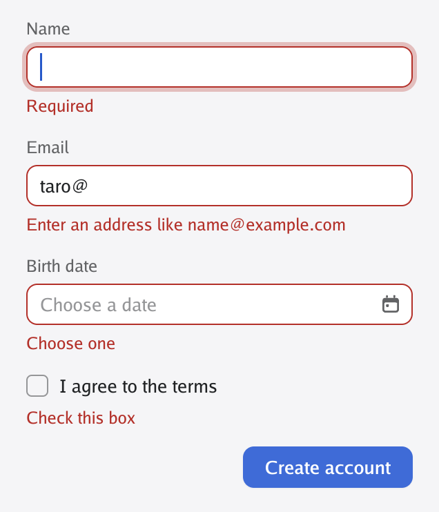
</picture>

```go
var form field.FormController
email := regexp.MustCompile(`[^@\s]+@[^@\s]+\.[^@\s]+`)
return basic.SizedBox{Width: 280, Child: field.Form{Controller: &form, Child: basic.Column{
	Size: layout.MainMin, Cross: layout.CrossStretch, Spacing: theme.Space12, Children: []core.Widget{
		field.FormItem[string]{Required: true, Child: field.Input{Label: "Name", OnChange: func(string) {}}},
		field.FormItem[string]{
			Value:      "taro@",
			Validators: []func(string) string{field.Pattern(email, "Enter an address like name@example.com")},
			Child:      field.Input{Label: "Email", Value: "taro@", OnChange: func(string) {}},
		},
		field.FormItem[time.Time]{Required: true, Child: field.DatePicker{
			Label: "Birth date", Placeholder: "Choose a date", OnChange: func(time.Time) {},
			InitialMonth: time.Date(1995, time.January, 1, 0, 0, 0, 0, time.UTC),
		}},
		field.FormItem[bool]{Required: true, Child: control.Checkbox{Label: "I agree to the terms", OnChange: func(bool) {}}},
		basic.Row{Main: layout.MainEnd, Children: []core.Widget{
			control.Button{Label: "Create account", Style: control.ButtonPrimary, OnPress: func() { form.Submit() }},
		}},
	},
}}}
```

API: [`field.Form`](https://pkg.go.dev/github.com/bankai-tensei/gowaku/widgets/field#Form) · [`field.FormItem`](https://pkg.go.dev/github.com/bankai-tensei/gowaku/widgets/field#FormItem) · [`field.FormController`](https://pkg.go.dev/github.com/bankai-tensei/gowaku/widgets/field#FormController)

## field.TimePicker

時刻の入力欄。時・分・秒・午前午後の部分ごとに、矢印キーか数字で編集する。12 時間制か 24 時間制かはロケールに従う。

パッケージ: [`github.com/bankai-tensei/gowaku/widgets/field`](https://pkg.go.dev/github.com/bankai-tensei/gowaku/widgets/field)

<picture>
  <source media="(prefers-color-scheme: dark)" srcset="../img/field-timepicker-dark.png">
  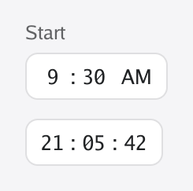
</picture>

```go
at := func(h, m int) time.Duration { return time.Duration(h)*time.Hour + time.Duration(m)*time.Minute }
return basic.Column{Size: layout.MainMin, Cross: layout.CrossStart, Spacing: theme.Space12, Children: []core.Widget{
	field.TimePicker{Label: "Start", Value: at(9, 30), MinuteStep: 15, OnChange: func(time.Duration) {}},
	field.TimePicker{Value: at(21, 5) + 42*time.Second, Seconds: true, HourCycle: field.HourCycle24, OnChange: func(time.Duration) {}},
}}
```

API: [`field.TimePicker`](https://pkg.go.dev/github.com/bankai-tensei/gowaku/widgets/field#TimePicker) · [`field.HourCycle`](https://pkg.go.dev/github.com/bankai-tensei/gowaku/widgets/field#HourCycle)
