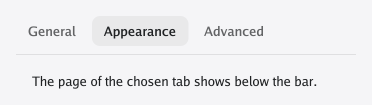
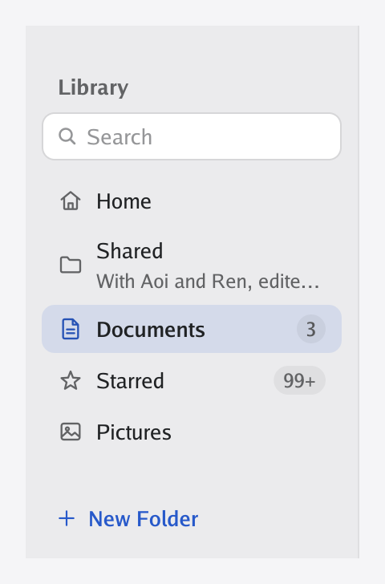
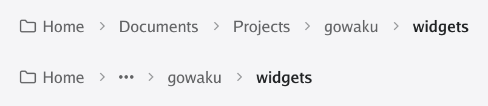
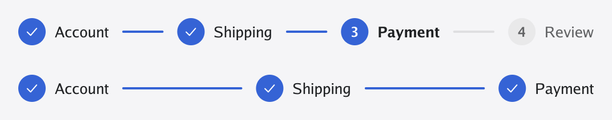
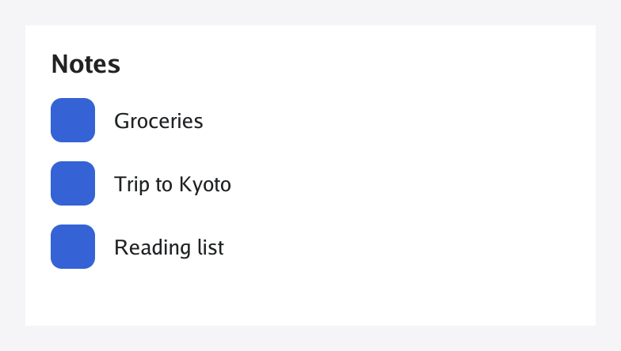
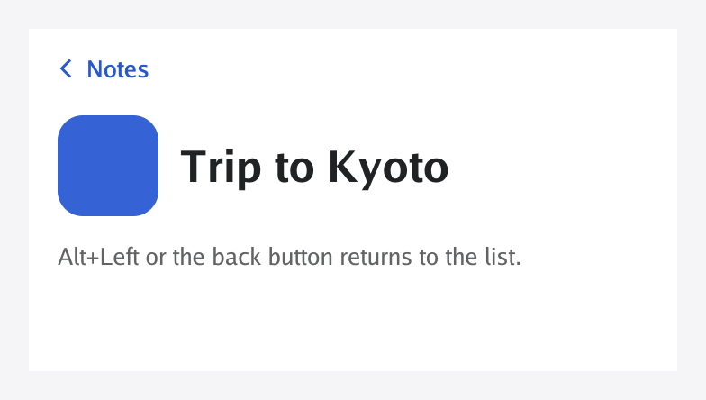

<!-- Code generated by internal/cmd/catalog; DO NOT EDIT. -->

# ナビゲーション

[カタログの目次](README.md) · [English](../en/navigation.md) · [検索できるサイト](https://bankai-tensei.github.io/gowaku/ja/catalog/navigation/)

画面の間を移動するためのウィジェット。アクセントの色は現在地にだけ使う。

> 例に出てくる小文字の関数（`themed`、`colored`、`tile`、`squareIcon` などの図形）は、[internal/catalog/helpers.go](../../../internal/catalog/helpers.go) にある小さな補助関数である。`themed` は `basic.ThemeOf(ctx)` を読み取る `basic.Builder`。例の `core.Widget` と `core.BuildContext` は、`gowaku.Widget` と `gowaku.BuildContext` と同じ型である。

[control.Tabs](#controltabs) · [collection.Sidebar](#collectionsidebar) · [nav.Breadcrumb](#navbreadcrumb) · [nav.Steps](#navsteps) · [nav.Navigator](#navnavigator) · [nav.BackButton](#navbackbutton)

## control.Tabs

ページを切り替えるタブ。下線付きのタブの並びの下に、選択したページを表示する。

パッケージ: [`github.com/bankai-tensei/gowaku/widgets/control`](https://pkg.go.dev/github.com/bankai-tensei/gowaku/widgets/control)

<picture>
  <source media="(prefers-color-scheme: dark)" srcset="../img/control-tabs-dark.png">
  
</picture>

```go
basic.SizedBox{Width: 340, Height: 150, Child: control.Tabs{
	Label: "Settings", Selected: 1, OnChange: func(int) {},
	Pages: []control.TabPage{
		{Label: "General"},
		{Label: "Appearance", Child: basic.Padding{Insets: geom.All(theme.Space16), Child: basic.Text{
			Content: "The page of the chosen tab shows below the bar.",
		}}},
		{Label: "Advanced"},
	},
}}
```

API: [`control.Tabs`](https://pkg.go.dev/github.com/bankai-tensei/gowaku/widgets/control#Tabs) · [`control.TabPage`](https://pkg.go.dev/github.com/bankai-tensei/gowaku/widgets/control#TabPage)

## collection.Sidebar

ウィンドウの左端に置く、移動先の一覧。背景と右端の区切り線を自分で描くので、`CrossStretch` の `Row` の先頭に置く。幅は `Width` で決まり、ゼロなら 208。行が収まらないときは行だけがスクロールし、タイトル、その下の `Header`（検索欄など）、下端に固定する `Footer`（ボタンなど）は動かない。選択中の行は `AccentTint` の背景になる。`SidebarItem` の `Count` は、未読の件数などを行の右端に控えめな丸い枠で表示し、スクリーンリーダーには行の値として 1 度だけ伝える。`Detail` は、チャットの最後のメッセージのような 2 行目を小さく `Ink2` で表示し（選択中の行では、件数とともに、色合いの上で読める `theme.Colors.OnTint` の色）、1 行に収まらない分は省略記号で切る。`Detail` のある行は 46 の高さになり、スクリーンリーダーには詳細の全文を行の説明として 1 度だけ伝える。`Leading` は、メールのラベルの色の点のようなウィジェットを `Icon` の代わりに行頭に置く。選択中の行では `OnTint` のテーマの下で作るので、テーマの色を使う部分は色合いの上で読め、点のように自分で決めた色はそのまま残る。

パッケージ: [`github.com/bankai-tensei/gowaku/widgets/collection`](https://pkg.go.dev/github.com/bankai-tensei/gowaku/widgets/collection)

<picture>
  <source media="(prefers-color-scheme: dark)" srcset="../img/collection-sidebar-dark.png">
  
</picture>

```go
open := func() {}
return basic.SizedBox{Height: 340, Child: collection.Sidebar{
	Title:  "Library",
	Header: field.Search{Placeholder: "Search", OnChange: func(string) {}},
	Children: []core.Widget{
		collection.SidebarItem{Label: "Home", Icon: icons.Home(), OnPress: open},
		collection.SidebarItem{Label: "Shared", Icon: icons.Folder(), Detail: "With Aoi and Ren, edited today", OnPress: open},
		collection.SidebarItem{Label: "Documents", Icon: icons.Document(), Count: 3, Selected: true, OnPress: open},
		collection.SidebarItem{Label: "Starred", Icon: icons.Star(), Count: 128, OnPress: open},
		collection.SidebarItem{Label: "Pictures", Icon: icons.Image(), OnPress: open},
	},
	Footer: control.Button{Label: "New Folder", Icon: icons.Plus(), Style: control.ButtonQuiet, OnPress: open},
}}
```

API: [`collection.Sidebar`](https://pkg.go.dev/github.com/bankai-tensei/gowaku/widgets/collection#Sidebar) · [`collection.SidebarItem`](https://pkg.go.dev/github.com/bankai-tensei/gowaku/widgets/collection#SidebarItem)

## nav.Breadcrumb

現在地までの道筋を示すパンくずリスト。収まらない場合は、中ほどの項目をメニューに畳む。

パッケージ: [`github.com/bankai-tensei/gowaku/widgets/nav`](https://pkg.go.dev/github.com/bankai-tensei/gowaku/widgets/nav)

<picture>
  <source media="(prefers-color-scheme: dark)" srcset="../img/nav-breadcrumb-dark.png">
  
</picture>

```go
trail := []nav.BreadcrumbItem{
	{Label: "Home", Icon: icons.Folder()}, {Label: "Documents"}, {Label: "Projects"}, {Label: "gowaku"}, {Label: "widgets"},
}
return basic.Column{Size: layout.MainMin, Cross: layout.CrossStart, Spacing: theme.Space12, Children: []core.Widget{
	basic.SizedBox{Width: 480, Child: nav.Breadcrumb{Items: trail, OnSelect: func(int) {}}},
	// Where the trail does not fit, the middle folds into a menu.
	basic.SizedBox{Width: 260, Child: nav.Breadcrumb{Items: trail, OnSelect: func(int) {}}},
}}
```

API: [`nav.Breadcrumb`](https://pkg.go.dev/github.com/bankai-tensei/gowaku/widgets/nav#Breadcrumb) · [`nav.BreadcrumbItem`](https://pkg.go.dev/github.com/bankai-tensei/gowaku/widgets/nav#BreadcrumbItem)

## nav.Steps

ウィザードや購入手続きのように、いくつかの手順を順に進む流れで、今どこにいるかを示す。手順ごとに番号の丸と名前を並べ、間を線でつなぐ。`Current` より前の手順は済んだものとしてチェックを、現在の手順はアクセントの色で塗った丸と太字の名前を表示する。`OnStepPress` を指定すると、済んだ手順が押せるようになり、Tab キーで移動して Enter か Space で戻れる。スクリーンリーダーには手順の一覧として、名前、位置（「3 件中 2 番目」など）、「現在の手順」か「完了」を伝える。数値を増減するものは `control.NumberStepper` である。

パッケージ: [`github.com/bankai-tensei/gowaku/widgets/nav`](https://pkg.go.dev/github.com/bankai-tensei/gowaku/widgets/nav)

<picture>
  <source media="(prefers-color-scheme: dark)" srcset="../img/nav-steps-dark.png">
  
</picture>

```go
labels := []string{"Account", "Shipping", "Payment", "Review"}
return basic.Column{Size: layout.MainMin, Cross: layout.CrossStretch, Spacing: theme.Space20, Children: []core.Widget{
	nav.Steps{Labels: labels, Current: 2, OnStepPress: func(int) {}},
	// Every step done.
	nav.Steps{Labels: labels[:3], Current: 3},
}}
```

API: [`nav.Steps`](https://pkg.go.dev/github.com/bankai-tensei/gowaku/widgets/nav#Steps)

## nav.Navigator

ページを積み重ねて画面を遷移させるウィジェット。名前のパターンに対応するルートでページを作り、Alt+Left で前のページに戻る。

パッケージ: [`github.com/bankai-tensei/gowaku/widgets/nav`](https://pkg.go.dev/github.com/bankai-tensei/gowaku/widgets/nav)

<picture>
  <source media="(prefers-color-scheme: dark)" srcset="../img/nav-navigator-dark.png">
  
</picture>

```go
basic.SizedBox{Width: 360, Height: 190, Child: nav.Navigator{
	Home: noteList{}, // its rows call NavigatorOf(ctx).PushNamed("/notes/1")
	Routes: []nav.RoutePattern{{Pattern: "/notes/:id", Build: func(p nav.RouteParams) core.Widget {
		i, _ := p.Int("id")
		return notePage{index: i}
	}}},
}}
```

API: [`nav.Navigator`](https://pkg.go.dev/github.com/bankai-tensei/gowaku/widgets/nav#Navigator) · [`nav.NavigatorController`](https://pkg.go.dev/github.com/bankai-tensei/gowaku/widgets/nav#NavigatorController) · [`nav.PageRoute`](https://pkg.go.dev/github.com/bankai-tensei/gowaku/widgets/nav#PageRoute) · [`nav.RoutePattern`](https://pkg.go.dev/github.com/bankai-tensei/gowaku/widgets/nav#RoutePattern) · [`nav.RouteParams`](https://pkg.go.dev/github.com/bankai-tensei/gowaku/widgets/nav#RouteParams)

## nav.BackButton

最も近い `Navigator` の前のページに戻るボタン。最初のページでは何も表示しない。

パッケージ: [`github.com/bankai-tensei/gowaku/widgets/nav`](https://pkg.go.dev/github.com/bankai-tensei/gowaku/widgets/nav)

<picture>
  <source media="(prefers-color-scheme: dark)" srcset="../img/nav-backbutton-dark.png">
  
</picture>

```go
// The top bar of a page that a Navigator pushed:
return basic.Row{Children: []core.Widget{nav.BackButton{Label: "Notes"}}}
```

API: [`nav.BackButton`](https://pkg.go.dev/github.com/bankai-tensei/gowaku/widgets/nav#BackButton)
