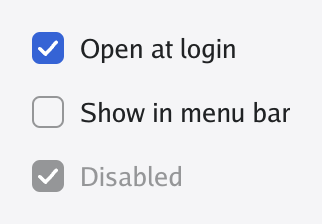
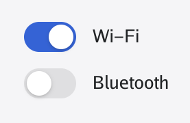
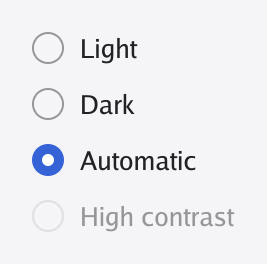
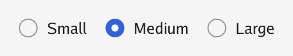
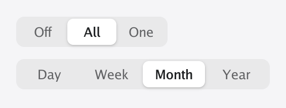
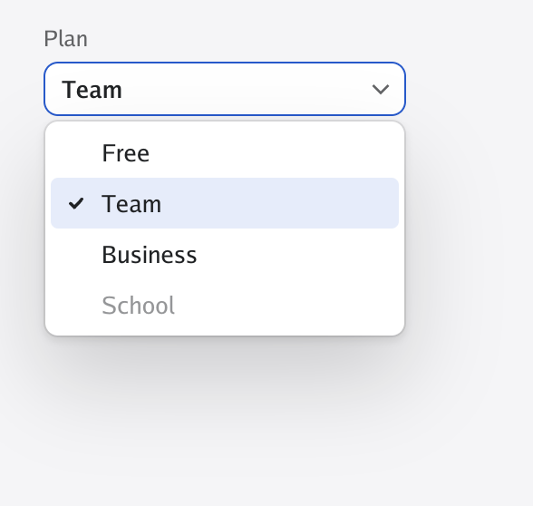
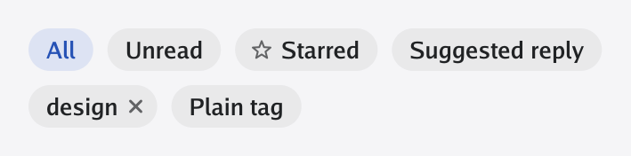
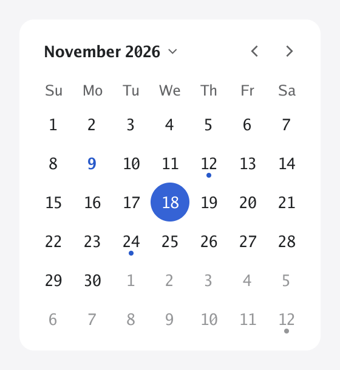
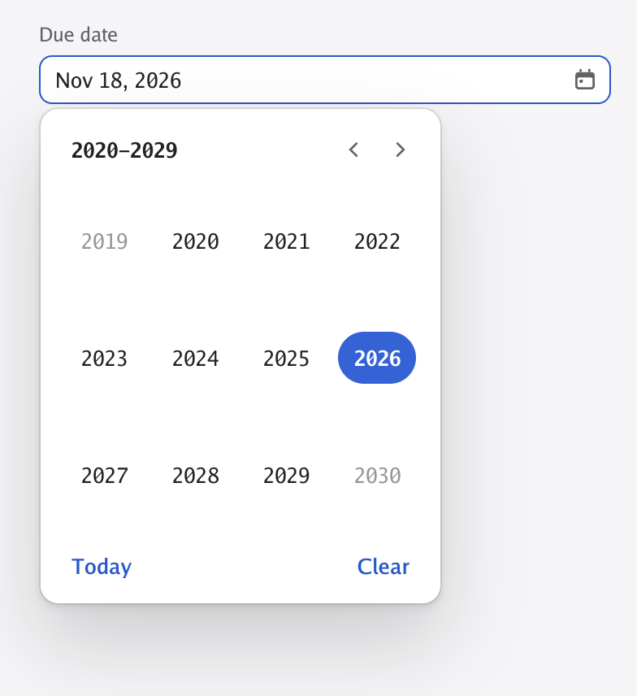
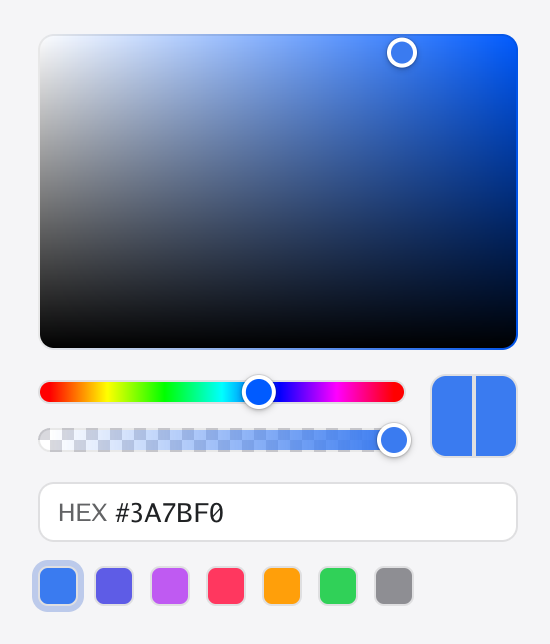

<!-- Code generated by internal/cmd/catalog; DO NOT EDIT. -->

# 選択

[カタログの目次](README.md) · [English](../en/selection.md) · [検索できるサイト](https://bankai-tensei.github.io/gowaku/ja/catalog/selection/)

決まった選択肢から選ぶウィジェット。選択肢が 2〜4 個なら `control.SegmentedControl`、それより多ければ `field.DropdownMenu` を使う。

> 例に出てくる小文字の関数（`themed`、`colored`、`tile`、`squareIcon` などの図形）は、[internal/catalog/helpers.go](../../../internal/catalog/helpers.go) にある小さな補助関数である。`themed` は `basic.ThemeOf(ctx)` を読み取る `basic.Builder`。例の `core.Widget` と `core.BuildContext` は、`gowaku.Widget` と `gowaku.BuildContext` と同じ型である。

[control.Checkbox](#controlcheckbox) · [control.Switch](#controlswitch) · [control.RadioGroup](#controlradiogroup) · [control.Radio](#controlradio) · [control.SegmentedControl](#controlsegmentedcontrol) · [field.DropdownMenu](#fielddropdownmenu) · [control.Chip](#controlchip) · [field.Calendar](#fieldcalendar) · [field.DatePicker](#fielddatepicker) · [field.ColorPicker](#fieldcolorpicker)

## control.Checkbox

オンとオフを切り替えるチェックボックス。ラベルを含めた全体を押せる。

パッケージ: [`github.com/bankai-tensei/gowaku/widgets/control`](https://pkg.go.dev/github.com/bankai-tensei/gowaku/widgets/control)

<picture>
  <source media="(prefers-color-scheme: dark)" srcset="../img/control-checkbox-dark.png">
  
</picture>

```go
set := func(bool) {}
return basic.Column{Size: layout.MainMin, Cross: layout.CrossStart, Spacing: theme.Space12, Children: []core.Widget{
	control.Checkbox{Value: true, Label: "Open at login", OnChange: set},
	control.Checkbox{Label: "Show in menu bar", OnChange: set},
	control.Checkbox{Value: true, Label: "Disabled"},
}}
```

API: [`control.Checkbox`](https://pkg.go.dev/github.com/bankai-tensei/gowaku/widgets/control#Checkbox)

## control.Switch

すぐに反映される設定のオンとオフを切り替えるスイッチ。つまみはスプリングのアニメーションで動く。

パッケージ: [`github.com/bankai-tensei/gowaku/widgets/control`](https://pkg.go.dev/github.com/bankai-tensei/gowaku/widgets/control)

<picture>
  <source media="(prefers-color-scheme: dark)" srcset="../img/control-switch-dark.png">
  
</picture>

```go
basic.Column{Size: layout.MainMin, Cross: layout.CrossStart, Spacing: theme.Space12, Children: []core.Widget{
	basic.Row{Size: layout.MainMin, Spacing: theme.Space12, Children: []core.Widget{
		control.Switch{Value: true, Label: "Wi-Fi", OnChange: func(bool) {}},
		basic.Text{Content: "Wi-Fi"},
	}},
	basic.Row{Size: layout.MainMin, Spacing: theme.Space12, Children: []core.Widget{
		control.Switch{Label: "Bluetooth", OnChange: func(bool) {}},
		basic.Text{Content: "Bluetooth"},
	}},
}}
```

API: [`control.Switch`](https://pkg.go.dev/github.com/bankai-tensei/gowaku/widgets/control#Switch)

## control.RadioGroup

複数の選択肢から 1 つを選ぶラジオボタンのグループ。Tab キーではグループ全体で 1 か所として止まり、選択肢の間は矢印キーで移動する。

パッケージ: [`github.com/bankai-tensei/gowaku/widgets/control`](https://pkg.go.dev/github.com/bankai-tensei/gowaku/widgets/control)

<picture>
  <source media="(prefers-color-scheme: dark)" srcset="../img/control-radiogroup-dark.png">
  
</picture>

```go
control.RadioGroup[string]{
	Label: "Appearance", Value: "auto", OnChange: func(string) {},
	Options: []control.RadioOption[string]{
		{Value: "light", Label: "Light"},
		{Value: "dark", Label: "Dark"},
		{Value: "auto", Label: "Automatic"},
		{Value: "contrast", Label: "High contrast", Disabled: true},
	},
}
```

API: [`control.RadioGroup`](https://pkg.go.dev/github.com/bankai-tensei/gowaku/widgets/control#RadioGroup) · [`control.RadioOption`](https://pkg.go.dev/github.com/bankai-tensei/gowaku/widgets/control#RadioOption)

## control.Radio

単独のラジオボタン。`RadioGroup` では実現できない配置のときに使い、グループの名前は `Semantics` で付ける。

パッケージ: [`github.com/bankai-tensei/gowaku/widgets/control`](https://pkg.go.dev/github.com/bankai-tensei/gowaku/widgets/control)

<picture>
  <source media="(prefers-color-scheme: dark)" srcset="../img/control-radio-dark.png">
  
</picture>

```go
interact.Semantics{Role: semantics.RoleRadioGroup, Label: "Size", Child: basic.Row{
	Size: layout.MainMin, Spacing: theme.Space16, Children: []core.Widget{
		control.Radio{Label: "Small", OnSelect: func() {}},
		control.Radio{Label: "Medium", Selected: true, OnSelect: func() {}},
		control.Radio{Label: "Large", OnSelect: func() {}},
	},
}}
```

API: [`control.Radio`](https://pkg.go.dev/github.com/bankai-tensei/gowaku/widgets/control#Radio)

## control.SegmentedControl

2〜4 個の選択肢から 1 つを選ぶセグメントコントロール。選択中の項目を示す板が、スプリングのアニメーションで滑る。

パッケージ: [`github.com/bankai-tensei/gowaku/widgets/control`](https://pkg.go.dev/github.com/bankai-tensei/gowaku/widgets/control)

<picture>
  <source media="(prefers-color-scheme: dark)" srcset="../img/control-segmentedcontrol-dark.png">
  
</picture>

```go
basic.Column{Size: layout.MainMin, Cross: layout.CrossStart, Spacing: theme.Space12, Children: []core.Widget{
	control.SegmentedControl{Label: "Repeat", Options: []string{"Off", "All", "One"}, Selected: 1, OnChange: func(int) {}},
	control.SegmentedControl{Label: "View", Options: []string{"Day", "Week", "Month", "Year"}, Selected: 2, OnChange: func(int) {}},
}}
```

API: [`control.SegmentedControl`](https://pkg.go.dev/github.com/bankai-tensei/gowaku/widgets/control#SegmentedControl)

## field.DropdownMenu

選択肢の一覧を下に開いて 1 つを選ぶ欄。文字を入力すると、その文字で始まる選択肢へ移動する。

パッケージ: [`github.com/bankai-tensei/gowaku/widgets/field`](https://pkg.go.dev/github.com/bankai-tensei/gowaku/widgets/field)

<picture>
  <source media="(prefers-color-scheme: dark)" srcset="../img/field-dropdownmenu-dark.png">
  
</picture>

```go
basic.SizedBox{Width: 200, Child: field.DropdownMenu[string]{
	Label: "Plan", Value: "team", OnChange: func(string) {},
	Options: []field.DropdownOption[string]{
		{Value: "free", Label: "Free"},
		{Value: "team", Label: "Team"},
		{Value: "business", Label: "Business"},
		{Value: "school", Label: "School", Disabled: true},
	},
}}
```

API: [`field.DropdownMenu`](https://pkg.go.dev/github.com/bankai-tensei/gowaku/widgets/field#DropdownMenu) · [`field.DropdownOption`](https://pkg.go.dev/github.com/bankai-tensei/gowaku/widgets/field#DropdownOption)

## control.Chip

小さな角丸のラベル。`OnChange` を指定すると絞り込みの切り替えに、`OnPress` を指定するとボタンになり、どちらも無ければ単なるタグとして表示される。

パッケージ: [`github.com/bankai-tensei/gowaku/widgets/control`](https://pkg.go.dev/github.com/bankai-tensei/gowaku/widgets/control)

<picture>
  <source media="(prefers-color-scheme: dark)" srcset="../img/control-chip-dark.png">
  
</picture>

```go
basic.SizedBox{Width: 360, Child: basic.Wrap{Spacing: theme.Space8, RunSpacing: theme.Space8, Children: []core.Widget{
	control.Chip{Label: "All", Selected: true, OnChange: func(bool) {}},
	control.Chip{Label: "Unread", OnChange: func(bool) {}},
	control.Chip{Label: "Starred", Icon: icons.Star(), OnChange: func(bool) {}},
	control.Chip{Label: "Suggested reply", OnPress: func() {}},
	control.Chip{Label: "design", OnRemove: func() {}},
	control.Chip{Label: "Plain tag"},
}}}
```

API: [`control.Chip`](https://pkg.go.dev/github.com/bankai-tensei/gowaku/widgets/control#Chip)

## field.Calendar

月のカレンダーから日付を選ぶウィジェット。週の始まりの曜日と曜日名はロケールに従う。`Marks` で日付の下に点を表示できる。見出しを押すとその年の月の一覧に、さらに年の見出しを押すと 10 年分の年の一覧に切り替わるので、生年月日のような遠い日付も数回の操作で選べる。`Value` が空のときは `InitialMonth` の月から表示する。

パッケージ: [`github.com/bankai-tensei/gowaku/widgets/field`](https://pkg.go.dev/github.com/bankai-tensei/gowaku/widgets/field)

<picture>
  <source media="(prefers-color-scheme: dark)" srcset="../img/field-calendar-dark.png">
  
</picture>

```go
themed(func(th *theme.Theme) core.Widget {
	return basic.Container{Color: th.Color.Card, Radius: th.Radius.Group, Padding: geom.All(theme.Space12), Child: field.Calendar{
		Value: day(18), Today: day(9), OnChange: func(time.Time) {},
		Marks: func(d time.Time) []geom.Color {
			if d.Day() == 12 || d.Day() == 24 {
				return []geom.Color{th.Color.AccentInk}
			}
			return nil
		},
	}}
})
```

API: [`field.Calendar`](https://pkg.go.dev/github.com/bankai-tensei/gowaku/widgets/field#Calendar)

## field.DatePicker

日付を表示する欄。開くと、下に `Calendar` を表示する。カレンダーの見出しから月と年の一覧に切り替えられる（図は年の一覧）。生年月日の欄には、30 年ほど前の `InitialMonth` と今日の `Max` を指定するとよい。`FormItem` の中では、エラーのときに枠が赤くなる。

パッケージ: [`github.com/bankai-tensei/gowaku/widgets/field`](https://pkg.go.dev/github.com/bankai-tensei/gowaku/widgets/field)

<picture>
  <source media="(prefers-color-scheme: dark)" srcset="../img/field-datepicker-dark.png">
  
</picture>

```go
day := func(d int) time.Time { return time.Date(2026, time.November, d, 0, 0, 0, 0, time.UTC) }
return field.DatePicker{
	Label: "Due date", Value: day(18), Today: day(9),
	ShowToday: true, ShowClear: true, OnChange: func(time.Time) {},
}
```

API: [`field.DatePicker`](https://pkg.go.dev/github.com/bankai-tensei/gowaku/widgets/field#DatePicker)

## field.ColorPicker

彩度と明度の平面、色相と透明度の帯、hex の入力欄で色を選ぶカラーピッカー。値を HSV で保持するため、黒や灰色を経由しても色相が失われない。`OnChange` を指定した `collection.PropertyColor` を押すと、これが開く。

パッケージ: [`github.com/bankai-tensei/gowaku/widgets/field`](https://pkg.go.dev/github.com/bankai-tensei/gowaku/widgets/field)

<picture>
  <source media="(prefers-color-scheme: dark)" srcset="../img/field-colorpicker-dark.png">
  
</picture>

```go
field.ColorPicker{
	Value: geom.Hex(0x3a7bf0), Label: "Accent color", OnChange: func(geom.Color) {},
	Swatches: []geom.Color{
		geom.Hex(0x3a7bf0), geom.Hex(0x5e5ce6), geom.Hex(0xbf5af2), geom.Hex(0xff375f),
		geom.Hex(0xff9f0a), geom.Hex(0x30d158), geom.Hex(0x8e8e93),
	},
}
```

API: [`field.ColorPicker`](https://pkg.go.dev/github.com/bankai-tensei/gowaku/widgets/field#ColorPicker)
